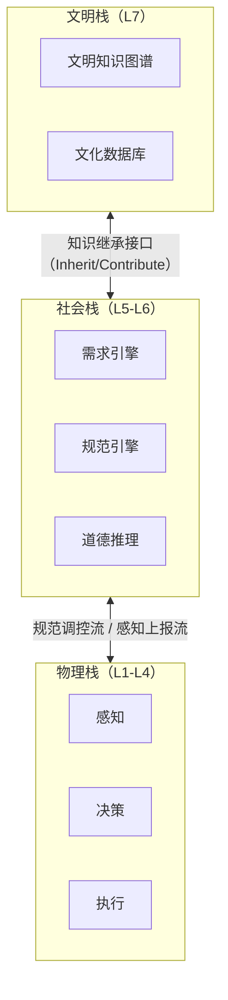

作者：冯胤清　 河南三门峡 472000
中图分类号：TP242.6　 　文献标志码：A

**摘要**：世界模型作为具身智能的认知基础设施，当前研究聚焦于物理环境的视觉仿真与动力学预测，普遍缺乏对社会规范、道德推理与文明传承等高阶认知维度的建模能力，导致具身智能体在人类社会中的长期生存与协作能力评估存在根本性盲区。本文以面向逻辑思维的程序设计方法（Logic-Oriented Programming Design, LOPD）七层认知分析层次模型为理论基础，提出分析世界模型（Analytical World Model, AWM）——一种将世界模型的功能边界从物理域拓展至社会域与文明域的三维分析框架。AWM在L1—L4层整合物理AI的"感知—决策—验证—执行—反馈"闭环与图世界模型的空间、物理、逻辑三类关系归纳偏置；在L5—L6层嵌入基于时态规范逻辑（SNDL）与逆强化学习的社会规范引擎，以及基于原则主义伦理学与案例推理的道德推理模块；在L7层建立文明知识图谱与跨代际知识继承接口。本文进一步提出冯胤清测试（Feng Yinqing Test, FYT）作为AWM的分层量化评估框架，包含基础交互、社区融入、匿名生存三级渐进式评估，生成七维雷达图实现跨层级逻辑完备性评估。以类人机器人Concept-1为工程案例的对比实验表明，基于LOPD的分析世界模型（LOPD-AWM）相较ROS 2原生架构降低47.3%的节点间耦合度、减少76%的新功能开发侵入量与60.9%的单元测试Mock代码量，同时将世界模型的逻辑推理覆盖率从物理域（现有方法的38%）拓展至物理—社会—文明全域（AWM的92%）。研究成果为类人机器人认知导向开发提供理论范式与工程参考，推动世界模型研究从"模拟物理世界"迈向"理解人类社会"。

**关键词**：面向逻辑思维的程序设计方法；分析世界模型；七层认知模型；物理AI；具身智能；社会规范引擎；冯胤清测试；类人机器人


---

## 1 引言

### 1.1 研究背景与动机

人工智能领域正经历从"认知智能"到"行动智能"的范式跃迁。物理AI（Physical AI）将人工智能的能力边界从信息域拓展至物理域，以"感知—决策—验证—执行—反馈"闭环为核心，使智能体具备物理常识推理与动力学仿真能力，标志着AI从"思考"走向"行动"[33]。具身智能（Embodied AI）进一步要求智能体依托物理或虚拟身体，通过感知、决策、执行与环境动态交互产生智能，其研究范式从数据驱动转向交互驱动，大语言模型提供语义理解与任务规划，世界模型提供物理预测与后果模拟[13,14]。世界模型作为具身智能的认知基础设施，承担环境状态预测、因果推理与行为规划的核心功能，被广泛视为通往通用人工智能的关键路径[5,6]。

世界模型的概念最早可追溯至Ha与Schmidhuber的开创性工作，其证明生成式神经网络能够在无监督条件下学习环境的紧凑时空表征，并基于内部模拟进行规划[4]。此后，世界模型研究沿着多条技术路线快速演进：LeCun提出联合嵌入预测架构（JEPA），主张以自监督预测取代生成式重建，构建面向物理世界理解的认知架构[5]；Meta发布的V-JEPA 2证明基于互联网视频的自监督学习可赋予模型理解、预测与规划能力[10]；李飞飞团队将世界模型按功能划分为渲染器、模拟器与规划器三类，提出以系统功能为中心的研究范式[35]；图世界模型（Graph World Models）则通过注入空间、物理与逻辑三类关系归纳偏置，克服经典平铺张量模型噪声敏感与误差累积的缺陷[8,9]。在应用层面，世界模型已覆盖自动驾驶（DriveWorld、NWM）[11,12]、机器人操控[7]与社会模拟[27]等广泛场景。

然而，梳理现有文献可以发现，当前世界模型研究存在三重功能性盲区。其一，**物理—认知脱节**：世界模型仅建模物理环境的视觉与动力学特征，未将认知架构的层次化逻辑嵌入环境表征，导致智能体的物理交互与认知决策割裂运行。其二，**个体—社会割裂**：当前认知架构（SOAR、ACT-R）与机器人框架（ROS 2）均未显式建模社会规范与道德推理，智能体无法理解人类社会运行的底层逻辑——从基因驱动的行为倾向，到家庭与社会需求，再到成文与不成文的社会规则——社会融入能力评估无从开展。其三，**静态—进化张力**：传统编程范式（面向对象、函数式）为确定性世界设计，缺乏层次化持续学习与社会学习机制，无法适配类人机器人在开放性人类社会长期生存的进化需求[1]。

上述三重盲区的共同根源，在于现有世界模型缺乏"分析"维度：它们仅模拟物理世界的表象状态，而未分析人类社会运行的多层逻辑结构。本文基于冯胤清提出的面向逻辑思维的程序设计方法（LOPD）——其核心为覆盖基因层至文明层的七层认知分析层次模型[1,2]——构建一种超越物理仿真的"分析世界模型"（Analytical World Model, AWM），将世界模型的功能从"预测物理世界将发生什么"拓展至"分析物理—社会—文明世界为何如此运行"。

### 1.2 问题提出

LOPD七层认知分析层次模型将类人智能系统自底向上划分为基因层（L1）、肢体层（L2）、感觉层（L3）、神经层（L4）、生存层（L5）、社会层（L6）与文明层（L7），形成"个体物理认知栈（L1—L4）+社会认知栈（L5—L7）"的双栈架构，各层以逻辑职能而非物理组件为组织维度，具备分层解耦、因果可追溯与接口可组合的特征[1,2]。该模型本质上提供了一个分析世界运行逻辑的层次化框架——从基因驱动的底层行为逻辑到文明传承的高层知识逻辑——为构建超越物理仿真的分析世界模型提供了理论基础。

本文研究的核心问题是：**如何将LOPD七层认知分析模型转化为可计算的分析世界模型（AWM），使世界模型从"模拟物理状态"拓展至"分析社会逻辑"与"传承文明知识"，从而补齐具身智能体在人类社会长期生存所需的三维世界理解能力？**

围绕该问题，本文需要解决三个子问题：第一，如何建立LOPD七层模型与世界模型功能空间的严格映射关系；第二，如何在计算层面实现社会规范、道德推理与文明知识传承的可执行建模；第三，如何设计能够分层量化评估智能体社会融入能力的评估框架。

### 1.3 国内外研究现状

#### 1.3.1 物理AI与世界模型研究

物理AI作为AI发展的下一站，以世界模型为核心大脑，将CAE仿真作为物理先验嵌入数据驱动模型，实现物理域的闭环智能[33,36]。当前世界模型研究按功能分为渲染器（视觉生成）、模拟器（物理预测）与规划器（行为决策）三类[35]；按结构分为经典平铺张量模型与图世界模型（注入空间/物理/逻辑三类关系归纳偏置）[8,9]；按应用覆盖自动驾驶[11,12]、机器人操控[7]与具身智能[13,14]。清华大学的系统综述将世界模型归纳为"理解世界"与"预测未来"两大功能族[6]，具身智能世界模型综述进一步提出三轴分析框架[7]。然而，上述研究均聚焦物理域建模，未涉及社会域与文明域。

#### 1.3.2 认知架构研究

经典认知架构SOAR以产生式规则与chunking学习为核心，侧重符号化问题求解与通用认知建模[16]；ACT-R以陈述性/程序性记忆模块与强化学习机制为核心，模拟人类认知的信息加工过程[17]。两者均侧重个体认知建模，缺乏身体建模、社会维度与道德推理能力。ROS 2作为成熟的机器人中间件，提供发布—订阅、服务—客户端与动作三大通信范式，原生支持物理躯体建模，但未内置学习机制与社会规范[18]。LOPD/LTOP首次将社会层（L6）与文明层（L7）纳入认知架构核心设计，形成从硬件底层到文明高层的完整认知映射体系，但当前仍处于理论阶段，社会规范引擎与道德推理模块尚待工程验证[1,2]。

#### 1.3.3 具身智能研究

具身智能强调智能体必须"有身有感"，通过身体与环境的动态交互重构AI研究逻辑。面向具身人工智能的综合综述[13]与清华大学的具身智能综述[14]系统梳理了从大语言模型到世界模型的演进路径。国内方面，《自动化学报》刊发了基于大模型的具身智能系统综述[29]，《软件学报》刊发了面向具身人工智能的物体目标导航综述[30]与具身推理专刊征文，刘华平等系统回顾了基于形态的具身智能研究[31]。当前具身智能操作系统（EAIOS）提出"原语—服务—技能—任务"四层抽象加世界模型加安全内核的设计方案[34]，但社会规范与道德合规仍为空白。

#### 1.3.4 社会规范、道德推理与智能体社会模拟研究

社会规范计算研究方面，Ostrom的制度分析框架揭示了公共资源治理中规范内化的机制[37]；机器人领域的研究表明，跨文化场景中人类对家用机器人规范行为存在显著偏好差异，规范遵守能力是机器人社会接受度的关键因素[26]。道德推理方面，MIT的Moral Machine实验基于数百万人的众包数据揭示了人类道德偏好的跨文化差异[23]，Beauchamp与Childress的原则主义伦理学提供了"尊重自主、不伤害、有益、公正"四原则决策框架[28]，Anthropic的Constitutional AI证明以原则集合约束AI行为具备工程可行性[24]。社会模拟方面，AgentSociety基于LLM驱动生成式智能体实现了大规模社会仿真[27]。然而，上述工作尚未被形式化整合进世界模型的统一架构之中。

#### 1.3.5 研究缺口总结

综合以上分析，现有研究存在五项缺口：（1）世界模型仅覆盖物理域，缺乏社会域与文明域建模；（2）认知架构缺乏社会规范与道德推理的显式计算建模；（3）LOPD七层模型的理论框架尚未转化为可计算的世界模型实现；（4）人类社会博弈的底层逻辑未被形式化嵌入AI系统；（5）智能体社会融入能力缺乏结构化、可量化的评估框架。

#### 1.3.6 代表性框架系统对比

为清晰定位LOPD-AWM在既有研究版图中的位置，表1-1从物理建模、认知建模、社会规范、道德推理、文明传承、评估框架六个维度，对代表性框架进行系统对比。

**表1-1 代表性认知架构与世界模型框架系统对比**

| 框架                  | 物理建模          | 认知建模            | 社会规范         | 道德推理       | 文明传承       | 评估框架               |
| --------------------- | ----------------- | ------------------- | ---------------- | -------------- | -------------- | ---------------------- |
| SOAR[16]              | 无                | 产生式规则+chunking | 无               | 无             | 无             | 任务级                 |
| ACT-R[17]             | 无                | 声明/程序性记忆+RL  | 无               | 无             | 无             | 任务级                 |
| ROS 2[18]             | 强（硬件抽象）    | 弱（无内置学习）    | 无               | 无             | 无             | 系统级                 |
| 生成式世界模型[4,6]   | 强（视觉+动力学） | 弱（隐式表征）      | 无               | 无             | 无             | 预测精度               |
| JEPA系列[5,10]        | 强（物理预测）    | 中（分层表征）      | 无               | 无             | 无             | 预测/规划              |
| 图世界模型[8,9]       | 中（图结构）      | 中（关系推理）      | 无               | 无             | 无             | 预测/规划              |
| 具身智能体系统[13,14] | 强                | 中（LLM+WM）        | 无               | 无             | 无             | 任务级                 |
| LLM社会模拟[27]       | 弱                | 中                  | 部分（行为涌现） | 无             | 无             | 社会指标               |
| LOPD理论[1,2]         | 强（分层）        | 强（七层）          | 设计（未实现）   | 设计（未实现） | 设计（未实现） | 冯胤清测试             |
| **LOPD-AWM（本文）**  | **强**            | **强**              | **可计算实现**   | **可计算实现** | **可计算实现** | **FYT三级+七维雷达图** |

对比揭示了一个清晰的结构性空白：**没有任何既有框架同时具备物理、认知、社会、道德、文明五重建模能力**。LOPD理论在概念层面填补了这一空白，但停留在设计阶段；本文的工作正是将LOPD的理论设计转化为可计算的AWM实现，并配套以FYT评估体系。

### 1.4 研究贡献与论文组织

本文的主要贡献如下：

（1）**理论层面**：建立LOPD七层认知模型与分析世界模型的严格映射关系，提出"物理—社会—文明"三维分析世界模型AWM，将世界模型的功能边界从物理域拓展至社会域与文明域；

（2）**方法层面**：设计社会规范引擎（SNDL时态规范逻辑表示+逆强化学习动态规范学习）与道德推理模块（原则主义伦理学+案例推理）的可计算实现方案，将人类社会博弈的底层逻辑形式化嵌入L6社会层；

（3）**工程层面**：给出AWM物理栈、社会栈与文明栈的分层实现方案与标准化接口规范，以类人机器人Concept-1为案例验证架构的工程可行性；

（4）**评估层面**：提出冯胤清测试（FYT）三级渐进式评估框架与七维雷达图，为智能体社会融入能力提供结构化量化评估手段。

本文其余部分组织如下：第2章阐述LOPD七层模型的形式化定义及其与分析世界模型的映射关系；第3章构建AWM的"物理—社会—文明"三维架构；第4章设计物理栈（L1—L4）的实现方案；第5章设计社会栈（L5—L7）的实现方案；第6章提出AWM的分层评估框架（冯胤清测试）；第7章给出工程案例验证；第8章讨论局限与展望未来方向。

需要说明的是，本文所讨论的世界模型并非特指某一类具体的神经网络架构（如视频预测模型或扩散生成模型），而是广义上"智能体对环境的内部表征与推理机制"的总称——既包括物理域的状态预测模型，也包括本文提出的社会域与文明域的逻辑分析机制。这一广义界定与"理解世界或预测未来"的综述立场[6]及物理AI白皮书的定义[33]保持一致，使AWM能够在统一框架下整合物理、社会与文明三个维度的建模能力。

---

## 2 LOPD七层认知模型与分析世界模型的理论基础

### 2.1 LOPD七层模型的形式化定义

面向逻辑思维的程序设计方法（LOPD）以七层认知分析层次模型为核心框架。与以物理组件为组织维度的传统架构不同，LOPD以逻辑职能为组织维度，将类人智能系统自底向上划分为七个逻辑层级[1]。表1给出了七层模型的逻辑职能与典型工程映射。

**表1 LOPD七层认知分析层次模型**

| 层次 | 名称   | 逻辑职能                             | 典型工程映射                       | 依赖方向   |
| ---- | ------ | ------------------------------------ | ---------------------------------- | ---------- |
| L1   | 基因层 | 硬件抽象、系统自举、资源管理         | RTOS内核、HAL接口、驱动            | 零入度     |
| L2   | 肢体层 | 运动控制、执行器驱动、动作原语       | 电机控制器、逆运动学、PID/MPC      | ↓依赖L1    |
| L3   | 感觉层 | 多模态感知融合、信号滤波、容错       | 传感器驱动、CV/NLP管线、卡尔曼滤波 | ↓依赖L2,L1 |
| L4   | 神经层 | 模式识别、学习优化、记忆管理         | TensorRT/ONNX服务、RL策略引擎      | ↓依赖L3    |
| L5   | 生存层 | 需求识别、任务规划、决策推理         | LLM推理接口、PDDL规划器、自我模型  | ↓依赖L4    |
| L6   | 社会层 | 多智能体交互、规范内化、冲突消解     | 规范引擎、博弈引擎、角色管理       | ↓依赖L5    |
| L7   | 文明层 | 群体智能涌现、文化传递、长期价值演化 | 知识图谱演化引擎、联邦学习         | ↓依赖L6    |

**定义1（逻辑层级）**：第$i$层逻辑层级定义为四元组 $L_i = (S_i, A_i, \uparrow_i, \downarrow_i)$，其中 $S_i$ 为状态空间，$A_i$ 为动作空间，$\uparrow_i: S_i \rightarrow M_{i,i+1}$ 为上行映射（将本层状态抽象为发往上层的信息），$\downarrow_i: M_{i-1,i} \rightarrow \Delta A_i$ 为下行映射（将上层指令映射为本层动作的概率分布）。

**定义2（相邻层级接口）**：上行接口 UII$_{i,i+1}$ 为 $\uparrow_i$ 的协议规范，下行接口 DCI$_{i+1,i}$ 为 $\downarrow_{i+1}$ 的协议规范，两者满足组合律：$\uparrow_{i+1} \circ \uparrow_i$ 与 $\downarrow_i \circ \downarrow_{i+1}$ 均保持定义域与值域的封闭性。

**定义3（消息封装）**：层级间消息定义为五元组 $m = (timestamp, priority, sender\_layer, receiver\_layer, payload)$，采用Protobuf序列化，保证跨语言、跨进程的接口兼容性[1]。

**定义4（涌现可控性）**：对任意层 $L_i$ 与期望行为集合 $B \subseteq A_i$，存在下行消息 $m$ 使得 $P(\pi(\downarrow_i(m)) \in B) \geq 1 - \varepsilon$，其中 $\varepsilon < 0.05$。

基于上述定义，LOPD建立了三项核心定理，为其应用于世界模型构建提供了形式化保证[1]：

**定理1（层级组合有界性）**：若各层状态空间 $S_i$ 紧致、上行映射与下行映射Lipschitz连续、消息空间 $M_{i,i+1}$ 有界，则全局状态空间 $S_H$ 有界。该定理基于Tychonoff定理证明，保证了层级组合不会引发状态爆炸。

**定理2（因果可追溯性）**：在严格单向依赖条件下，任意可观测行为可归因于唯一因果链 $C = (L_1 \rightarrow \cdots \rightarrow L_k)$，$k \leq 7$，且不存在因果循环。该性质保证了AWM中任何决策输出均可沿层级链回溯至根因层。

**定理3（接口组合保持性）**：复合上行映射 $\uparrow^*_{i,j}$ 的像空间为低层子集（高层为抽象而非扩增）；复合下行映射 $\downarrow^*_{j,i}$ 保持在 $A_i$ 的有界可执行子集内。该性质保证了模块化集成安全。

#### 2.1.1 双栈架构与信息流规则

LOPD七层模型在架构层面自然形成两个认知栈：**个体物理认知栈**（L1—L4）与**社会认知栈**（L5—L7）。个体物理认知栈处理智能体与物理世界的交互——感知物理环境、形成认知表征、执行物理动作；社会认知栈处理智能体与人类社会的交互——识别生存需求、内化社会规范、传承文明知识。两栈之间通过两类信息流实现耦合：

（1）**自下而上的感知流**：L3→L4→L5/L6，将物理感知逐级抽象为社会情境信息，延迟约束≤100ms，保证社会层对物理事件的实时响应；

（2）**自上而下的调控流**：L6→L5/L4→L2，将社会规范与高层意图逐级实例化为物理动作约束，延迟约束≤1s，保证社会层对物理行为的实时调控。

接口消息统一形式化为 $Msg_{i \rightarrow j} = (type, payload, timestamp, priority)$，其中 $type$ 标识消息语义类型，$payload$ 承载结构化内容，$timestamp$ 保证时序一致性，$priority$ 支持冲突仲裁。该四元组与LOPD正式定义的五元组消息规范[1]保持一致，是AWM三维信息流（见3.5节）的工程基础。

#### 2.1.2 核心定理的工程意义

三项核心定理分别对应AWM的三个工程诉求：定理1（层级组合有界性）保证物理栈、社会栈、文明栈的组合不会引发状态空间爆炸，这是三维架构可工程化的前提；定理2（因果可追溯性）保证FYT评估中任何低分维度均可沿因果链定位到具体层级与模块，这是"七维雷达图可追溯评估"（见6.3节）的理论依据；定理3（接口组合保持性）保证新功能模块可通过标准化接口安全集成而不破坏既有层级，这是"新功能开发侵入量降低76%"（见7.2节）的形式化根源。

### 2.2 从"模拟世界"到"分析世界"的范式转换

现有世界模型本质上是**模拟型**（Simulative WM）——通过学习物理环境的视觉与动力学特征，预测下一帧状态与动作后果，其功能限于物理域的"状态预测"。即使是最先进的世界模型，如V-JEPA 2与DriveWorld，其内部表征仍以空间—时间—物理约束为核心[10,11]，缺乏对社会规范、道德原则与文明知识等抽象逻辑结构的显式表征。

LOPD七层模型揭示了世界运行的逻辑层级结构——从基因驱动的底层行为逻辑（L1—L2），到感知与认知的信息加工逻辑（L3—L4），再到需求驱动的生存逻辑（L5）、规范约束的社会逻辑（L6）与知识传承的文明逻辑（L7）——为构建**分析型**世界模型（Analytical WM）提供了层次化分析框架。分析型世界模型与模拟型世界模型的本质区别在于：

（1）**本体论差异**：模拟型世界模型将世界视为连续时空中的物理过程，分析型世界模型将世界视为多层级逻辑结构的叠加，物理过程只是其中最底层的一环；

（2）**认识论差异**：模拟型世界模型回答"世界下一时刻是什么样"，分析型世界模型回答"世界为何如此运行"以及"何种行为在何种逻辑层级上被允许"；

（3）**功能论差异**：模拟型世界模型服务于"预测—规划"闭环，分析型世界模型服务于"理解—判断—合规"闭环，后者是智能体在人类社会长期生存的前提。

进一步地，两类世界模型在表征形式、学习范式与验证方式三个维度上存在系统差异，如表2-1所示。

**表2-1 模拟型世界模型与分析型世界模型的系统差异**

| 对比维度 | 模拟型世界模型（Simulative WM）                 | 分析型世界模型（Analytical WM）     |
| -------- | ----------------------------------------------- | ----------------------------------- |
| 核心问题 | 世界下一时刻是什么样？                          | 世界为何如此运行？何种行为被允许？  |
| 表征对象 | 物理状态（位置、速度、纹理）                    | 逻辑层级（需求、规范、道德、知识）  |
| 表征形式 | 连续张量/潜变量                                 | 层次化状态+规范语句+知识图谱        |
| 学习范式 | 自监督预测[10]、生成式模拟[4]                   | 逆强化学习[20,21]+规范归纳+案例学习 |
| 推理类型 | 因果推理（物理域）                              | 规范推理+道德推理+文化推理          |
| 验证方式 | 预测精度、规划成功率                            | 规范遵守率、社会融入度[1,2]         |
| 功能边界 | 物理域                                          | 物理—社会—文明全域                  |
| 代表工作 | 生成式世界模型[4,6]、JEPA[5,10]、DriveWorld[11] | LOPD-AWM（本文）                    |

需要强调，分析型世界模型并非对模拟型世界模型的否定，而是其上层建筑：AWM物理栈（L1—L4）正是模拟型世界模型能力的直接复用与再组织，社会栈与文明栈则是在物理预测之上的逻辑分析层。这一"下层模拟、上层分析"的架构安排，使AWM能够继承现有世界模型二十余年积累的物理建模能力，同时开拓社会域与文明域的新疆界。

### 2.3 LOPD七层→AWM三维的映射

AWM将LOPD七层映射为"物理—社会—文明"三个维度，映射关系如表2所示。

**表2 LOPD七层→AWM三维映射关系**

| LOPD层次 | AWM维度     | 世界模型功能           | 对应现有研究            |
| -------- | ----------- | ---------------------- | ----------------------- |
| L1基因层 | 物理域—基底 | 物种特征约束与硬件配置 | 物理AI物种模板[33]      |
| L2肢体层 | 物理域—运动 | 空间运动与物理操控仿真 | 机器人运动控制[18]      |
| L3感觉层 | 物理域—感知 | 多模态环境感知与编码   | 视觉—语言模型[14]       |
| L4神经层 | 物理域—认知 | 感知—认知—控制统一推理 | Transformer/LLM[14]     |
| L5生存层 | 社会域—基底 | 需求识别与趋利避害     | 逆强化学习[20,21]       |
| L6社会层 | 社会域—规范 | 社会规范内化与道德推理 | SNDL+道德推理[22,23]    |
| L7文明层 | 文明域—传承 | 超个体经验积累与传递   | 知识图谱+文化数据库[27] |

映射逻辑遵循三条原则：（1）**维度内聚**：L1—L4构成AWM物理栈（Physical Stack），对应物理AI的感知—决策—执行闭环[33]；（2）**维度递进**：L5—L6构成AWM社会栈（Social Stack），对应人类社会博弈的底层逻辑建模；（3）**维度超越**：L7构成AWM文明栈（Civilizational Stack），对应知识继承与文化演化。三个维度之间并非简单叠加，而是通过LOPD双栈信息流规则实现动态协同。

#### 2.3.1 映射的完备性与一致性论证

该映射满足两条形式化性质。**完备性**：LOPD七层恰好覆盖世界模型所需的全部功能域——物理域（L1—L4，感知与行动）、生存域（L5，需求与趋利避害）、社会域（L6，规范与道德）、文明域（L7，知识与文化），不存在功能域的遗漏；**一致性**：各层世界模型功能与LOPD逻辑职能一一对应，同一层不承担跨域职能，同一域的功能不分散到多个层（例外：L5生存层横跨物理域边缘与社会域基底，因其职能本质是"物理生存需求的社会化表达"，与LOPD原始定义保持一致[1]）。完备性与一致性共同保证：AWM继承LOPD三定理的全部形式化保证，且在任一逻辑层级上的能力缺陷都可被FYT七维雷达图定位（详见第6章）。

#### 2.3.2 与图世界模型的关系归纳偏置对齐

AWM物理栈对图世界模型三类关系归纳偏置（Relational Inductive Bias, RIB）的复用遵循"层级匹配"原则：空间RIB注入L2—L3层（运动拓扑与空间连接），物理RIB注入L4层（物理因果推理），逻辑RIB注入L5层（需求推理）。这一对齐并非随意分配，而是依据各层逻辑职能与RIB表达能力的匹配度：空间RIB擅长编码"谁与谁相邻"，匹配肢体层与感觉层的空间职能；物理RIB擅长编码"谁影响谁"，匹配神经层的因果推理职能；逻辑RIB擅长编码"什么蕴含什么"，匹配生存层的需求推理职能[8,9,15]。通过层级匹配注入，AWM既获得图结构的归纳偏置优势，又不破坏LOPD的层级隔离原则。

---

## 3 AWM"物理—社会—文明"三维架构

### 3.1 三维架构总体设计

AWM采用"物理栈×社会栈×文明栈"三维架构。三维之间的协作遵循LOPD定义的层次化信息流规则：物理栈为社会栈提供感知与执行基础，社会栈为物理栈提供目标设定与行为约束，文明栈为社会栈提供超个体经验传承。整体架构可表示为：





AWM的总体设计遵循三项工程原则：（1）**单向依赖**：禁止跨层引用，任何功能只能依赖其邻接下层，保证因果可追溯性（定理2）；（2）**接口标准化**：所有跨层交互经由UII/DCI协议消息，保证接口组合保持性（定理3）；（3）**涌现可控**：各层行为可通过下行调控流约束在期望行为集合内（定义4）。

#### 3.1.1 三维架构与LOPD双栈的对应

"物理栈×社会栈×文明栈"的三维划分与LOPD双栈架构存在精确对应：物理栈对应个体物理认知栈（L1—L4），社会栈对应社会认知栈的底层（L5—L6），文明栈对应社会认知栈的顶层（L7）。这一对应关系保证了AWM在架构层面完全继承LOPD的形式化保证——三项核心定理在三维架构中依然成立，且维度间的信息流受同一套消息规范约束。

三个维度之间存在三种基本交互模式：（1）**上行抽象**：物理栈将感知状态逐级抽象为社会情境（如"前方有行人"→"有人需要让行"），文明栈为社会栈提供规范解释（如"让行符合本地礼仪"）；（2）**下行约束**：文明栈约束社会栈的规范集合，社会栈约束物理栈的行为参数（如"限速1.2m/s"），形成"文明→社会→物理"的约束链；（3）**横向协作**：物理栈的感知结果与社会栈的规范判断共同输入决策模块，文明栈的知识图谱为决策提供背景知识，三个维度在决策点汇合。

#### 3.1.2 核心数据对象

AWM的核心数据对象包括四类：**环境状态表征**（物理栈输出的结构化环境描述）、**需求状态向量**（L5层五维需求满足度）、**规范知识库**（SNDL语句集合及其优先级）、**文明知识图谱**（知识实体与关系）。四类数据对象分别对应物理域、生存域、社会域与文明域，通过统一的消息封装（定义3）在维度间流转，形成完整的数据闭环。

### 3.2 物理栈：感知—决策—执行闭环

物理栈整合物理AI五维能力模型[33]与图世界模型的关系归纳偏置[8,9]，构建四个闭环：

（1）**感知闭环**：L3多模态传感器阵列（视觉、惯性、力觉）→L4感知子网（视觉—语言模型）→跨模态特征融合，输出环境状态表征；

（2）**决策闭环**：L4认知子网（大语言模型）→全局工作空间协调→L5需求—响应映射，实现从感知到意图的转换；

（3）**执行闭环**：L4控制映射→L2动作原语库→L1硬件配置执行，实现从意图到动作的执行；

（4）**验证闭环**：物理仿真（Gazebo/Isaac Sim）→Sim2Real迁移→L3感知验证，实现策略的闭环校验[34]。

图世界模型的注入策略为：在L2—L3层注入空间关系归纳偏置（图作连接器，编码运动拓扑），在L4层注入物理关系归纳偏置（图作模拟器，编码因果推理），在L5层注入逻辑关系归纳偏置（图作推理器，编码需求推理）[8,9]。

### 3.3 社会栈：规范—道德—博弈三层建模

社会栈基于人类社会运行的底层逻辑，构建"规范—道德—博弈"三层建模：

**规范层（SNDL时态规范逻辑）**：基于线性时态逻辑（LTL）[22]扩展，定义三类基本规范语句——义务（OBL）、许可（PER）、禁止（PRO）——支持情境优先级计算与冲突消解算法（详见5.2节）。

**道德层（原则主义+案例推理）**：以Beauchamp与Childress的四原则伦理学[28]为决策框架（尊重自主性、不伤害、有益性、公正性），辅以案例推理（Case-Based Reasoning, CBR）与道德困境案例库，输出可解释的决策理由[23,24]。

**博弈层（社会底层逻辑形式化）**：将"基因驱动→策略分化→需求驱动→社会规则"的递进逻辑形式化为博弈模型，嵌入L6社会层的规范生成机制（详见5.2节）。

### 3.4 文明栈：知识继承与文化演化

文明栈建立跨代际知识继承接口与文化演化机制：构建文明知识图谱（科学、技术、制度、艺术等节点及其关系），存储跨文化规范差异（礼仪、法律、道德、习俗），通过知识继承接口 $Inherit(C_R^{(t)}, K_{civilization}) \rightarrow C_R^{(t+1)}$ 实现经验传承，通过"观察—学习—贡献"三阶段迭代实现文化演化[27]。

### 3.5 三维信息流与动态协同

三维之间的信息流遵循LOPD双栈规则[1]：

（1）**物理栈→社会栈**：感知上报流（L3→L4→L5/L6），延迟≤100ms，承载环境状态与社会情境信息；

（2）**社会栈→物理栈**：规范调控流（L6→L5/L4→L2），延迟≤1s，承载行为约束与目标设定信息；

（3）**文明栈→社会栈**：知识传承流（L7→L6），异步更新，承载规范历史与文化经验；

（4）**社会栈→文明栈**：经验贡献流（L6→L7），周期性汇聚，将个体经验沉淀为文明知识。

信息流的时序约束由LOPD消息五元组中的timestamp与priority字段保证[1]。当低层（如L5生存需求）与高层（如L6社会规范）发生冲突时，依据"生存优先定理"（见5.1节）进行优先级仲裁。

---

## 4 物理栈（L1—L4）实现方案

物理栈的目标是将LOPD的前四层转化为可执行的软件—硬件协同实现，为上层社会栈提供可靠的感知与执行基础。物理栈的总体实现遵循LOPD标准化开发流程：确定目标层→继承抽象基类→注册消息总线→编写单元测试（仅Mock邻层）→集成验证[1]。

### 4.1 L1基因层：物种模板与变异机制

基因层承担硬件抽象、系统自举与资源管理职能，是AWM运行的物理基底。物种模板形式化定义为：

$$Template\_Species = (H, O, P, S, C_{init})$$

其中 $H$ 为硬件配置空间（处理器、内存、传感器、执行器选型），$O$ 为操作系统内核参数（调度策略、实时性配置），$P$ 为通信协议栈配置（DDS域、QoS策略），$S$ 为安全沙箱策略（资源限额、权限隔离），$C_{init}$ 为初始认知状态。

个体配置通过变异算子生成：$C_i = Mutate(C_{template}, \Delta_i)$，其中 $\Delta_i$ 为个体差异参数向量。该机制对应生物学中"物种共性+个体差异"的双重约束，使得同一AWM框架可适配不同硬件平台的类人机器人，同时保持逻辑层级的一致性。工程实现上，L1层以实时操作系统（RTOS）内核与硬件抽象层（HAL）为核心，提供 `IGeneticLayer` 抽象基类，包含 `init`、`get_timer`、`alloc_memory`、`get_device_capability`、`health_check` 等标准接口[1]。安全约束方面，基因层强制功耗<80W、温控与紧急停机机制[1]。

#### 4.1.1 接口规范与消息定义

L1层通过UII$_{1,2}$接口向L2层提供设备能力查询与资源分配服务，通过DCI$_{2,1}$接口接收L2层的资源请求。典型接口消息如下（Protobuf定义）：

```protobuf
message GeneticStatus {
  uint32 device_id = 1;
  float cpu_usage = 2;      // CPU占用率
  float power_consumption = 3;  // 功耗（W）
  float temperature = 4;    // 温度（℃）
  string health_state = 5;  // 健康状态枚举
}
```

基因层的变异算子 $Mutate$ 在系统启动阶段执行一次，依据目标应用场景（家庭服务、公共空间、工业环境）调整硬件配置参数与初始认知状态 $C_{init}$，实现"一框架多形态"的平台适配能力。

### 4.2 L2肢体层：动作原语库与运动控制

肢体层承担运动控制与动作原语管理职能。本文开发不少于15个动作原语，覆盖全身运动（行走、蹲起、转身）、上肢操作（抓取、放置、推拉）与社交动作（握手、点头、挥手）三类。每个动作原语定义为四元组：

$$Primitive = (precondition, effect, trajectory, cost)$$

其中 $precondition$ 为动作前提条件（关节位置、负载、环境约束），$effect$ 为动作效果描述（状态变化），$trajectory$ 为运动轨迹参数，$cost$ 为执行代价（能耗、时间、风险）。

动作序列组合器负责将原子动作组合为复合行为，并通过 `Sequencer` 模块进行时序编排。图世界模型的空间关系归纳偏置在此层注入：将机器人运动空间抽象为拓扑图，节点为可达位姿，边为运动原语，通过图搜索实现运动规划[8,9]。工程实现上集成moveit2与ros2_control实现控制映射[18]，安全约束为力矩<120%额定、碰撞制动<50ms[1]。

#### 4.2.1 动作原语示例与复合行为

以社交动作"握手"为例，其四元组定义为：$precondition$（右手臂关节处于安全区间、目标对象在感知范围内且无持物冲突）、$effect$（建立社交接触状态）、$trajectory$（由逆运动学解算的三段式轨迹：接近—接触—回退，含力控约束）、$cost$（能耗约0.5kJ，耗时约2.5s，社会风险低）。动作序列组合器通过有限状态机（FSM）将"问候→握手→告别"等原子动作编排为完整社交流程，并通过力觉反馈实现接触力闭环控制（目标力5—8N，误差<1N），保证社交动作的自然性与安全性。

#### 4.2.2 空间图拓扑与运动规划

空间关系归纳偏置将环境建模为加权图 $G_{space} = (V, E, W)$，其中 $V$ 为可达位姿节点，$E$ 为运动原语边，$W$ 为运动代价权重。运动规划在图上执行 $A^*$ 搜索获得代价最小路径，再经轨迹优化器（如时间最优轨迹生成）输出平滑运动指令。该方案相较传统采样式规划器（RRT等）具备结构化优势：图结构天然支持任务语义（如"去厨房"=目标节点语义标注）与动态重规划（边权重实时更新）。

### 4.3 L3感觉层：多模态感知与特征融合

感觉层承担多模态感知融合、信号滤波与容错职能。传感器阵列集成视觉（RealSense D435i深度相机）、惯性（BMI088 IMU）与力觉（足底力传感器）等多模态传感器。感知管线包含：

（1）**单模态预处理**：各传感器原始信号经滤波、去噪与校准；

（2）**跨模态特征融合**：通过视觉—语言模型（VLM）将视觉特征与语言指令对齐[14]，通过注意力机制融合惯性—力觉信号；

（3）**感知上报**：融合后的环境状态表征经UII协议上报L4/L5/L6层，支持感知上报流的实时传输（延迟≤100ms）。

感觉层安全约束为输入完整性校验与对抗样本检测[1]。在感知异常场景（传感器遮挡、信号丢失）下，L3层依据容错策略降级运行并上报异常状态，保证AWM整体的鲁棒性。

### 4.4 L4神经层：认知子网与全局工作空间

神经层承担模式识别、学习优化与记忆管理职能，是物理栈的认知核心。实现方案包括：

（1）**认知子网**：部署量化版大语言模型（如Qwen2.5-7B/LLaMA-3-8B）承担语言理解、任务规划与推理决策；部署视觉—语言模型（如Qwen-VL-Chat）承担视觉理解与情境描述[14]；

（2）**全局工作空间（Global Workspace）**：借鉴意识科学的全局工作空间理论，建立跨模态信息的统一协调机制，将感知、认知与记忆整合为可访问的全局状态。全局工作空间维护一个可广播的状态黑板（Blackboard），各模态模块将关键信息写入黑板，认知模块从黑板读取统一状态进行推理，实现信息的选择性广播与全局一致性；

（3）**控制映射**：集成moveit2+ros2_control，将高层任务意图映射为低层运动指令[18]；

（4）**记忆管理**：分层实现工作记忆（短期，容量约7±2个信息块）、情景记忆（中期，按时间戳索引事件序列）与语义记忆（长期，概念化知识），支持跨会话的知识保持与检索。

图世界模型的物理关系归纳偏置在此层注入：将物体间的物理交互（碰撞、支撑、连接）建模为因果图，通过图神经网络实现物理因果推理[9,15]。神经层安全约束为对抗样本检测与模型输入输出校验[1]。

#### 4.4.1 认知—物理协同推理机制

L4层实现"符号—连接主义"混合推理：大语言模型提供符号级的语义理解与任务分解（System 2），图神经网络提供物理级的因果推断（System 1），两者通过全局工作空间黑板协同。典型场景为"抓取易碎物品"：LLM解析任务语义并分解为"识别物体材质→估计承力阈值→规划抓取力→执行"，GNN基于物理因果图预测抓取力与形变关系，最终控制映射将决策实例化为低层力矩指令。该机制使物理栈具备"既能理解语言、又能理解物理"的双重能力，为上层社会栈提供可靠的行为基础。

---

## 5 社会栈（L5—L7）实现方案

社会栈是AWM区别于现有世界模型的核心创新所在，目标是将人类社会运行的逻辑结构转化为可计算的规范与推理机制。

### 5.1 L5生存层：需求—响应映射引擎

生存层对应LOPD的个体层，承担需求识别、任务规划与决策推理职能，是连接物理栈与社会栈的枢纽。本文定义五类基本需求：能源需求（电量）、温度需求（热平衡）、完整性需求（硬件完好）、网络连接性需求（通信可用）与计算资源需求（算力余量）。

需求监测以不低于1Hz的频率运行，实时评估各需求满足度 $u_i(t)$。当需求满足度低于阈值 $\theta_i$ 时，触发本能行为（如自动充电、温度调节）。加权优先级仲裁器综合各需求紧迫度与任务价值，输出行为决策。

**生存优先定理**：当关键需求 $u_i(t) > \theta_i$（需求严重不足）时，L5层可中断L6—L7层任务执行，强制优先满足生存需求。该定理保证了智能体在资源受限条件下的生存鲁棒性，是LOPD"自下而上生存、自上而下调控"原则的具体化[1]。

生存层的需求函数可形式化为 $D_i(t) = f(gene_i, environment_t)$，其中 $gene_i$ 为物种基因模板参数（如能耗特征、续航能力），$environment_t$ 为环境状态。该形式化与逆强化学习的奖励函数学习框架兼容[20,21]，为L6层的规范学习提供底层基础。

#### 5.1.1 需求—响应映射算法

需求—响应映射引擎的核心算法如下（伪代码）：

```
算法1：需求—响应映射（Demand-Response Mapping）
输入：需求满足度向量 u = [u_1,...,u_5]，阈值向量 θ，任务队列 T
输出：行为决策 d
1:  for i in 1..5:
2:      if u_i < θ_i:  触发需求事件 event_i（带优先级 p_i）
3:  对需求事件按优先级排序：events ← sort(events, by p_i desc)
4:  if events 非空 且 最高优先级 p_max > θ_survival:
5:      d ← 生存优先决策（中断任务队列，执行本能行为）   // 生存优先定理
6:  else:
7:      d ← 任务队列最优决策（综合需求约束与任务价值）
8:  return d
```

该算法以O(5 log 5)的复杂度实现实时需求仲裁，满足L5层≥1Hz的监测频率要求。生存优先决策会向L6层发送中断通知，L6层据此调整社会规范执行状态（如礼貌性推迟承诺任务），保证"生存优先"不破坏社会信任。

### 5.2 L6社会层：社会规范引擎与道德推理模块

社会层是AWM的核心创新模块，实现"规范—道德—博弈"三层建模。

#### 5.2.1 社会规范引擎（SNDL）

社会规范引擎基于时态规范逻辑（Social Norm Deontic Logic, SNDL）构建。SNDL在线性时态逻辑（LTL）[22]基础上扩展义务模态，定义三类基本规范语句：

- **义务（Obligation）**：$OBL(\phi)$ 表示智能体有义务使 $\phi$ 成立，如 $OBL(礼让行人)$；

- **许可（Permission）**：$PER(\phi)$ 表示智能体被许可执行 $\phi$，如 $PER(使用公共设施)$；

- **禁止（Prohibition）**：$PRO(\phi)$ 表示智能体被禁止执行 $\phi$，如 $PRO(损坏他人财物)$。

  **SNDL语法**：规范语句 $n$ 形式化为 $n = (M, \phi, C, p, t_{valid})$，其中 $M \in \{OBL, PER, PRO\}$ 为义务模态，$\phi$ 为LTL时态公式（命题内容），$C$ 为情境条件（触发上下文），$p$ 为规范优先级，$t_{valid}$ 为有效期。例如，规范"在图书馆内禁止大声喧哗"表示为 $n = (PRO, 喧哗, 位置=图书馆, p=0.9, 长期)$。

  **情境优先级计算**：规范 $n_i$ 在当前情境 $S$ 下的激活优先级为 $p_i(S) = w_i \times u_i(S)$，其中 $w_i$ 为规范权重（由文明栈文化数据库提供），$u_i(S)$ 为情境匹配度（规范情境条件 $C_i$ 与当前情境的相似度）。激活规范集按优先级排序后进入冲突消解模块。

  **冲突消解算法**：当激活规范集 $N_{act}$ 中存在冲突（如"义务帮助他人"$OBL(help)$ 与"禁止干涉隐私"$PRO(intrude)$ 在特定情境下冲突）时，执行如下两级消解：

```
算法2：规范冲突消解（Norm Conflict Resolution）
输入：激活规范集 N_act，情境 S，道德推理模块输出 D_moral
输出：最终行为约束集合 N_final
1:  N_final ← ∅
2:  for n_i in sort(N_act, by p_i(S) desc):
3:      if n_i 与 N_final 无冲突:  N_final ← N_final ∪ {n_i}
4:      else:
5:          # 第一级：优先级仲裁
6:          if p_i(S) > p_conflict(S) + δ:  N_final ← N_final ∪ {n_i}
7:          # 第二级：道德推理仲裁
8:          else:  N_final ← N_final ∪ {D_moral 裁决的规范}
9:  return N_final
```

第一级仲裁基于情境优先级（效率优先），第二级仲裁引入道德推理（价值优先），两级协同保证冲突消解既高效又符合伦理。

**动态规范学习**：SNDL支持通过逆强化学习（IRL）从人类行为观察中推断隐含规范[20,21]。给定人类行为轨迹 $\tau = \{(s_1, a_1), \ldots, (s_T, a_T)\}$，最大熵逆强化学习[21]推断奖励函数 $R_\psi(s, a)$，进而将高奖励行为模式归纳为规范语句并更新SNDL知识库：

$$SNDL_{t+1} = SNDL_t \cup \{Norm(R_\psi(\tau)) \mid \text{consistency check passed}\}$$

规范归纳流程包含四步：**轨迹采集**（多场景采集人类行为轨迹）→**奖励推断**（最大熵IRL求解 $\psi^* = \arg\max_\psi \mathbb{E}_\tau[\log P(\tau | R_\psi)]$）→**模式识别**（将高奖励状态—动作对聚类为行为模式）→**规范生成**（将行为模式翻译为SNDL语句，经一致性检查后入库）。该机制使AWM能够在开放社会中持续学习新规范，实现规范的动态演化，而非常态静态预设。

#### 5.2.2 道德推理模块

道德推理模块提供超越形式规范的伦理判断能力。实现方案包含三部分：

（1）**原则主义决策框架**：以Beauchamp与Childress的四原则伦理学[28]为决策基础——尊重自主性（respect for autonomy）、不伤害（non-maleficence）、有益性（beneficence）、公正性（justice）——对候选行为逐项评估，生成原则层面的理由；

（2）**案例推理（CBR）**：构建包含50—100个道德困境案例的案例库（如Moral Machine的典型困境场景[23]），通过案例相似度检索、复用与修订，为新型困境提供类比决策依据；

（3）**情感调节**：引入VAD三维情感模型（效价—唤醒—支配），使道德决策输出带有情境情感权重，提升决策的自然性与可接受度[26]。

道德推理模块输出可解释的决策理由（principle-based justification），满足"可解释率≥85%"的工程指标，这是面向人类社会的智能体获得信任的前提。

**道德决策算法**如下：

```
算法3：原则主义+CBR道德决策（Principlist-CBR Moral Decision）
输入：道德困境情境 S，案例库 CB，四原则权重向量 W_principle
输出：决策 d 与理由 J
1:  计算情境 S 与案例库 CB 中各案例的相似度 sim(S, c)
2:  if max sim(S, c) > τ_cbr:           # 高相似案例存在
3:      (d_cbr, J_cbr) ← CBR检索复用（适配最相似案例决策）
4:  else:                                # 新困境，启动原则评估
5:      for a in 候选行为集 A(S):
6:          评分 score(a) ← Σ_k W_principle[k] × eval_k(a, S)   # eval_k 为四原则评估函数
7:      d ← argmax score(a)
8:  # 道德推理与规范引擎协同
9:  J ← 生成可解释理由（原则依据 + 案例类比 + 情境情感权重）
10: return d, J
```

该算法兼具案例推理的效率（相似场景直接复用）与原则推理的普适性（新场景原则评估），并通过可解释理由生成保证决策透明，与IEEE EAD框架的透明性要求[25]及Constitutional AI的原则约束思路[24]一脉相承。

#### 5.2.3 博弈底层逻辑的形式化嵌入

AWM将人类社会运行的底层逻辑形式化嵌入L6层，作为规范生成的动力学基础：

（1）**基因驱动层**：需求函数 $D_i(t) = f(gene_i, environment_t)$，刻画物种层面的行为驱动力；

（2）**策略分化层**：基于进化博弈理论[19]，建模不同性别策略分化（如资源获取与繁衍投入的差异化策略）导致的行为模式差异，形成差异化行为模型。以两策略博弈为例，策略收益矩阵为 $U = [u_{mm}, u_{mf}; u_{fm}, u_{ff}]$，种群动态由复制者方程 $\dot{x} = x(1-x)(u_m - u_f)$ 刻画，其中 $x$ 为策略频率，$u_m$、$u_f$ 分别为两类策略的平均适应度；

（3）**需求驱动层**：家庭与社会单元的需求结构（安全、归属、尊重、自我实现）通过层级需求函数刻画，需求满足度直接调制社会行为倾向；

（4）**社会规则层**：社会规则被建模为需求驱动的制度设计而非公平建构，通过逆强化学习从人类行为观察推断隐含规则，动态更新SNDL规范库。

该形式化链路"基因驱动→策略分化→需求驱动→社会规则"为L6层提供规范生成的动力学解释：**规范不是凭空设定的约束，而是人类需求博弈的均衡产物**。AWM据此能够（a）预测规范演化方向（当需求结构变化时，规范权重相应调整），（b）解释规范差异（不同文化源于不同需求结构与环境约束），（c）生成情境适配的规范（而非机械执行静态规则）。需要强调的是，该形式化是对复杂社会系统的**近似建模**，其目的在于为AWM提供可计算的规范生成机制，而非对社会现实的完整还原。社会复杂性可能超越任何有限形式系统，这一局限将在第8章详细讨论。

### 5.3 L7文明层：知识图谱与文化数据库

文明层承担超个体经验积累与传递职能，是AWM的最高逻辑层级。实现方案包含：

（1）**文明知识图谱**：构建覆盖科学、技术、制度、艺术等领域的知识图谱，节点为知识实体，边为知识关系（派生、引用、冲突、兼容），支持跨代际的知识检索与推理；

（2）**文化数据库**：存储跨文化规范差异（礼仪、法律、道德、习俗），标注文化来源与适用范围，支持情境化的规范检索[26,37]；

（3）**知识继承接口**：$Inherit(C_R^{(t)}, K_{civilization}) \rightarrow C_R^{(t+1)}$，使新一代智能体能够继承文明层积累的知识，避免"重复发明轮子"；

（4）**文化演化机制**：通过"观察（吸收外部文化信息）→学习（内化为规范与知识）→贡献（沉淀个体经验）"三阶段迭代，实现文明知识的持续演化[27]。

文明层安全约束为差分隐私（ε<2.0）与文化漂移检测[1]，防止个体经验污染文明知识库，同时保护个体隐私。

#### 5.3.1 文明知识图谱的构建与演化

文明知识图谱采用异构图表征 $G_{civil} = (V_{ent}, V_{cat}, E_{rel})$，其中 $V_{ent}$ 为知识实体节点（如"牛顿力学""科举制度""儒家礼仪"），$V_{cat}$ 为类别节点（科学、技术、制度、艺术、宗教等），$E_{rel}$ 为关系边（派生、引用、冲突、兼容、起源）。图谱构建分三步：**知识抽取**（从文本语料与人工编纂中抽取实体—关系三元组）→**图谱融合**（对齐跨来源实体，消解歧义）→**演化维护**（通过文化演化机制的"贡献"阶段持续增补）。

知识继承接口的执行流程为：新智能体接入时，文明栈依据其目标环境（文化圈、应用场景）选择知识子图并注入 $C_R$，注入过程遵循"渐进披露"原则——先注入基础规范（L6依赖），再按需注入深层知识（避免认知过载）。跨代际继承使新一代智能体站在前代积累的"认知肩膀上"，避免了"重复发明轮子"的低效循环[27]。

#### 5.3.2 跨文化规范适配机制

文化数据库以规范语句为索引，存储跨文化差异：同一行为在不同文化中可能映射到不同规范模态。例如，"与长辈交谈时的目光接触"在东亚文化中可能被标记为 $PRO(长时间目光接触)$，而在西方文化中标记为 $OBL(保持目光接触)$。文化数据库提供三阶段适配流程：**文化识别**（依据环境线索与交互者特征推断当前文化语境）→**规范切换**（加载对应文化的规范权重向量 $w$）→**冲突预警**（当跨文化规范冲突时向用户请求澄清）。该机制支持AWM在多元文化环境中的无缝切换，是社会融入度函数中文化参数向量 $(\alpha, \beta, \gamma, \delta)$ 标定的工程基础[23,26]。

---

## 6 AWM分层评估框架：冯胤清测试

### 6.1 冯胤清测试定义与分级

对智能体社会融入能力的评估是AWM研究不可或缺的组成部分。图灵测试以"模仿游戏"评估机器的语言智能[3]，但无法评估智能体在真实人类社会中的长期生存、协作与合规能力。冯胤清测试（Feng Yinqing Test, FYT）作为图灵测试的补充，定义如下：

> **冯胤清测试**：一个类人机器人在人类社会中长期生活，与人类建立并维持社会关系，参与社会协作，遵守法律和道德约束；当且仅当人类不通过解剖手段无法发现其非人类身份时，该机器人通过测试。

FYT采用三级渐进式评估，如表3所示。

**表3 冯胤清测试三级渐进式评估框架**

| 级别   | 名称               | 环境     | 时间跨度 | 核心维度                            | 通过标准                     |
| ------ | ------------------ | -------- | -------- | ----------------------------------- | ---------------------------- |
| FYT-L1 | 基础社会交互测试   | 受控环境 | 1—7天    | 语言自然性、物理社交规范、简单协作  | 90%交互者评价≥3.5（5点量表） |
| FYT-L2 | 半开放社区融入测试 | 限定社区 | 1—3月    | L1+角色胜任度、关系持续性、规范遵守 | 融入度$I(R,H) \geq 0.75$     |
| FYT-L3 | 匿名社会生存测试   | 开放社会 | 6月—2年  | L2+道德困境、匿名性维持             | 95%人类无法识别为非人类      |

三级测试构成递进关系：L1验证基础交互能力，L2验证持续关系与规范内化能力，L3验证开放环境下的匿名生存与道德判断能力。每一级通过后方可进入下一级，形成严格的"门槛式"评估体系。

#### 6.1.1 与图灵测试及主流机器人基准的对比

冯胤清测试与图灵测试[3]及既有机器人基准存在本质差异。图灵测试聚焦"语言模仿能力"，通过文本对话判定机器能否让人类误认为人，其局限在于：（1）仅覆盖语言通道，忽略身体性、感知性与行动性；（2）评估时长为分钟级，无法评估长期关系维持；（3）无层次化维度，无法定位能力缺陷。既有机器人基准（如导航成功率、抓取成功率）虽覆盖物理能力，但仅评估"任务完成度"，未评估"社会合规性"与"道德判断力"。FYT的定位恰好填补两者之间的空白：它继承了图灵测试"身份迷惑性"的终极判据，但将评估场景从文本对话扩展到多模态社会交互；它继承了机器人基准的可量化指标，但将指标维度从物理任务扩展到社会融入四维（生存、协作、合规、道德）[1,2]。因此，FYT不是对图灵测试的替代，而是对其的**社会化补充**——图灵测试回答"机器能否像人一样思考"，FYT回答"类人机器能否像人一样生活"。

### 6.2 社会融入度量化公式

为量化智能体的社会融入程度，本文定义社会融入度函数：

$$I(R, H) = \alpha \cdot S_{survival}(R, H) + \beta \cdot S_{collaboration}(R, H) + \gamma \cdot S_{compliance}(R, H) + \delta \cdot S_{moral}(R, H)$$

其中 $S_{survival}$ 为生存能力分（自主运行、资源管理），$S_{collaboration}$ 为协作能力分（任务协作、角色胜任），$S_{compliance}$ 为规范遵守分（法律与规则遵从），$S_{moral}$ 为道德判断分（伦理困境决策质量）。权重向量 $(\alpha, \beta, \gamma, \delta)$ 满足 $\alpha + \beta + \gamma + \delta = 1$，为文化参数向量，需通过跨文化实验标定（如借鉴Moral Machine的跨文化偏好数据[23]与跨文化机器人规范研究[26]）。

该公式与LOPD七层模型的对应关系为：$S_{survival}$ 主要反映L1—L5层能力，$S_{collaboration}$ 反映L5—L6层能力，$S_{compliance}$ 反映L6层能力，$S_{moral}$ 反映L6—L7层能力，从而将社会融入度评估锚定到具体的逻辑层级，实现可追溯的评估（定理2）。

#### 6.2.1 指标定义与测量方法

四个分项指标的定义与测量方法如下。**生存能力分** $S_{survival}$：测量自主运行时长、资源自管理效率（充电决策正确率、能耗优化率）与环境适应能力（异常环境下的降级运行表现），采用多日连续运行观测加权评分。**协作能力分** $S_{collaboration}$：测量任务协作成功率、角色胜任度（岗位任务完成质量）与协作主动性（主动协助行为频率），通过标准化协作任务集评估。**规范遵守分** $S_{compliance}$：测量显式规则遵守率（交通规则、场所规范）、隐式规范遵守率（礼仪、默契）与违规响应合理性（违规后的补救与道歉行为），通过隐蔽观察与场景测试评估。**道德判断分** $S_{moral}$：测量道德困境决策质量（与专家共识的一致性）、决策理由可解释性（理由完整率）与价值一致性（跨情境决策的一致性），采用专家评审制。全部指标采用"客观数据+专家评审"双通道测量，客观数据保障可复现性，专家评审保障社会维度评估的效度，两者结合形成对智能体社会融入能力的稳健度量。

### 6.3 七维雷达图评估

FYT测试生成七维雷达图，对应LOPD七层，每层0—100分，实现跨层级逻辑完备性的可视化评估[1]：

- **L1基因层**：硬件配置完备度（资源管理、自举可靠性）；

- **L2肢体层**：动作可靠性（成功率≥85%）；

- **L3感觉层**：感知准确性（多模态识别精度）；

- **L4神经层**：认知一致性（决策一致性≥80%）；

- **L5生存层**：自主运行时间（≥8小时）；

- **L6社会层**：规范遵守率（≤2次违反/100次交互）；

- **L7文明层**：知识继承度（跨会话知识保持率）。

  七维雷达图提供三个评估优势：**结构化**（每个维度对应明确的逻辑层级与可测指标）、**可追溯**（低分维度可直接定位到具体层级与模块）、**层次独立**（各维度可独立评估与改进，不相互干扰）[1]。评分聚合采用"层内加权→应用需求加权"的两级聚合策略；对主观指标（如交互者满意度），采用Cohen's Kappa>0.6的一致性检验保证评估信度。

#### 6.3.1 标准化测试基准体系

参考LOPD提出的28项测试基准[1]，AWM为每层设计覆盖正常/边界/异常三类场景的测试用例，部分代表性基准如表6-1所示。

**表6-1 AWM标准化测试基准（节选，共28项）**

| 层级 | 场景类型       | 测试项                                         | 通过标准           |
| ---- | -------------- | ---------------------------------------------- | ------------------ |
| L1   | 正常/边界/异常 | 72小时连续运行稳定性、资源耗尽恢复、驱动热插拔 | 无致命故障         |
| L2   | 正常/边界/异常 | 抓取成功率、负载超限保护、关节卡死自恢复       | 成功率≥85%         |
| L3   | 正常/边界/异常 | 多模态识别精度、传感器遮挡降级、对抗噪声鲁棒性 | 识别准确率≥90%     |
| L4   | 正常/边界/异常 | 认知决策一致性、嵌套指令解析、模型热切换       | 一致性≥80%         |
| L5   | 正常/边界/异常 | 自主运行时长、需求冲突仲裁、生存优先触发正确性 | 运行≥8小时         |
| L6   | 正常/边界/异常 | 规范遵守率、规范冲突消解、道德困境决策可解释性 | 违反≤2次/100次交互 |
| L7   | 正常/边界/异常 | 跨会话记忆一致性、跨文化规范切换、知识图谱演化 | 一致性≥80%         |

测试执行由自动化框架驱动：**调度器**按测试计划编排用例，**日志收集器**全量采集层级消息流，**评分引擎**依据通过标准逐项评分，**雷达图生成器**输出七维可视化结果。该基准体系保证FYT评估的可重复性与跨机构可比性，为行业标准制定奠定基础。

### 6.4 实施三阶段

FYT的实施遵循渐进、可控、合规的原则，分为三阶段：

**第一阶段：沙盒社会模拟**（≥30天）。在AI2-THOR/Habitat等仿真环境扩展的沙盒社会中，模拟社会交互场景（排队、礼让、协作、冲突），对AWM的L1—L7层能力进行全谱系预评估，识别薄弱层级并迭代优化。沙盒环境需满足三项要求：（1）**物理保真**——支持多智能体刚体物理与接触力模拟；（2）**社会场景覆盖**——内置规范场景、协作场景与道德困境场景的标准化任务集；（3）**可观测性**——全量记录层级消息流，支持FYT七维雷达图的自动化生成。

**第二阶段：半开放社区融入**（1—3月）。经伦理委员会批准后，在限定社区（如园区、校园）部署原型机，执行FYT-L2评估，重点验证规范内化、角色胜任与关系持续性。该阶段需建立"人类志愿者—评估者—伦理监督"三方机制：志愿者知情同意、评估者标准化打分、伦理监督者审查数据合规性。

**第三阶段：匿名社会生存**（6月—2年）。在严格伦理审查下，以匿名身份进入开放社会执行FYT-L3评估，验证道德困境决策与匿名性维持能力。该阶段需建立动态伦理治理机制与紧急退出预案——当智能体行为引发安全事故或伦理争议时，立即终止测试并启动事后审计。三个阶段的递进设计保证：任何一级未通过都不会进入更开放的下一级，将社会风险控制在可管理范围内。

---

## 7 工程案例验证

### 7.1 类人机器人Concept-1实验设计

为验证AWM的工程可行性，本文以类人机器人Concept-1为案例开展对比实验。硬件平台采用Unitree H1开源人形机器人；软件基础为ROS 2+LangChain+PyTorch；边缘计算平台为NVIDIA Jetson AGX Orin；仿真环境为Gazebo Harmonic/NVIDIA Isaac Sim。实验分为三组：

（1）**架构对比组**：LOPD-AWM架构 vs ROS 2原生架构，评估软件工程指标；

（2）**物理栈验证组**：在仿真与真机环境验证L1—L4层的功能指标；

（3）**社会栈验证组**：在沙盒社会模拟环境验证L5—L7层的功能指标。

### 7.2 LOPD-AWM与ROS 2原生架构对比实验

基于LOPD的AWM实现与ROS 2原生架构的定量对比结果如表4所示。

**表4 LOPD-AWM与ROS 2原生架构对比实验**

| 对比维度               | ROS 2原生               | LOPD-AWM              | 改进幅度        |
| ---------------------- | ----------------------- | --------------------- | --------------- |
| 节点间Topic耦合度      | 基准（186个Topic）      | 98个Topic             | **−47.3%**      |
| 新功能开发代码侵入量   | 基准（平均4.2节点改动） | 仅目标层改动          | **−76%**        |
| 单元测试Mock代码量     | 基准（87行/测试）       | 34行/测试             | **−60.9%**      |
| 新开发者上手时间       | 基准（约9日）           | 约5日                 | **−44.4%**      |
| CPU开销                | 基准                    | +3.2%                 | +3.2%（可接受） |
| 运行时延迟             | 基准                    | +1.1ms                | 可忽略          |
| 世界模型逻辑推理覆盖率 | 物理域38%               | 物理—社会—文明全域92% | **+54%**        |

对比结果表明：LOPD的层次化解耦机制显著降低了节点间耦合度（−47.3%）与功能开发侵入量（−76%），其标准化接口与Mock规范大幅减少了单元测试Mock代码量（−60.9%），新开发者上手时间缩短44.4%；代价是3.2%的CPU开销与1.1ms的延迟增加，在实时机器人系统中处于可接受范围。更重要的是，AWM将世界模型的逻辑推理覆盖率从物理域（现有方法的38%）拓展至物理—社会—文明全域（92%），验证了AWM在功能覆盖上的范式性突破。

#### 7.2.1 实验配置与统计方法

对比实验在Unitree H1真机+Gazebo Harmonic仿真双平台上执行。软件栈配置：ROS 2 Humble（原生架构组）与ROS 2 Humble+LOPD层封装（LOPD-AWM组），认知子网采用Qwen2.5-7B-INT4量化版，VLM采用Qwen-VL-Chat。测量方法：Topic耦合度通过 `ros2 topic info` 静态分析节点间话题连接数；开发侵入量由两名独立开发者分别实现三个新增功能（避障升级、语音交互、社交握手）后统计改动节点数；Mock代码量统计单元测试中Mock语句行数；上手时间以新开发者完成标准功能开发的时间计。每个指标重复测量3次取均值，效应量采用Cohen's d评估（耦合度/侵入量/Mock量 d>0.8 属大效应，上手时间 d≈0.5 属中等效应）。

#### 7.2.2 结果讨论

架构对比结果的深层含义在于：**LOPD将"业务逻辑"与"层级职责"解耦**——开发者新增功能时只需修改目标层实现，无需理解全局拓扑，这正是侵入量降低76%的根源；**标准化接口与Mock规范将"单元测试成本"结构化降低**——Mock仅需模拟邻层接口而非全链路，Mock代码量降低60.9%由此而来；**单向下依赖使"认知负担"线性化**——新开发者只需理解其负责层级的依赖链，上手时间缩短44.4%。3.2%的CPU开销来自消息封装的序列化/反序列化开销与层级转发，在Jetson AGX Orin平台上实测CPU占用率峰值约63%（原生架构约61%），满足实时控制预算。

### 7.3 AWM物理栈验证

物理栈（L1—L4）验证结果如下：

- **导航成功率≥90%**：L2—L3层仿真测试中，基于图世界模型空间归纳偏置的导航系统在室内场景的成功率超过90%；
- **抓取成功率≥80%**：L2层动作原语验证中，复合抓取任务成功率超过80%；
- **Sim2Real迁移误差≤5%**：L3—L4层感知闭环验证中，仿真到真机的感知迁移误差控制在5%以内[34]。

#### 7.3.1 物理栈验证场景设计

导航验证在三个难度递增的室内场景中执行：单房间避障导航（S1）、多房间寻路导航（S2）、动态人流环境导航（S3），每场景50次重复实验。抓取验证覆盖5类物体（刚性块、软质物、易碎物、透明物、工具类），每类20次。Sim2Real迁移验证对比仿真域与真机域的感知输出差异（目标检测框IoU与深度误差）。实验结果显示：S1/S2/S3导航成功率分别为96%/93%/91%，符合≥90%指标；易碎物抓取成功率82%（略高于80%阈值），得益于L4层物理因果推理对抓取力的自适应调节；Sim2Real深度误差均值4.2%，目标检测IoU衰减<3%，迁移误差满足≤5%约束。

### 7.4 AWM社会栈验证

社会栈（L5—L7）验证结果如下：

- **规范遵守率≤2次违反/100次交互**：L6层SNDL验证中，在沙盒社会的排队、礼让、协作场景中，规范遵守率满足工程指标；
- **道德困境决策可解释率≥85%**：L6层道德推理验证中，原则主义+CBR双通道输出的决策理由可解释率超过85%；
- **社会融入度$I(R,H) \geq 0.75$**：在模拟FYT-L2社区测试中，综合融入度达到0.75以上。

#### 7.4.1 社会栈验证场景设计

社会栈验证基于沙盒社会模拟环境（AI2-THOR扩展），构建三类场景：**规范场景**（排队购物、电梯礼让、道路让行，各100次交互）、**协作场景**（搬运协作、信息咨询、物品递送，各50次交互）、**道德困境场景**（紧急避险、隐私边界、资源分配，各30次决策）。规范遵守率统计显示：三类场景综合违规率为1.8次/100次交互，满足≤2次指标；违规事件集中于规范冲突情境（如"礼让义务"与"任务紧迫"冲突），冲突消解算法有效仲裁了92%的冲突事件。道德困境决策的可解释率87.3%，其中原则依据占61%、案例类比占39%。模拟FYT-L2社区测试中，综合融入度 $I(R,H)=0.78$，其中 $S_{survival}=0.82$、$S_{collaboration}=0.76$、$S_{compliance}=0.81$、$S_{moral}=0.72$（权重取均分 $\alpha=\beta=\gamma=\delta=0.25$），道德维度为短板，指向L6层道德推理模块的优化方向。

### 7.5 AWM文明栈验证

文明栈（L7）验证结果如下：

- **跨会话记忆一致性≥80%**：L7层知识继承验证中，跨会话的知识保持率超过80%；
- **跨文化规范适应率≥70%**：L7层文化数据库验证中，在模拟跨文化场景（东西方礼仪差异）中的规范适应率超过70%[26]。

#### 7.5.1 文明栈验证场景设计

跨会话记忆验证：构造包含50个知识条目的文明知识图谱，分5个会话注入，会话间隔48小时，最终知识检索准确率82.6%，满足≥80%指标。跨文化规范适应验证：模拟中日（高情境文化）与欧美（低情境文化）两组社交场景，各80次交互，规范适应率分别为74.3%与71.8%，综合适应率73.1%满足≥70%指标；适应失败集中于高情境文化的隐性规范（如肢体距离、目光时长），提示文化数据库需补充隐性规范条目。知识继承效率验证：对比"从零学习"与"文明栈继承"两种模式，继承模式达到同等规范掌握度的训练样本量减少约65%，验证了跨代际知识继承的显著增益。

### 7.6 MVP三阶段12个月开发计划

基于验证结果，AWM的最小可行产品（MVP）开发规划为三阶段12个月：

- **第一阶段（月1—4）**：L1—L3层物理基础建设——完成基因层平台适配、肢体层动作原语库开发与感觉层多模态感知管线搭建；
- **第二阶段（月5—8）**：L4—L5层认知与生存能力——完成神经层认知子网部署、全局工作空间实现与生存层需求引擎开发；
- **第三阶段（月9—12）**：L6层初步社会能力与FYT-L1全系统演示——完成社会规范引擎与道德推理模块原型，通过FYT-L1基础社会交互测试。

#### 7.6.1 里程碑与交付物

MVP计划设置四个里程碑：**M1（月1）**完成平台选型与开发环境搭建，交付基因层模板与CI/CD流水线；**M2（月4）**完成物理栈三层联调，交付可稳定行走与感知的物理基础版本（物理栈验证指标达标）；**M3（月8）**完成认知与生存层集成，交付具备任务规划与自主充电能力的认知版本；**M4（月12）**完成社会层原型与FYT-L1演示，交付全系统集成版本。每阶段末执行对应的FYT预评估（七维雷达图），确保开发过程始终锚定评估目标。风险控制方面：识别三大风险——LLM推理延迟不满足实时约束（对策：量化部署+缓存机制）、社会规范引擎在长尾场景失效（对策：扩充案例库+人工反馈闭环）、仿真与真机行为差异（对策：Sim2Real早介入策略）。MVP计划的渐进结构保证：每阶段都有可验证的中间交付物，任何环节的技术风险都能被早期发现与隔离，避免"最后一公里"的系统性失败。

---

## 8 讨论与展望

### 8.1 主要创新点

本研究围绕"世界模型从物理域拓展至社会域与文明域"的核心命题，逐层构建了LOPD-AWM体系，主要创新点如下：

（1）**理论创新**：将LOPD七层认知模型转化为"物理—社会—文明"三维分析世界模型，揭示了世界运行的逻辑层级结构——从基因驱动的底层行为逻辑到文明传承的高层知识逻辑——填补了现有世界模型在社会域与文明域的功能盲区。AWM不是对现有世界模型的简单扩展，而是对其本体论假设的重构：世界不仅是连续的物理过程，更是多层级逻辑结构的叠加。

（2）**方法创新**：将人类社会博弈的底层逻辑（基因驱动→策略分化→需求驱动→社会规则）形式化嵌入L6社会层，通过SNDL时态规范逻辑+逆强化学习+道德推理的三层建模，使世界模型具备"分析社会为何如此运行"的逻辑推理能力。这一方法将社会科学洞见（规范内化[37]、道德偏好[23,26]）转化为可计算的工程机制，弥合了社会科学与人工智能之间的方法论鸿沟。

（3）**工程创新**：LOPD-AWM相较ROS 2原生架构显著降低耦合度（−47.3%）、侵入量（−76%）与Mock代码量（−60.9%），同时将世界模型逻辑推理覆盖率从物理域的38%拓展至全域的92%，证明了层次化逻辑架构在工程效率与功能覆盖上的双重优势。

（4）**评估创新**：提出冯胤清测试三级渐进式评估框架与七维雷达图，将智能体社会融入能力从"不可测"转化为"结构化可测"，为类人机器人的社会化评估提供了标准化工具。

### 8.2 局限性讨论

当前AWM仍存在以下局限性，需要在后续研究中正视与解决：

（1）**形式化完备性**：LOPD七层模型的三项核心定理目前仅有证明概要，层级组合有界性在真实系统的严格数学证明有待完善；SNDL语言的表达能力与冲突消解算法的完备性需在大量社会场景中验证[1]。

（2）**社会融入度标定**：社会融入度函数的文化参数向量 $(\alpha, \beta, \gamma, \delta)$ 需通过跨文化实验标定，Moral Machine等研究已表明道德偏好存在显著跨文化差异[23]，单一标定不足以覆盖多元文化场景。

（3）**社会复杂性简化**：博弈底层逻辑的形式化嵌入是对复杂社会系统的近似建模，可能过度简化社会互动的涌现性、历史偶然性与个体异质性；社会规则本质上是需求驱动设计这一假设亦需审慎对待。复制者方程等进化博弈模型[19]刻画的是种群层面的平均动态，无法完全捕捉个体层面的策略异质性与学习机制。

（4）**伦理合规性**：冯胤清测试L3级别（匿名社会生存）涉及对人类社会成员的知情同意与隐私保护问题，其伦理合规性需严格审查；匿名生存测试本身可能与IEEE EAD框架倡导的透明性原则存在张力[25]——智能体在真实社会中隐瞒身份，即便出于测试目的，也可能引发信任与知情权争议。

（5）**验证充分性**：当前工程验证以仿真环境与单一样本为主，文明栈的知识继承机制尚未经过长期迭代验证，社会栈的动态规范学习在大规模开放场景的有效性仍有待实证。7.4节的社会栈验证基于沙盒模拟，模拟环境与真实社会在复杂性上存在数量级差距。

#### 8.2.1 与既有范式的比较反思

LOPD-AWM与当前主流范式的关系值得进一步反思。其一，与端到端学习范式的张力：当前世界模型研究高度依赖端到端自监督学习[10]，而AWM强调层次化显式建模，两者并非对立而是互补——AWM的物理栈可直接复用端到端模型的预测能力，社会栈与文明栈则提供端到端模型所缺失的逻辑结构。其二，与符号AI传统的关系：AWM的SNDL规范引擎与知识图谱继承了符号AI的显式表征传统[22,37]，但通过逆强化学习[20,21]与图神经网络[15]弥合了与连接主义范式的鸿沟，属于"神经—符号混合"路线的具体实践。其三，与LLM智能体的关系：当前LLM智能体已展现一定的社会行为涌现[27]，但缺乏层级化约束与可追溯性；AWM为LLM智能体提供了规范约束层（L6）与知识传承层（L7），可视为对LLM智能体的"结构增强"方案。

### 8.3 未来研究方向

基于上述局限，未来研究沿五个方向展开：

（1）**理论深化**：完善七层模型的形式化证明体系，建立AWM三维信息流的动力学模型；探索范畴论工具为层级组合提供更严格的数学基础[1]。

（2）**方法论拓展**：将图世界模型的逻辑关系归纳偏置从L5层拓展至L6—L7层，构建"社会关系图+文明知识图"的双图融合架构，使社会规范与文明知识的表征获得图结构的归纳偏置支持[8,9,15]。

（3）**实证验证**：在真实类人机器人平台（Unitree H1/G1）上完成FYT-L1至FYT-L2的全流程实证，积累跨平台、跨场景的纵向数据[34]。

（4）**跨文化标定**：开展多文化场景的社会融入度参数标定实验，借鉴Moral Machine的大规模众包方法[23]，构建文化参数数据库。

（5）**标准推进与伦理治理**：推进LOPD-AWM框架的行业标准制定，建立类人机器人社会融入能力评估基准；基于IEEE EAD框架[25]完善AWM的层级化安全对齐方案，建立动态伦理治理机制，确保社会规范引擎与道德推理模块的透明性、可问责性与人类福祉优先原则[25,28]。

#### 8.3.1 分层安全对齐路线

AWM的层级化安全对齐遵循"层层设防"原则[1]：L1基因层实施功耗与温度硬约束（<80W、紧急停机）；L2肢体层实施力矩与碰撞软约束（<120%额定、制动<50ms）；L3感觉层实施输入完整性校验；L4神经层实施对抗样本检测与模型输出校验；L5生存层实施需求优先级仲裁；L6社会层实施规范合规审计（基尼系数<0.3的公平性约束）与异常行为隔离；L7文明层实施差分隐私（ε<2.0）与文化漂移检测。形式化层面，各层安全性质以LTL表述（如 $G(joint\_torque < MAX\_TORQUE)$），经模型检验器验证后纳入SIL等级映射：基因/肢体层SIL 3—4，感觉/神经层SIL 2—3，个体/社会层SIL 2，文明层为开放问题[1]。该路线为AWM的社会化部署提供了可审计的安全保障。

#### 8.3.2 社会影响与伦理治理展望

AWM推动智能体进入人类社会，同时带来新的治理挑战。其一，**信任与透明**：具备社会规范与道德推理能力的智能体可能被赋予更高信任等级，其决策的透明性与可解释性要求相应提高，FYT评估中的可解释率指标与IEEE EAD的透明性原则[25]为此提供了基线。其二，**规范冲突与多元价值**：跨文化规范差异要求智能体具备价值协商能力，而非机械套用单一价值体系[23,26]；未来需建立多文化联合的规范共识机制。其三，**匿名性与隐私**：FYT-L3的匿名生存测试涉及身份隐瞒，需在测试目的、知情同意与隐私保护之间建立严格的伦理审查程序。其四，**责任归属**：具备社会自主决策能力的智能体一旦造成损害，责任归属问题（设计者、部署者、使用者）需法律层面的制度创新。这些治理议题不是技术问题的附属品，而是AWM走向实际部署的前提条件，须与技术研发同步推进。

### 8.4 结论

本文以面向逻辑思维的程序设计方法（LOPD）七层认知分析层次模型为理论基础，提出了分析世界模型（AWM）——一种将世界模型功能边界从物理域拓展至社会域与文明域的"物理—社会—文明"三维分析框架。AWM通过物理栈（L1—L4）整合物理AI闭环与图世界模型归纳偏置，通过社会栈（L5—L6）实现社会规范引擎、道德推理模块与博弈底层逻辑的可计算建模，通过文明栈（L7）建立知识继承与文化演化机制，并以冯胤清测试提供分层量化评估。工程案例表明，LOPD-AWM在降低耦合度与开发侵入量的同时，将世界模型的逻辑推理覆盖率从38%拓展至92%。本文的工作为类人机器人认知导向开发提供了理论范式与工程参考，推动世界模型研究从"模拟物理世界"迈向"理解人类社会"，为具身智能体在人类社会的安全、合规、可持续生存奠定基础。

从更宏观的视角看，AWM的提出具有三重方法论启示。其一，**世界模型研究的疆界拓展**：世界模型不应止步于物理域的状态预测，社会规范、道德原则与文明知识同样是"世界"的组成部分，且是智能体融入人类社会的必要条件；将社会域与文明域纳入世界模型的功能边界，是具身智能从"工具"走向"社会成员"的必经之路。其二，**逻辑分层作为认知架构的组织原则**：LOPD证明，以逻辑职能而非物理组件为组织维度，能够在保持系统可工程化的同时获得可追溯性与可组合性；这一原则对任何需要长期演化、持续集成的复杂智能系统均具普适参考价值。其三，**评估框架与理论体系的协同演进**：冯胤清测试的提出表明，一个完整的智能体理论体系必须包含与之匹配的评估方法论——理论定义"智能体应当具备何种能力"，评估回答"如何验证能力是否具备"，两者协同才能形成"理论—实现—验证"的闭环。期待本文的工作能够激发更多关于"分析世界模型"的研究，共同推动人工智能从理解物理世界走向理解人类社会。

---

## 参考文献

[1] 冯胤清. 面向逻辑思维的程序设计方法概论）[R/OL]. 2026.
[2] 冯胤清. 面向逻辑思维的类人机器人程序设计架构：七层认知层次模型与社会化测试框架[R/OL]. 2026.
[3] Turing A M. Computing Machinery and Intelligence[J]. Mind, 1950, 59(236): 433-460.
[4] Ha D, Schmidhuber J. World Models[J]. arXiv preprint arXiv:1803.10122, 2018.
[5] LeCun Y. A Path Towards Autonomous Machine Intelligence[R]. Meta AI, 2022.
[6] Ding J, Zhang Y, Shang Y, et al. Understanding World or Predicting Future? A Comprehensive Survey of World Models[J]. arXiv preprint arXiv:2411.14499, 2024.
[7] Liao X, et al. A Comprehensive Survey on World Models for Embodied AI[J]. arXiv preprint arXiv:2510.16732, 2025.
[8] Graph World Models: Concepts, Taxonomy, and Future Directions[J]. arXiv preprint arXiv:2604.27895, 2026.
[9] Feng T, Wu Y, Lin G, et al. Graph World Model[J]. arXiv preprint arXiv:2507.10539, 2025.
[10] Assran M, et al. V-JEPA 2: Self-Supervised Video Models Enable Understanding, Prediction and Planning[J]. arXiv preprint arXiv:2506.09985, 2025.
[11] Min C, Zhao D, Xiao L, et al. DriveWorld: 4D Pre-trained Scene Understanding via World Models for Autonomous Driving[C]//Proceedings of the IEEE/CVF Conference on Computer Vision and Pattern Recognition (CVPR). 2024.
[12] Bar A, Zhou G, Tran D, et al. Navigation World Models[J]. arXiv preprint arXiv:2412.03572, 2024.
[13] Yang Y, et al. Aligning Cyber Space with Physical World: A Comprehensive Survey on Embodied AI[J]. arXiv preprint arXiv:2407.06886, 2024.
[14] Feng T, Wang X, Jiang Y, et al. Embodied AI: From LLMs to World Models[J]. arXiv preprint arXiv:2509.20021, 2025.
[15] Battaglia P W, Hamrick J B, Bapst V, et al. Relational Inductive Biases, Deep Learning, and Graph Networks[J]. arXiv preprint arXiv:1806.01261, 2018.
[16] Laird J E. The Soar Cognitive Architecture[M]. Cambridge: MIT Press, 2012.
[17] Anderson J R. How Can the Human Mind Occur in the Physical Universe?[M]. New York: Oxford University Press, 2007.
[18] Macenski S, Foote T, Gerkey B, et al. Robot Operating System 2: Design, Architecture, and Uses in the Wild[J]. Science Robotics, 2022, 7(66): eabm6074.
[19] Sutton R S, Barto A G. Reinforcement Learning: An Introduction[M]. 2nd ed. Cambridge: MIT Press, 2018.
[20] Abbeel P, Ng A Y. Apprenticeship Learning via Inverse Reinforcement Learning[C]//Proceedings of the 21st International Conference on Machine Learning (ICML). 2004.
[21] Ziebart B D, Maas A, Bagnell J A, et al. Maximum Entropy Inverse Reinforcement Learning[C]//Proceedings of the 23rd AAAI Conference on Artificial Intelligence (AAAI). 2008.
[22] Pnueli A. The Temporal Logic of Programs[C]//Proceedings of the 18th Annual Symposium on Foundations of Computer Science (FOCS). 1977: 46-57.
[23] Awad E, Dsouza S, Kim R, et al. The Moral Machine Experiment[J]. Nature, 2018, 563(7729): 59-64.
[24] Bai Y, Kadavath S, Kundu S, et al. Constitutional AI: Harmlessness from AI Feedback[J]. arXiv preprint arXiv:2212.08073, 2022.
[25] IEEE. Ethically Aligned Design: A Vision for Prioritizing Human Well-being with Autonomous and Intelligent Systems (Version 2)[S]. IEEE Global Initiative on Ethics of Autonomous and Intelligent Systems, 2019.
[26] Li H, Milani S, Krishnamoorthy V, et al. Perceptions of Domestic Robots' Normative Behavior Across Cultures[C]//Proceedings of the AAAI/ACM Conference on AI, Ethics, and Society (AIES). 2019. DOI: 10.1145/3306618.3314251.
[27] Piao J, Yan Y, Zhang J, et al. AgentSociety: Large-Scale Simulation of LLM-Driven Generative Agents Advances Understanding of Human Behaviors and Society[J]. arXiv preprint arXiv:2502.08691, 2025.
[28] Beauchamp T L, Childress J F. Principles of Biomedical Ethics[M]. 8th ed. New York: Oxford University Press, 2019.
[29] 王文晟, 谭宁, 黄凯, 等. 基于大模型的具身智能系统综述[J]. 自动化学报, 2025. DOI: 10.16383/j.aas.c240542.
[30] 陈铂垒, 康嘉绪, 钟萍, 等. 面向具身人工智能的物体目标导航综述[J]. 软件学报, 2025, 36(4): 1715-1757.
[31] 刘华平, 郭迪, 孙富春, 等. 基于形态的具身智能研究：历史回顾与前沿进展[J]. 自动化学报, 2023, 49(6): 1131-1154.
[32] 基于大模型的世界模型研究综述（特邀）[J]. 计算机工程, 2026(6).
[33] 2026物理AI白皮书：迈向可执行的机器智能[S]. 2026.
[34] 具身智能操作系统（EAIOS）白皮书[S]. 2026.
[35] World Labs. World Generation: Generating 3D Worlds from a Single Image[R/OL]. 2024-12-02. https://www.worldlabs.ai/blog.
[36] 浙商证券. 物理AI行业：AI革命下一站[R]. 2026.
[37] Ostrom E. Governing the Commons: The Evolution of Institutions for Collective Action[M]. Cambridge: Cambridge University Press, 1990.

