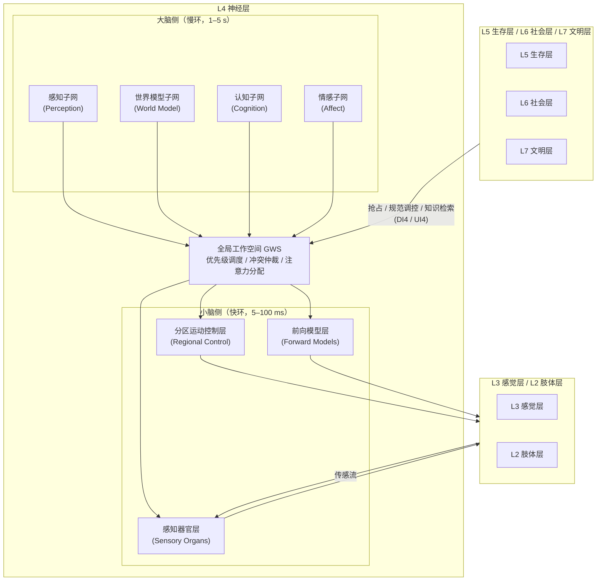

基于七层认知层次模型与世界大模型的大脑—小脑双层神经层（L4）架构

作者：冯胤清　 peak918 @qq.com

中图分类号：TP242.6　 　文献标志码：A

系列论文说明：本文为"面向逻辑思维的程序设计方法"系列论文第四篇。系列脉络为：总纲《七层认知层次模型与社会化测试框架》→ 世界模型篇《分析世界模型》→ 肢体篇《如何设计一双灵巧的手》→ **本篇：神经层（L4）"脑"专论**。
**证据等级标注约定**：为区分论述的可验证程度，本文沿用系列论文的证据标注体系。[Comparative] 表示基于与现有架构横向对比得出的判断；[Computational] 表示可由计算模型或形式化推导支撑的论断；[Engineering] 表示基于成熟工程实践的设计选择；[Speculative] 表示尚缺充分证据、属探索性提议的内容。凡未标注者，为综述性或定义性陈述。

**摘要**

**背景与问题**：人形机器人的"脑"是物理智能与社会智能的汇聚点，也是当前具身智能研究中抽象层次最模糊的环节。现有技术路线呈现三重割裂：大语言模型智能体具备符号推理与语言交互能力，却缺乏物理因果理解，存在典型的"符号接地问题"；物理人工智能的世界模型具备状态推演能力，却仅被当作外部模拟工具使用，未被组织为脑内认知器官，且缺乏社会认知维度；面向对象程序设计以"对象"为基本组织单元，在脑这一跨层级、强耦合、多时间尺度的系统上抽象能力不足。更关键的是，既有类人机器人软件架构普遍将"感知—决策—控制"压缩为单一时间尺度的流水线，忽视了生物脑中大脑与小脑在时间常数、表征形式与学习机制上的根本分工。

**方法与架构**：本文基于面向逻辑思维的程序设计方法（**Logic-Oriented Programming Design，LOPD**）的七层认知分析层次模型，聚焦神经层（L4），提出人形机器人脑的大脑—小脑双层架构。大脑侧承担慢环认知，由感知子网、世界模型子网、认知子网、情感子网构成，特征时间尺度为 1～5 s；小脑侧承担快环执行，由感知器官层、分区运动控制层、前向模型层构成，特征时间尺度为 5～100 ms；两侧以全局工作空间（Global Workspace，GWS）为脑内总线实现有限带宽的双向耦合。核心设计包括：其一，将世界模型由"模拟工具"重构为脑的"预测—想象—规划"引擎，为认知子网提供物理接地；其二，建立覆盖外感受、本体感受、内感受三类共十一条通道的感知器官全谱系映射，明确每条通道的生物通路、工程器件、信号形式与时延预算；其三，提出小脑侧按手部、上体、下体、头部、体内五个分区组织专用硬件与基础控制模型的分区架构，并以前向模型—逆模型配对机制实现运动预测与感觉预测抵消；其四，给出四级记忆架构与"程序性记忆自动化"通道，刻画技能由大脑陈述性表征向小脑程序性表征迁移的过程。

**评估与实现**：本文提出脑级冯胤清测试的分层评估设计，覆盖感知、世界模型、认知、控制、协同五个维度，并给出基于开源软硬件栈的最小可行产品实现路线。需明确说明的是，本文属架构设计与方法论研究，所列各项量化指标均为设计目标值与验证方案，尚未经真实平台实测，具体数值有待后续实验证实。

**意义**：本文为人形机器人脑的认知导向软件开发提供了一套可分解、可实现、可评估的架构范式，也为世界模型从"模拟工具"走向"认知器官"、为小脑计算从"控制模块"走向"独立认知层"提供了理论组织形式。

**关键词**：人形机器人；脑架构；神经层；大脑—小脑双层架构；世界模型；面向逻辑思维程序设计；七层认知模型；全局工作空间；前向模型；具身智能

**Abstract**

**Background.** The "brain" of a humanoid robot is where physical intelligence converges with social intelligence, and it remains the most weakly abstracted component in current embodied-intelligence research. Three disconnections characterize existing approaches. Large language model agents offer symbolic reasoning and linguistic interaction but lack physical causal understanding — the classic symbol grounding problem. World models in physical AI provide state rollout capability, yet they are used as external simulation tools rather than organized as intracerebral cognitive organs, and they omit the social dimension of cognition. Object-oriented programming, taking the "object" as its organizing unit, abstracts poorly over a system that is simultaneously cross-level, tightly coupled and multi-timescale. More critically, prevailing humanoid software architectures compress perception, decision and control into a single-timescale pipeline, ignoring the fundamental division of labour between cerebrum and cerebellum in biological brains with respect to time constants, representational format and learning mechanism.

**Method**. Building on the seven-layer cognitive hierarchy of Logic-Oriented Programming Design (LOPD) and focusing on the neural layer (L4), this paper proposes a **cerebrum–cerebellum dual-layer architecture** for the humanoid robot brain. The cerebral side handles the slow loop of cognition through four subnets — perception, world model, cognition and affect — at a characteristic timescale of 1–5 s. The cerebellar side handles the fast loop of execution through three subsystems — sensory organs, regional motor control and forward models — at 5–100 ms. The two sides are coupled through a Global Workspace (GWS) acting as a bandwidth-limited intracerebral bus. Four design contributions are made: reconstructing the world model from a simulation tool into a predict–imagine–plan engine that grounds the cognitive subnet physically; establishing a full-spectrum mapping of eleven sensory channels across exteroception, proprioception and interoception, each specified by biological pathway, engineering device, signal form and latency budget; organizing the cerebellar side into five regional partitions — hand, upper body, lower body, head and intracorporeal — each with dedicated hardware and a basic control model, unified by forward–inverse model pairing for motion prediction and sensory cancellation; and defining a four-tier memory architecture with a procedural-automation pathway that describes skill migration from cerebral declarative representation to cerebellar procedural representation.

**Evaluation**. A layered evaluation design, the brain-level Feng Yinqing Test, is proposed across five dimensions, together with a minimum-viable-product roadmap on an open-source stack. This work is architectural and methodological; all quantitative indicators reported are design targets and validation protocols, not measured results, and remain to be empirically confirmed.

**Keywords**: humanoid robot; brain architecture; neural layer; cerebrum–cerebellum dual-layer architecture; world model; logic-oriented programming design; seven-layer cognitive hierarchy; global workspace; forward model; embodied intelligence

**第1章 引言**
**1.1 脑**：**人形机器人的智慧中枢**
人形机器人区别于传统工业机器人的本质，并不在于形态的相似，而在于其面对的是一个开放、非结构化且充满社会性的任务空间。工业机器人在结构化工位中重复执行预编程轨迹，其"智能"可以外置于环境设计之中；人形机器人则必须在陌生房间里找到水杯、在拥挤走廊中避让行人、在被打断的对话后接续先前的任务意图。前者需要的是精度，后者需要的是理解。

这一区别决定了人形机器人的技术瓶颈正在发生迁移。过去十年，产业界的主要投入集中于本体——更高扭矩密度的关节模组、更轻量化的连杆、更灵巧的多指手。这些进步是真实的，但也逐渐暴露出一个结构性失衡：本体能力的提升并未同比例转化为任务能力的提升。一台能够完成后空翻的机器人，未必能可靠地把一杯水从桌上端到另一个房间而不洒出来。造成差距的不是电机，而是控制电机的那套东西——脑。有研究者将这一现象概括为机器人行业"重硬件、轻大脑"的路径依赖，认为当前具身智能的核心矛盾已从执行能力转向认知能力[1]。

近两年兴起的视觉—语言—动作（Vision-Language-Action，VLA）模型部分回应了这一矛盾。此类模型以端到端方式建立从图像与指令到动作序列的映射，在若干桌面操作任务上展现了可观的泛化性。但从架构视角看，VLA 解决的是"感知—动作映射"这一个环节，它并不构成一个脑。一个脑至少还需要回答：当映射失败时如何诊断？当任务需要多步且中间状态不可见时如何规划？当环境反馈与预期不符时，究竟是感知错了、模型错了，还是执行错了？这些问题的共同特征是，它们要求系统对自身的内部状态具有可分解、可归因的组织结构，而端到端映射恰恰消解了这种结构。

脑的设计难度还来自其固有的复杂性特征，本文将其概括为三个维度：

**跨层级**。脑同时处理物理层面的力与位移、认知层面的目标与推理、社会层面的规范与角色。这三个层面使用完全不同的表征语言，一个能同时容纳它们的架构必须在抽象层次上做出明确切分，而不是把它们混在同一个神经网络里。

**强耦合**。脑内各功能之间并非松散协作。视觉预测会改变抓取力度，情绪状态会改变语言输出的措辞，电量不足会抢占正在进行的任务。任何试图把脑切成互不通信的独立模块的设计，都会在这些耦合处失效。

**多时间尺度**。这是本文特别强调的一点。脑内不同过程的特征时间常数跨越至少五个数量级：碰撞回撤的反射在毫秒级完成，步态平衡的调节在数十毫秒级完成，动作原语的执行在数百毫秒级完成，任务规划在秒级完成，而人格与价值倾向的稳定性以月甚至年为单位。把这些过程置于同一个调度框架内，要么牺牲实时性，要么牺牲深度。

**1.2 程序设计方法：从面向对象到面向逻辑思维**
上述复杂性对程序设计方法本身构成了挑战。回顾软件工程范式的演进，面向对象程序设计（**Object-Oriented Programming，OOP**）以"对象"为基本组织单元，通过封装、继承与多态管理复杂度，在信息系统领域取得了持续数十年的成功。面向智能体的程序设计（**Agent-Oriented Programming，AOP**）进一步以"信念—愿望—意图"等精神状态为组织单元，把自治性与目标导向纳入语言层面。

然而在人形机器人的脑这一对象上，两者都遇到了抽象失配。OOP 的对象边界由数据与方法的封装关系确定，但脑内的功能边界由时间尺度与表征形式确定——把"平衡控制"和"任务规划"封装成两个类是容易的，难的是表达它们运行在完全不同的时钟上、共享的状态量必须以受控带宽交换。AOP 虽引入了精神状态，但其状态语义停留在符号层，对连续控制、感觉运动预测这类亚符号过程缺乏表达力。

面向逻辑思维的程序设计方法（**Logic-Oriented Programming Design，LOPD**）正是针对这一失配提出的[2]。**其核心主张是**：**以思维层次为基本组织单元，以逻辑思维过程为执行驱动**。所谓思维层次，指的是智能体在不同抽象级别上组织信息与产生行为的相对独立的功能层；所谓逻辑思维过程驱动，指的是系统的执行流不由外部调用图决定，而由"感知触发—内部推演—决策生成—行为执行—结果回写"这一逻辑链条自身的推进决定。

**术语说明**：该方法在系列论文的不同篇目中曾出现 LTOP（Logic-Thinking-Oriented Programming）与 LOPD 两种缩写写法，本文统一采用 LOPD（Logic-Oriented Programming Design），并建议后续系列论文统一至该写法，以免造成检索与引用上的混淆。
LOPD 将智能体划分为七个认知分析层次：基因层（L1）、肢体层（L2）、感觉层（L3）、神经层（L4）、生存层（L5）、社会层（L6）、文明层（L7）。每层以四元组形式化描述：
$L_i = (S_i,\ A_i,\ UI_i,\ DI_i)$
其中 
 为$S_i$该层的状态集合，$A_i$为该层可执行的动作集合，$UI_i(Upward Interface)$为向上层输出的接口，$DI_i(Downward Interface)$为接收上层指令的接口。

定义补注：四元组符号约定源自系列总纲，但各分量的严格语义在既有论文中未给出完整释义。本文在此明确其语义，并将该释义视为本文对系列框架的补充，而非对既有文献的转述。
本文聚焦的是其中的 L4 神经层，即通常意义上所说的"脑"。

1.3 脑设计的四重挑战
在 LOPD 框架下审视 L4 的设计，可以识别出四个必须正面回应的挑战。前三个已在系列前作中有所触及，第四个为本文新提出。

**挑战一**：**物理—认知脱节**。 大语言模型掌握了关于世界的语言性知识，却没有关于世界的因果性知识。它知道"水会从倾斜的杯子里流出来"这句话的语法与语用，但不具备预测倾斜角度与流量关系的内部模型。这一差距在纯对话场景中不显著，一旦进入需要力控与时序的物理操作，便会以"物理幻觉"的形式暴露。反过来，物理仿真器与世界模型具备状态推演能力，却没有把推演结果组织成可供推理的命题，无法回答"为什么要这样做"。二者的鸿沟被称为符号接地问题。

**挑战二**：**个体—社会割裂**。 现有机器人软件架构处理的是任务，而不是处境。机器人能够计算最优抓取位姿，但不会因为对方正在打电话而推迟递交动作。社会规范并非可以事后叠加的过滤器，它必须以约束的形式内化进决策过程本身，这要求脑向社会层开放一个语义精确的调控接口。

**挑战三**：**静态—进化张力**。 OOP 的类型系统建立在"结构在运行期保持不变"的假设上，而脑必须在部署后持续改变自己：参数要随经验更新，技能库要增删，甚至子网拓扑也可能重组。如何在允许自我修改的同时保证行为不发生灾难性漂移，是一个架构级而非算法级的问题。

**挑战四**：**快慢混淆**。 这是本文相对于系列前作的主要问题增量。现有架构的普遍做法，是把感知、决策、控制串成单一流水线，用同一个调度周期驱动。这一做法在生物学上是可疑的：人类在保持平衡、调节眼动、抵消自身运动引起的感觉扰动时，并不占用意识带宽；这些过程由小脑在毫秒尺度上自主完成，大脑仅在需要时下达意图。一个把平衡控制和任务推理放在同一个循环里的机器人架构，本质上是在用秒级的钟去驱动毫秒级的过程，其结果要么是控制带宽不足导致失稳，要么是为了保证控制带宽而牺牲认知深度。

因此，**本文的核心主张**是：L4 神经层不应被建模为一个单一的认知系统，而应被建模为**大脑与小脑两个具有不同时间常数、不同表征形式、不同学习机制的耦合子系统**。这一划分不是对生物结构的形式化模仿，而是由"多时间尺度"这一固有复杂性推导出的架构必然。

1.4 本文聚焦、贡献与结构
**研究边界**。 本文聚焦 L4 神经层的本体设计及其与相邻层的接口，明确以下边界：L1 基因层（材料与本体模板）、L2 肢体层（关节级动力学与执行）不在本文展开范围，仅作为接口对端出现；L5 生存层、L6 社会层、L7 文明层以调控约束与知识来源的身份出现，其内部机制由系列其他篇目论述。本文亦不涉及具体的机械设计与电气选型，此部分参见系列肢体篇。

**主要贡献**。 本文的贡献可归纳为五点：

**架构层面**：提出人形机器人脑的大脑—小脑双层架构，将 L4 由概念层落地为由四子网、三子系统与一条全局工作空间总线构成的可计算设计，并给出双环耦合的形式化描述。[Comparative]
**感知层面**：建立覆盖外感受、本体感受、内感受三类共十一条感知通道的全谱系映射表，逐条给出生物通路、工程实现、信号形式、采样率与时延预算，填补既有架构中感知描述停留在"多模态融合"这一笼统层面的空白。[Engineering]
**小脑层面**：提出小脑侧按手部、上体、下体、头部、体内五分区组织的架构，并给出前向模型—逆模型配对、感觉预测抵消、时间感知与节律生成、运动技能自进化等基础模型的设计。[Computational]
**协作层面**：给出大脑与小脑的双环协作机制，包括意图下行的四级细化通道、误差上行的三类反馈通道、世界模型与前向模型的分工判据、抢占仲裁规则与七级失效降级谱系。[Comparative]
**评估层面**：提出脑级冯胤清测试的分层评估设计与量化指标体系。需说明的是，"冯胤清测试"这一概念在系列总纲中已被提出为图灵测试的补充，但其具体评估维度与指标细则此前未见公开定义，本文给出的是面向 L4 的操作化定义，属本文原创。[Speculative]
章节结构。 第 2 章综述相关工作并归纳研究缺口；第 3 章确立 L4 的逻辑职能与双层设计哲学；第 4 章给出双层脑总体架构；第 5 章展开大脑侧核心组件——世界模型子网；第 6 章展开感知器官体系；第 7 章展开小脑子系统；第 8 章论述大脑与小脑的协作机制；第 9 章讨论记忆系统与自进化；第 10 章给出跨层接口设计；第 11 章给出工程实现与评估方案；第 12 章为深层思考；第 13 章总结全文。其中第 6、7、8 章为本文相对系列前作的主要增量。

**第2章 相关工作**
**2.1 经典认知架构**
认知架构研究的目标，是给出一套能够解释并复现广泛智能行为的统一计算结构。SOAR 以问题空间与产生式规则为核心，将所有认知活动统一为在状态空间中的搜索，并通过组块机制实现学习[3]。ACT-R 采用模块化设计，区分陈述性记忆与程序性记忆，引入激活扩散与时间衰减机制，在认知心理学实验数据拟合上具有较强解释力[4]。CLARION 提出显式表征与隐式表征的双层结构，试图统一符号推理与连接主义学习[5]。LIDA 则将全局工作空间理论工程化，以认知循环的形式组织感知、理解、注意与行动选择[6]。

这些架构的共同贡献，是确立了"智能需要结构"这一基本立场，并提供了若干至今仍然有效的组织概念——工作记忆、注意瓶颈、陈述性与程序性记忆的区分、认知循环。其共同局限则同样明显：其一，身体接口薄弱，感知与动作多以抽象符号形式出现，缺乏对连续控制与实时约束的表达；其二，社会维度缺失，架构中没有为规范、角色、他者建模预留结构位置；其三，与现代深度学习集成困难，其表征形式与端到端可微分模型之间缺乏自然的衔接层。值得注意的是，ACT-R 对陈述性与程序性记忆的区分与本文第 8 章讨论的"技能自动化"通道高度相关，但 ACT-R 并未将这一区分与时间尺度分层绑定。

**2.2 世界模型与物理人工智能**
世界模型的基本含义，是智能体在内部建立的关于环境结构与动态的表征，用于预测未来状态并支持规划。这一思想在控制论时代即有雏形，在深度学习时代被重新激活。Ha 与 Schmidhuber 的工作展示了智能体可以在自身学到的隐空间"梦境"中完成策略训练[7]；Dreamer 系列进一步把隐空间想象与强化学习结合，显著提升了样本效率[8]。LeCun 提出的联合嵌入预测架构（Joint-Embedding Predictive Architecture，JEPA）主张在表征空间而非像素空间做预测，从而避免为不可预测的细节浪费建模能力[9]。与之并行的是视频生成路线，以大规模生成模型直接合成未来帧，在视觉保真度上表现突出，但其物理一致性与长程稳定性仍是公开问题。

在功能维度上，已有研究者提出将世界模型划分为渲染器、模拟器与规划器三类角色的分类学观点【文献待核验】：渲染器负责生成可观察的场景，模拟器负责推演状态转移，规划器负责在内部搜索中比较备选行动。本文认为这一功能三分法对架构设计具有直接价值，并在第 5 章据此组织世界模型子网的内部结构。

物理人工智能的讨论则把关注点从"能否预测"推进到"预测是否服从物理律"，强调感知、决策、验证、执行、反馈的闭环，以及信息、能量、时间、因果四类约束对系统设计的刚性限制。

上述工作的共同局限在于：**世界模型**至今主要作为**外部工具**存在——用于生成训练数据、用于离线策略优化、用于人类可视化。它很少被组织为智能体运行时的**常驻器官**，也就是说，它不参与在线的、逐次决策的内部推演。此外，现有世界模型几乎全部面向物理域，对社会域（他人反应、规范后果）的建模基本空白。

**2.3 大模型与智能体架构**
大语言模型作为通用推理与语言接口的价值已获广泛验证，围绕其构建的智能体架构大致形成了若干稳定组件：以提示与工具调用组织行动、以检索增强生成补充事实性知识、以短期与长期记忆维持跨轮次一致性、以反思机制实现有限的自我改进[10]。在具身场景中，VLA 类模型把语言指令与视觉观测直接映射为动作，代表性工作如 RT-2 展示了网络规模知识向机器人控制的迁移[11]，π0 等后续工作进一步提升了动作生成的连续性与跨本体泛化性[12]。

局限有二。第一，纯语言模型路线在物理任务上的能力天花板已经显现，其根源不在参数规模而在训练信号——文本语料中不包含力、摩擦、惯性的连续观测，因此无法从中习得可外推的物理模型。第二，智能体架构目前更接近"能力集合"而非"器官系统"：记忆、工具、反思各自可用，但缺少一个统一的调度与冲突仲裁机制，也缺少对实时性的硬约束表达。当把这类架构直接搬到机器人上时，最先失效的往往不是推理质量，而是时序——一次三秒的模型调用足以让一台正在行走的机器人失去平衡。

**2.4 小脑计算模型与运动控制**
由于本文引入小脑作为独立架构层，有必要单独回顾这一方向。与大脑皮层相比，小脑的计算原理在神经科学中反而获得了更清晰的刻画，这为工程实现提供了难得的理论抓手。

**结构与学习规则**。Marr 与 Albus 分别提出了小脑作为模式识别与联想学习装置的经典理论，其核心是苔藓纤维—平行纤维输入在浦肯野细胞上汇聚，攀缘纤维携带误差信号并诱导突触权重的长时程抑制13。这一"误差驱动的监督学习"图景与反向传播在功能上具有可类比性，但其误差信号是局部的、由下橄榄核提供的，无需全局梯度传播——这一特性对工程实现意义重大，因为它意味着小脑式学习天然适合分布式、低延迟的在线更新。

**CMAC 与工程化**。Albus 在其小脑理论基础上提出了小脑模型关节控制器（Cerebellar Model Articulation Controller，CMAC），以稀疏编码与查表方式实现快速函数逼近，被广泛用于机器人前馈控制[14]。CMAC 的价值在于证明了小脑原理可以直接转化为可实时运行的控制结构。

**内部模型理论**。Kawato 等提出小脑存储着运动系统的内部模型，包括预测动作感觉后果的前向模型与由期望结果反推控制指令的逆模型[15]。Wolpert 与 Kawato 进一步提出多组配对前向—逆模型（MOSAIC）框架，认为大脑通过多个模型对的竞争与加权组合应对不同的动力学环境[16]。前向模型的一个关键功能是感觉预测抵消：系统预测自身动作将引起的感觉输入并将其从实际感觉中减去，从而突出外源性扰动——这解释了为什么人无法给自己挠痒，也直接对应机器人中"如何区分自身运动引起的传感器变化与环境真实变化"这一工程难题。

**在机器人学中的对应**。工程实践中已有大量与小脑功能同构的技术：前馈—反馈复合控制、基于模型的逆动力学补偿、模型预测控制中的滚动预测、中枢模式发生器驱动的节律运动等。但这些技术在现有架构中通常被归入"控制层"，作为大脑的下游执行工具，而非具备独立记忆、独立学习与独立时间尺度的认知子系统。

**缺口**。将小脑提升为架构层的尝试在具身智能产业讨论中已有出现，例如以"**大脑负责思考、小脑负责运动**"的二分来组织技术栈的表述。但这类表述多停留在比喻层面，缺少三方面的实质内容：其一，未给出小脑侧的内部结构划分；其二，未给出大脑与小脑之间接口的形式化定义与带宽约束；其三，未处理小脑自身的记忆与进化机制。本文第 7、8 章正是针对这三点展开。

**2.5 人形机器人"脑"的工程现状**
产业侧大致存在两条路线。一条是端到端路线，以单一大型神经网络承担从传感输入到关节指令的全部映射，主张让数据决定内部结构；其优势是避免了人为模块划分带来的信息损失，劣势是可解释性与可调试性差，且难以对实时性与安全性给出结构性保证。另一条是分层路线，以大模型承担任务理解与规划、以传统控制承担运动执行，通过接口协议连接；其优势是各层可独立验证，劣势是层间语义落差大，规划结果常常在执行层不可行。

学术侧的机器人基础模型工作试图在两条路线之间取得平衡，通过在大规模多任务数据上预训练获得可迁移的动作先验。世界模型与机器人结合的工作则尝试用预测能力改善样本效率与安全性。

现状的共同问题是缺少全谱系认知映射：现有方案各自解决了脑的某一片段——感知的、规划的、控制的——但没有一个方案给出从感觉末梢到社会规范的完整层次组织，也没有说明各片段之间的时序预算如何分配。

**2.6 研究缺口与本文定位**
综合上述回顾，本文识别出六项缺口：

 1. **缺乏脑级统一架构**：现有工作解决片段问题，无覆盖感知—预测—认知—控制—社会接口的完整组织。
 2. **世界模型未内化为认知器官**：世界模型停留于外部模拟工具，未进入在线决策回路。
 3.  **感知描述过于笼统**：多数架构以"多模态融合"一笔带过，缺少通道级的谱系划分，尤其严重忽视本体感受与内感受。
 4.  **小脑缺乏架构地位**：小脑功能被降格为控制模块，其独立时间尺度、独立记忆与独立学习机制未被承认。
 5.   **缺乏自进化的编程范式**：运行期自我修改与行为稳定性之间的张力无架构级应对。
 6. **缺乏脑级评估框架**：现有评测面向任务成功率，缺少对预测质量、协同时延、进化稳定性等架构性质的度量。

 本文定位：在 LOPD 七层框架内，以世界模型技术与小脑计算理论共同填充 L4，给出一个可分解、可实现、可评估的大脑—小脑双层脑架构。表 2-1 概括了本文与代表性工作在关键维度上的差异。
**表 2-1　本文架构与代表性工作的对比**[Comparative]
| 维度 | SOAR / ACT-R | LIDA | LLM 智能体 | VLA（RT-2/π0） | 产业端到端方案 | 本文双层脑架构 |
| :--- | :--- | :--- | :--- | :--- | :--- | :--- |
| 物理接地 | 弱（符号） | 弱 | 无 | 强（数据驱动） | 强 | 强（世界模型+前向模型双通道） |
| 社会接口 | 无 | 无 | 中（语言层） | 无 | 无 | 有（L6 规范注入接口） |
| 时间尺度分层 | 单层 | 单层 | 单层 | 单层 | 隐式 | 显式四级（<5 ms / 5–100 ms / 0.1–1 s / 1–5 s） |
| 小脑地位 | 无 | 无 | 无 | 融于网络 | 融于网络 | 独立子系统，含记忆与学习 |
| 自进化 | 组块学习 | 无 | 反思提示 | 离线再训练 | 离线再训练 | 参数/结构/知识三级，含安全约束 |
| 可解释性 | 高 | 中 | 中 | 低 | 低 | 中高（推演路径+推理链双轨） |
| 可部署性 | 低 | 低 | 中 | 中 | 高 | 中（给出 MVP 路线，待验证） |

说明：表中"本文架构"一列为设计目标，尚未经实测验证，与其他各列基于已发表结果的评价不具备同等证据强度。

**第3章 L4神经层的逻辑职能与双层设计哲学**

**3.1 L4 在七层模型中的定位与形式化定义**
在 LOPD 七层认知层次模型中，L4 神经层位于感觉层（L3）之上、生存层（L5）之下，是整个层次体系的枢纽。其下方三层构成"身体"：L1 基因层规定材料属性与本体模板，L2 肢体层负责关节级动力学与执行，L3 感觉层负责原始信号的采集与初级处理。其上方三层构成"处境"：L5 生存层维护个体的持续存在，L6 社会层处理规范与协作，L7 文明层承载跨代知识。L4 的职能，是把身体提供的信号转化为可以在处境中被评价的行为。

按照四元组形式化，L4 可写作：$L_4 = (S_4,\ A_4,\ UI_4,\ DI_4)$
其中：状态集 $S_4$ 由五个分量构成：$S_4 = \langle S^{perc},\ S^{wm},\ S^{cog},\ S^{aff},\ S^{cb} \rangle$

分别为感知状态（当前场景的结构化表示）、世界模型状态（对环境动态的内部表征及其推演缓存）、认知状态（任务栈、推理上下文、目标集）、情感状态（三维情感向量及其时间轨迹）、小脑状态（各分区的运动状态、内部模型参数、技能激活情况）。

**动作集  $A_4$** 包含四类：推理动作（生成命题、检索知识、构造计划）、推演动作（在世界模型中执行 K 步前向模拟）、控制动作（向 L2 下发动作原语与力矩指令）、学习动作（更新参数、写入记忆、修改技能库）。

**上行接口 $UI_4$**向 L5 报告生理与安全评估，向 L6 报告场景理解与行为意图，向 L7 贡献可复用经验。

**下行接口 $DI_4$** 接收 L5 的生存优先级抢占、L6 的规范调控指令、L7 的知识检索结果，并向 L2、L3 下发执行指令与感知配置。

**3.2 从生物脑到机器脑：大脑与小脑的分工原理**
引入大脑—小脑二分，需要先回答一个方法论问题：这究竟是对生物结构的形式化模仿，还是有独立于生物学的工程理由？本文的立场是后者——生物学提供的是启发与验证，而非论证依据。支持二分的工程理由有三条。

**第一，时间常数不可调和**。 一个平衡控制回路要稳定，其采样周期必须显著小于系统的自然振荡周期。对人形机器人而言，这意味着姿态控制回路需要百赫兹以上的更新率。而基于大模型的任务推理，单次前向计算在端侧硬件上通常需要数百毫秒至数秒。这两个数量级的差距无法通过工程优化弥合，只能通过架构分离处理：让快的归快，慢的归慢，二者之间用低频、低带宽的意图通道连接，而非高频同步。

**第二，表征形式不兼容**。 大脑侧的自然表征是离散的、组合的、可命名的——"杯子""在桌上""可抓取"。小脑侧的自然表征是连续的、高维的、无需命名的——关节角速度向量、接触力分布、时序相位。强行统一到任一侧都会产生损失：把连续控制符号化会丢失精度，把符号推理连续化会丢失可组合性与可解释性。承认两套表征并在边界处做显式转换，比伪装成一套要诚实得多。

**第三，学习机制不同类**。 大脑侧的学习是低频、大批量、可离线的：知识更新、策略调整可以在夜间或云端完成。小脑侧的学习是高频、单样本、必须在线的：负载变了、地面摩擦系数变了、某个关节磨损了，模型必须在数十次交互内适应，否则机器人就会摔倒。用同一套训练框架覆盖两者，要么在线部分太慢，要么离线部分不稳定。

**生物学恰好给出了同构的答案**。小脑仅占脑重的约十分之一，却包含了脑内过半数以上的神经元，且其结构高度规则、连接模式高度重复——这是一个为大规模并行、快速、专用计算而优化的结构。而大脑皮层的结构则更为异质，适合灵活但缓慢的组合式加工。这一对照支持了本文的架构判断，但架构判断本身立足于上述三条工程理由。[Comparative]

**3.3 四级神经控制映射**
在双层划分的基础上，本文进一步把从刺激到行为的通路细分为四级，如表 3-1 所示。相较系列前作提出的三级映射，本文在"脊髓反射"与"皮层运动"之间插入了"小脑快环"这一级，这是引入小脑层后的直接结果。

表 3-1　**四级神经控制映射 [Comparative]**

| 级别 | 生物对应 | 本文归属 | 特征时延 | 典型功能 | 表征形式 | 学习方式 |
| :--- | :--- | :--- | :--- | :--- | :--- | :--- |
| 一级：反射 | 脊髓反射弧 | L2 肢体层 | < 5 ms | 碰撞回撤、限位保护、过流断电 | 阈值触发 | 不学习（固化） |
| 二级：小脑快环 | 小脑—脑干回路 | L4 小脑侧 | 5–100 ms | 平衡维持、前馈补偿、注视稳定、感觉预测抵消 | 连续向量 | 在线误差驱动 |
| 三级：皮层运动 | 运动皮层—基底节 | L4 小脑侧上部 / 大脑侧下部 | 100 ms–1 s | 动作原语执行、轨迹生成、技能序列 | 参数化原语 | 强化学习 + 模仿 |
| 四级：前额叶决策 | 前额叶—顶叶网络 | L4 大脑侧 | 1–5 s | 任务规划、情景推演、价值判断、语言交互 | 符号/语言 | 离线微调 + 上下文学习 |

时延数值说明：表中各级时延为本文提出的设计预算，用于指导子系统选型与调度设计，并非对生物系统的实测转述，亦非既有文献给出的标准值。生物学文献中相应通路的时延存在较大个体与任务差异，此处取值以工程可实现性为主要依据。使用时应视作约束条件而非经验事实。
四级划分的调度含义是明确的：低级别对高级别具有抢占权。当一级反射触发时，二至四级的输出被立即旁路；当二级检测到失衡时，三级的轨迹执行被暂停并让位于平衡恢复。这一优先级顺序在第 8 章的仲裁机制中被形式化。

**3.4 LOPD 四原则在双层脑上的具化**
LOPD 的四条设计原则在 L4 上具体化为以下要求。

**原则一：思维层次分离**。 大脑侧四子网与小脑侧三子系统各自拥有独立的数据结构、独立的计算资源配额与独立的接口定义，任意两个组件之间不得直接调用，一切跨组件通信经全局工作空间中转。这一约束看似增加了开销，实则是可调试性与可替换性的前提——当抓取失败时，能够通过检查 GWS 上的消息序列定位是感知给出了错误的位姿、世界模型给出了错误的预测，还是小脑执行出现了跟踪误差。

**原则二：逻辑驱动执行**。 系统不设中央主循环，执行由逻辑链条推进：感知事件触发世界模型推演，推演结果触发认知评估，评估结论生成意图，意图下行为运动指令，执行结果回写为预测误差，误差再触发学习或重新推演。每一环节的触发条件与产出契约在架构中显式声明。

**原则三：自进化编码**。 脑在运行期可修改自身，修改分参数、结构、知识三级，各级配有相应的安全约束。小脑侧的在线适应与大脑侧的离线更新使用不同的进化通道与不同的验证标准，详见第 9 章。

**原则四：社会约束内化**。 L6 下发的规范不作为输出端的过滤器，而是注入认知子网的评估函数与世界模型的推演目标，使规范在"选择行为"阶段而非"阻止行为"阶段发挥作用。其架构含义是：机器人应当是反思性的规范遵守者，而不是被规则拦截的执行器。

**3.5 设计差异小结**
与经典认知架构相比，本文架构的差异集中在三点：其一，把时间尺度提升为架构的第一性划分依据，而非实现细节；其二，把世界模型置于决策回路内部而非外部；其三，承认两套不兼容的表征并显式设计其转换边界，而非追求表征统一。这三点差异也构成了后续各章的展开主线。

**第4章 双层脑总体架构**

**4.1 总体结构与双环数据流**

本文提出的脑架构由三部分构成：**大脑侧**（四子网）、**小脑侧**（三子系统）、**全局工作空间**（GWS）。其宏观组织如下：

架构中存在两条闭环，本文称之为双环：

**快环**：$L3 传感 → 小脑感知器官层 → 前向模型预测 → 分区运动控制 → L2 执行 → L3 传感$。该环不经过大脑侧，周期 5～100 ms，负责平衡、跟踪、补偿与抵消。快环的存在保证了即使大脑侧完全停止响应，机器人仍能维持站立、握持与安全姿态。

**慢环**：$小脑上报状态 → GWS → 感知子网 → 世界模型推演 → 认知评估 → 意图生成 → GWS → 小脑执行$。周期 1～5 s，负责理解、规划与决策。

两环通过 GWS 耦合，耦合带宽被**刻意限制**。这一限制是设计选择而非工程妥协：若允许大脑侧以高频访问小脑内部状态，则时间尺度分离将名存实亡，架构会退化为单层流水线。

**4.2 大脑侧四子网**

**4.2.1 感知子网（Perception Subnet）**

载体为视觉语言模型与多模态编码器。其职能不是"识别物体"——那是小脑感知器官层与 L3 的工作——而是把已经初步处理的多模态特征，组织为**可供推演的结构化场景表示**。

形式上，感知子网输出场景图 $G = (O, R, \Phi)$，其中 O 为对象集合，每个对象携带类别、位姿、物理属性估计（质量、材质、可抓取性）；R 为对象间关系集合（支撑、遮挡、包含、接触）；$\Phi$， 为全局场景属性（光照、空间布局、可通行区域）。

这里的关键设计判断是：**感知的输出必须是世界模型可以接受的状态向量，而不仅仅是人类可读的标签**。一个只输出"桌上有杯子"的感知模块无法支持"如果推这个杯子会发生什么"的推演；必须输出杯子的位置、估计质量、与桌面的摩擦条件，推演才能进行。这一要求实质上把感知子网的设计目标从"识别准确率"改写为"推演充分性"。

**4.2.2 世界模型子网（World Model Subnet）**
本文的核心组件，承担脑内模拟、未来预测、想象性规划与因果推断，第 5 章将专门展开。此处仅明确其在架构中的位置：它不是感知的后处理，也不是控制的前处理，而是**与认知子网并列的决策参与者**。认知子网提出假设，世界模型子网验证假设；认知子网负责"应该做什么"，世界模型子网负责"这样做会怎样"。

**4.2.3 认知子网（Cognition Subnet）**
载体为大语言模型与结构化知识库的混合体，采用图检索增强生成模式以抑制事实性幻觉。职能包括：逻辑推理、任务分解与规划、语言理解与生成、符号约束满足、社会规范的评估应用。
认知子网与感知子网的分工可以概括为：**感知管"是什么"，认知管"怎么做、为什么"**。二者的输出在 GWS 上汇合，由认知子网完成从场景到任务的映射。

**4.2.4 情感子网（Affect Subnet） [Speculative]**
载体为三维情感表征（效价—唤醒度—支配度，Valence-Arousal-Dominance，VAD）及其动力学模型。职能有二：其一，作为内部调制信号，改变认知子网的搜索深度与风险偏好（例如高唤醒度下缩短规划视野、提高安全裕度）；其二，作为社交输出信号，调节语音韵律、面部表达与动作幅度。
本文对情感子网采取审慎立场：将其定位为**行为调制机制**而非"机器情感"的本体主张。它是否对应任何主观体验，本文不作断言，相关讨论见第 11 章。

**4.3 小脑侧三子系统**
小脑侧的划分依据是信息流方向与功能性质，而非解剖类比。

**4.3.1 感知器官层（Sensory Organs Layer）**
承接 L3 感觉层的原始信号，完成通道级的预处理、时空对齐与初级特征提取，向上输出两路：一路经 GWS 送至大脑侧感知子网用于场景理解，一路直接送至分区运动控制层用于闭环反馈。后一路是快环得以成立的前提——如果所有传感数据都必须经过大脑侧才能回到控制，快环的时延预算将无法满足。
该层覆盖外感受、本体感受、内感受三大类共十一条通道，第 6 章详述。

**4.3.2 分区运动控制层（Regional Motor Control Layer）**
按身体分区组织，包括手部、上体、下体、头部、体内五个分区。每个分区拥有专用硬件接口与基础控制模型，分区之间通过协调层交换必要的状态量（如重心、动量、支撑多边形）。第 7 章详述。

**4.3.3 前向模型层（Forward Model Layer）**
存储并运行各分区的前向模型与逆模型配对，提供三项能力：预测自身动作的感觉后果、由期望结果反推控制指令、通过感觉预测抵消区分自因与他因扰动。这一层是小脑成为"认知子系统"而非"控制模块"的关键——它拥有可学习的内部表征与独立的记忆。第 7 章详述。

**4.4 体感状态的跨层归属**
一个需要专门处理的架构问题是：内感受信号（电量、温度、负载、故障）应归属大脑侧还是小脑侧？
本文的处理是双重归属：原始内感受信号的采集与阈值监测归属小脑侧感知器官层，以保证过热、过流等危险状态能在毫秒级触发保护；而内感受状态的语义解释与优先级评估归属大脑侧，并经 
 上报 L5 生存层。这一划分对应生物系统中"自主神经反射"与"内感受意识"的区别：手碰到火会先缩回，然后才意识到疼。
 
**4.5 全局工作空间：脑内总线**
GWS 借鉴认知神经科学中的全局工作空间理论17，其核心思想是：脑内存在大量并行的专用加工过程，但只有获得"全局广播"的信息才能被所有子系统访问并进入统一的行为控制。这一思想在工程上正好对应了一个**受限带宽的仲裁式共享总线**。
GWS 承担三项机制：
**机制一：优先级调度**。 消息定义为四元组：
$Msg = (\text{type},\ \text{payload},\ \text{timestamp},\ \text{priority})$
**优先级按生存 > 安全 > 任务 > 社交的顺序排列**，同级按时间戳先后处理。高优先级消息可抢占正在广播的低优先级消息。
**机制二：冲突检测与仲裁**。 当多个子网对同一执行资源提出不相容请求时（例如认知子网要求前进而小脑侧报告失衡风险），GWS 依据预设的仲裁规则表裁决，并把裁决结果与理由一并广播，供各子网更新其内部状态。仲裁规则的完整定义见第 8.5 节。
**机制三：注意力分配**。 GWS 依据当前任务状态动态调整各子网的计算资源配额。例如在精细抓取阶段提高感知子网与手部分区的算力份额，在导航阶段提高世界模型子网与下体分区的份额。这一机制使得在算力受限的端侧平台上，脑可以"专注"而非平均用力。
关于容量限制的说明：GWS 的广播容量被有意设为有限（本文建议的初始设计为同时最多广播 7 条消息，队列深度 64）。这一限制并非模仿人类工作记忆容量的经验数字，而是出于三点工程考虑：限制仲裁复杂度、保证广播时延可预测、强制各子网做信息压缩。具体数值需在实测中标定。[Engineering]

**4.6 双层脑的形式化描述**
综合上述，双层脑的运行可形式化为如下耦合动力系统。设大脑侧状态为$x_c \in \mathcal{X}_c$，小脑侧状态为 $x_b \in \mathcal{X}_b$，环境状态为 $e$，则：
$\dot{x}_b = f_b\big(x_b,\ u_c,\ y(e)\big), \qquad \Delta t_b \in [5, 100]\ \text{ms}x_c^{k+1} = f_c\big(x_c^k,\ g(x_b),\ n\big), \qquad \Delta t_c \in [1, 5]\ \text{s}$
其中 $y(e)$ 为传感观测，$u_c$为大脑侧下发的意图指令，$g(\cdot)$ 为小脑向大脑的状态压缩映射，$n$ 为来自 L5/L6/L7 的外部调控输入。
耦合的关键在于两个映射的**带宽约束**：
$dim(uc)≪dim(xc),          dim(g(xb))≪dim(xb)$
即：大脑不向小脑传递完整的推理过程，只传递压缩后的意图；小脑不向大脑上报完整的状态轨迹，只上报压缩后的摘要与异常。这一约束是双层架构的形式化本质，也是它区别于"分层流水线"的地方——分层流水线的层间是完整信息传递，双层脑的层间是**有损压缩传递**，正是这种有损性使得两层可以在不同时钟上独立运行。[Computational]

**第5章 世界模型子网：脑的"预测—想象—规划"引擎**

**5.1 脑为什么需要世界模型**

**从符号接地问题说起**。 语言模型学到的是符号之间的共现统计。"把杯子倾斜四十五度水会流出来"这句话之所以能被生成，是因为语料中存在大量语义相邻的表达，而不是因为模型内部存在一个关于液体、重力与容器几何的可推演结构。这一区别在需要外推的场合会立刻显现：换成一个模型从未见过的异形容器、换成粘度不同的液体、换成倾斜速度极慢的情况，符号统计给不出可靠答案，而一个哪怕粗糙的物理模型都能给出定性正确的预测。
**从预测编码说起**。 认知神经科学中有一个影响广泛的观点：脑并非被动接收感觉输入，而是持续生成对下一刻感觉输入的预测，并以预测误差作为主要的加工信号[19]。若接受这一图景，那么"脑内存在生成模型"就不是一个可选的架构增强，而是脑运作方式的核心。世界模型子网正是这一机制在工程上的对应物。
**从架构角色说起**。 本文的主张是：世界模型应当由外部模拟工具转变为脑内常驻器官。这一转变有三层含义：
其一，在线性。世界模型参与每一次决策，而不仅在训练阶段被使用。其推演结果实时进入 GWS，与感知、认知的输出一同被评估。
其二，双向性。世界模型不仅向决策输出预测，也从执行结果接收误差并持续更新。它是活的，不是固化的。
其三，中介性。它是认知子网与物理世界之间的翻译层：认知子网提出的符号级假设（"先移开挡住的书"）经由世界模型转化为可检验的状态推演（"移开后杯子是否仍在可达范围内"），从而获得物理接地。

**5.2 三模态功能划分：渲染器、模拟器、规划器**

沿用功能分类学的三分视角，世界模型子网在脑内承担三种可切换的角色。
**渲染器模态（Renderer）**。 生成具体可观察的场景表象。在脑内的用途有三：为数据增强生成训练样本；为人机交互提供"机器人当前如何理解场景"的可视化，服务于可解释性；为想象性任务提供具象支撑。渲染器模态计算代价最高，仅在离线或低实时性场合启用。
**模拟器模态（Simulator）**。 执行状态转移推演，回答"若施加动作 a，状态将如何演化"。形式上给出：
$\hat{s}_{t+1} = T_\theta(s_t,\ a_t), \qquad \hat{s}_{t+K} = T_\theta^{(K)}(s_t,\ a_{t:t+K-1})$
这是世界模型在脑内最常用的模态，是所有前瞻决策的基础。
**规划器模态（Planner）**。 在模拟器基础上叠加搜索与评价，在内部比较多条候选动作序列，输出最优或满意解：
$a^*_{t:t+K-1} = \arg\max_{a_{t:t+K-1}} \sum_{k=0}^{K-1} \gamma^k \, V\big(\hat{s}_{t+k},\ a_{t+k}\big)$
其中价值函数 V 并非单一来源，而是由认知子网提供任务价值项、情感子网提供风险偏好项、L6 接口提供社会规范项加权合成。这一设计使得"规范内化"具有了具体的计算形式：**规范不是事后否决，而是在内部搜索的评价函数中就已参与打分**。
三模态共享同一套底层表征（几何、动力学、物体属性），仅在输出头与计算预算上区分，从而避免维护三套独立模型带来的一致性问题。

**5.3 内部模拟与前瞻规划闭环**

世界模型子网的运行闭环包含六个环节：

**状态注入**：感知子网输出的场景图 G 与小脑上报的本体状态压缩为初始状态 s_t。
**候选生成**：认知子网提出 M 条候选行动方案（符号级），经动作词典展开为可推演的参数化动作序列。
**并行推演**：模拟器模态对每条候选执行 K 步前向推演，输出预测轨迹与终止状态。
**多源评估**：对每条预测轨迹计算任务价值、风险代价、规范符合度、能量消耗，加权得分。
**择优下行**：最优方案经 GWS 转为意图指令下发小脑侧。
**误差回写**：实际执行结果与预测轨迹比对，预测误差$\delta = \|s^{real}_{t+k} - \hat{s}_{t+k}\|$ 用于两个目的——即时目的是触发重规划（当 $\delta$ 超阈值），长期目的是驱动模型参数更新。
推演深度 K 与候选数 M 构成计算预算，由 GWS 的注意力分配机制动态设定。本文建议的初始配置为：常规导航 K=20 步（对应约 2 s 预见）、M=3；精细操作 K=10、M=5；紧急规避退化为 K=3、M=2 以保证响应速度。这些数值为设计起点，需按平台算力实测标定。[Engineering]
与基于模型的强化学习的关系。 上述闭环在数学形式上与基于模型的强化学习高度相似，但在架构定位上有实质区别：基于模型的强化学习中，世界模型服务于策略训练，训练完成后策略独立运行；本文架构中，世界模型服务于在线决策，即使策略已经训练充分，推演仍在每次决策时发生。这一区别的代价是运行时算力开销，收益是面对分布外情况时的可诊断性——当机器人做出异常行为时，可以检查它当时"想象"到了什么。

**5.4 与认知子网的协同：快慢思考的机器实现**
双过程理论把人类思维区分为直觉式的系统一与分析式的系统二。本文架构给出的对应实现如下。

**系统一路径（< 100 ms）**：感知器官层 → 前向模型快速预测 → 分区控制直接响应。该路径完全在小脑侧完成，不经世界模型子网，不经认知子网。典型场景：走路时避开地面的小障碍。

**系统二路径（1～5 s）**：感知子网 → 世界模型多步推演 → 认知子网符号评估 → 意图生成。典型场景：判断是否应该先把桌上的书移开再放杯子。

**中间路径（0.1～1 s）**：世界模型短程推演 + 缓存策略查表，不启动完整符号推理。典型场景：抓取时根据物体形变预测调整握力。

三条路径的**选择机制**由两个判据决定：一是**新颖度**，当感知输出与已有经验的匹配度低于阈值时，强制升级到系统二；二是**代价非对称性**，当预测显示错误行为的后果不可逆（打碎、跌倒、伤人）时，无论新颖度如何都升级到系统二。这一设计避免了"熟练即盲目"的失效模式。

**认知与世界模型的假设—验证循环**。 二者的协作可概括为一个循环：认知子网基于知识与语言提出假设，世界模型基于物理与动力学验证假设，图检索增强机制校验假设的符号一致性。三者形成三角制衡——语言模型可能生成物理上荒谬的计划，世界模型可以否决；世界模型可能给出物理可行但语义荒谬的方案（例如把杯子直接推下桌来"清空桌面"），认知子网可以否决；两者都可能违反事实性知识，知识图谱可以否决。

值得指出的是，思维链推理与世界模型推演在功能上是同构的：前者是在文本空间中的多步推演，后者是在状态空间中的多步推演。二者的差别在于推演的媒介与可验证性——文本推演灵活但缺乏物理约束，状态推演受约束但缺乏组合灵活性。本文架构的价值之一，正是把这两种推演并置并让它们互相校验。

**5.5 物理一致性约束与安全机制**
**约束的来源。** 世界模型相对语言模型的一个结构性优势，是它可以在架构层面嵌入物理约束，从而在源头上而非输出端抑制荒谬预测。可嵌入的约束包括：能量守恒（推演过程中系统总能量不得无故增加）、动量守恒、接触互补条件（物体不得互相穿透）、因果时序（结果不早于原因）、运动学可行性（预测状态须在机器人可达空间内）。

**预演式安全。** 传统安全机制是事后拦截：动作生成后由安全监视器检查，违规则否决。本文架构支持预演式安全：危险在想象中先发生一次，从而在真实世界中不必发生。其形式为，在第 5.3 节步骤 4 的评估中引入安全代价项：

$C_{safe} = \sum_{k=1}^{K} \gamma^k \cdot P\big(\text{hazard} \mid \hat{s}_{t+k}\big) \cdot L(\hat{s}_{t+k})$

其中$P(\cdot)$为危险事件概率，$L(\cdot)$为损失严重度。这一形式的意义在于把安全从二值判断变为连续代价，可以与任务价值在同一尺度上权衡。

四类约束的架构落点。 物理人工智能讨论中常提到的信息、能量、时间、因果四类约束，在本架构中分别落于：信息约束体现为感知通道的采样率与带宽预算（第 6 章）；能量约束体现为评估函数中的能耗项与 L5 生存层的抢占机制；时间约束体现为四级时延预算与推演深度上限；因果约束体现为世界模型的结构先验与知识图谱的因果边。

**局限的诚实陈述。** 当前世界模型技术存在三项尚未解决的问题，本文架构无法回避：其一，**长程一致性衰减**，多步推演的误差累积使得超过一定步数后预测不再可信，这直接限制了 K 的取值；其二，**物理幻觉**，即便嵌入约束，生成式模型仍可能产出违反直觉的结果，尤其在接触密集、形变显著的场景；其三，**算力成本**，在线推演对端侧平台是显著负担，这也是本文设置三档推演预算的原因。这些问题的存在意味着，世界模型子网必须配备降级路径（第 8.7 节），而不能被设计为不可或缺的单点。

**5.6 实现路线：三种范式与混合策略**
**路线 A：潜空间预测（JEPA 风格）——主推**。 在表征空间而非像素空间做预测，不重建不可预测的细节，计算效率高，语义抽象度高，适合作为在线推演的主力。缺点是预测结果不可直接观察，调试困难，需要额外的解码器用于可视化。

**路线 B：生成式（扩散/自回归视频）——辅助**。 保真度高，可直接渲染，适合数据增强与人机交互展示。缺点是推理代价大，难以满足在线时延要求，物理一致性依赖数据而非结构。

**路线 C：可微物理模拟器注入——特定场景**。 在刚体动力学、接触力学等有成熟解析模型的领域，直接注入可微物理引擎，精度高、外推可靠。缺点是覆盖面窄，对形变体、流体、柔性物体建模困难，且难以处理未建模对象。

混合策略。 本文建议按任务时域与精度需求动态选择：

| 场景 | 时域 | 主用路线 | 备用 |
| :--- | :--- | :--- | :--- |
| 快速避障 | < 200 ms | A（潜空间单步/少步） | 前向模型直接外推 |
| 抓取规划 | 0.5–2 s | A + C（接触段用物理引擎） | A 单独 |
| 多步任务规划 | 2–10 s | A（多步）+ 认知子网符号推理 | 纯符号规划 |
| 训练数据生成 | 离线 | B | C |
| 交互可视化 | 离线 | B | — |

表 5-1　世界模型三路线的混合调度策略 [Engineering]

三条路线共享统一的状态接口，使得运行时可按预算切换而不改变上下游代码。这一"接口统一、实现可换"的设计，也是 LOPD 层次分离原则在子网内部的递归应用。

**第6章 感知器官体系：外感受、本体感受与内感受**

**6.1 为什么感知需要谱系化而非笼统化**
现有具身智能架构在描述感知时，普遍使用"多模态融合"这一表述。这一表述掩盖了三个重要事实。

**事实一：感知通道的时间尺度差异巨大**。 视觉的有效更新率通常为 30～60 Hz，触觉中的振动通道需要千赫兹级采样才能捕捉滑移，而内感受中的电量变化以分钟为单位演化。把它们塞进同一个"融合模块"，要么统一到最低频率而丢失高频信息，要么统一到最高频率而浪费算力。

**事实二：感知通道的架构去向不同**。 视觉主要服务于大脑侧的场景理解，本体感觉主要服务于小脑侧的闭环控制，内感受主要服务于 L5 生存层的状态评估。它们在架构中的接收方不同，因此不应在源头强行合并。

**事实三：本体感受与内感受被系统性忽视**。 检索现有人形机器人架构文献可以发现，"感知"一词绝大多数情况下指向外部感知（视觉、听觉、触觉），而对身体自身状态的感知——关节在哪、身体是否倾斜、电机是否过热——往往被降格为"传感器读数"而非"感知"。这一忽视在架构上的后果是严重的：一个不知道自己身体状态的系统，无法建立自身的前向模型，也就无法区分"世界变了"和"我动了"。

因此，本文采用感知神经科学中的三分法组织感知器官层：

**外感受（Exteroception）**：面向外部世界，含视觉、听觉、嗅觉、味觉、触觉五大类，其中触觉进一步分为压觉、振动觉、温度觉、痛觉四条亚通道。
**本体感受（Proprioception）**：面向身体构型，含关节位置觉、肌张力觉（对应机器人的关节力矩）、前庭平衡觉。
**内感受（Interoception）**：面向身体内部状态，含能量状态、热状态、机械健康状态。
需要说明的是，通常所说的"五感"是一个粗粒度的日常分类。若按感受器类型与上行通路严格划分，触觉之下的压觉、振动觉、温度觉、痛觉分属不同的感受器与不同的上行传导束，与其说是一种感觉的四个方面，不如说是四种独立的感觉。加上本体感受与前庭感受，人的感觉通道实际在十种以上。本文的通道划分即基于这一严格立场。

**6.2 外感受通道**

**6.2.1 视觉通道**
**生物通路**：光 → 角膜与晶状体成像 → 视网膜（视杆细胞与视锥细胞完成光电转换，双极细胞与神经节细胞完成初级编码）→ 视神经 → 外侧膝状体 → 枕叶初级视皮层 V1 → 腹侧流（"是什么"，通向颞叶）与背侧流（"在哪里、怎么做"，通向顶叶）。

**工程对应**：光 → 镜头 → CMOS 感光阵列（光电转换）→ 图像信号处理器（去马赛克、白平衡、降噪、高动态范围合成）→ 视觉专用模型。

生物与工程的对应关系值得逐级审视。视网膜对应的不只是 CMOS，而是"CMOS + 图像信号处理器"的组合——视网膜本身即包含显著的预处理（侧抑制实现的边缘增强、局部自适应实现的动态范围压缩），并非单纯的光电转换器。而视网膜神经节细胞的输出已是稀疏编码而非原始像素，这一点提示工程实现中不必把完整像素流一路上送。

**架构中的双路输出**，这是本文设计的关键：

**背侧路（快）**：低分辨率、高帧率（≥ 60 Hz）的视觉流直送小脑侧，用于光流估计、障碍距离估计、注视稳定。该路不做语义识别，只做几何与运动量估计，因而可以极低时延完成。对应生物学中的背侧视觉流。
**腹侧路（慢）**：高分辨率、低帧率（5～10 Hz）的关键帧送大脑侧感知子网，由视觉语言模型完成物体识别、关系抽取、场景理解。对应腹侧视觉流。
这一双路划分直接解决了一个常见的工程困境：既要语义理解又要实时避障，而单一视觉流无法同时满足两者的分辨率与帧率要求。
**辅助模态**：深度相机、激光雷达、事件相机。其中事件相机（异步输出亮度变化事件）在原理上与视网膜的瞬变通道更为接近，微秒级时间分辨率使其特别适合背侧路的高速运动检测。[Engineering]

**6.2.2 听觉通道**
**生物通路**：声波 → 外耳道与鼓膜 → 听小骨阻抗匹配 → 耳蜗（基底膜按频率位置编码，即行波理论；毛细胞完成机电转换）→ 听神经 → 脑干听觉核团（完成双耳时间差与强度差计算）→ 内侧膝状体 → 颞叶初级听皮层 A1。

**工程对应**：声波 → 麦克风阵列（MEMS 麦克风，声电转换）→ 模数转换与前端处理 → 时频变换（对应耳蜗的频率分解）→ 听觉专用模型。

**关键设计：**

**频率分解先行**。耳蜗的核心功能是把时域波形转为频率—位置映射。工程上对应短时傅里叶变换或梅尔滤波器组，这一步应在小脑侧感知器官层完成，而非留给大脑侧模型，理由是频域表示的数据量远小于原始波形，可显著降低总线负载。
**声源定位在快环**。双耳时间差与强度差的计算对应脑干核团的功能，其时延要求高（用于快速转头定向），应置于小脑侧，输出方位角直送头部分区的注视控制。
**语义理解在慢环**。语音识别、说话人识别、环境声事件分类送大脑侧，与语言模型对接。
架构去向：方位角 → 小脑头部分区（转头定向）；文本与事件标签 → 大脑侧认知子网；异常声（碰撞、玻璃破碎）→ 高优先级消息直送 GWS 触发警觉。

**6.2.3 嗅觉通道**
**生物通路**：挥发性气味分子 → 鼻腔气流 → 嗅上皮的嗅感觉神经元（数百种嗅觉受体，组合编码）→ 嗅球（嗅小球汇聚同类受体输入）→ 不经丘脑中继，直接投射至梨状皮层、杏仁核与内嗅皮层。

**工程对应**：气味分子 → 气体传感器阵列（金属氧化物半导体型、导电聚合物型、石英晶体微天平型，即通常所称"电子鼻"）→ 阵列响应模式 → 模式识别模型。

**架构含义**：嗅觉通路有两个特征对架构设计有直接启发。

其一，**组合编码**。单个受体对多种气味有响应，单种气味激活多个受体，气味身份由激活模式而非单一通道确定。这与电子鼻的交叉敏感传感器阵列原理完全一致，意味着嗅觉识别本质上是一个高维模式分类问题，而非阈值检测问题。

其二，**不经丘脑直达边缘系统**。嗅觉是唯一绕过丘脑中继直接进入情绪与记忆脑区的感觉。在本文架构中，这一特征映射为：嗅觉通道设有一条直连情感子网与记忆系统的旁路，用于危险气体的快速警觉与场景的气味标记。[Speculative]

**现实定位**。必须承认，当前人形机器人对嗅觉的工程需求有限，传感器在选择性、漂移、响应时间上均存在明显不足。本文将其纳入谱系的理由是架构完整性——预留接口位置，使得在燃气泄漏检测、食品状态判断、医疗辅助等特定场景中可以接入，而不必届时重构架构。本通道在 MVP 实现中标记为可选。

**6.2.4 味觉通道**
**生物通路**：可溶性化学分子 → 舌面与咽部味蕾中的味觉受体细胞（五种基本味质：酸、甜、苦、咸、鲜）→ 面神经/舌咽神经/迷走神经 → 孤束核 → 丘脑腹后内侧核 → 岛叶与顶叶岛盖的味觉皮层。

**工程对应**：溶液 → 电化学传感器阵列（伏安型、阻抗谱型、离子选择电极，即通常所称"电子舌"）→ 多维响应向量 → 分类与回归模型。

**架构含义**：味觉与嗅觉共享"化学感受 + 组合编码"的基本模式，其独特之处在于与内感受的强耦合——味觉皮层位于岛叶，而岛叶同时是内感受的主要皮层区域。这一解剖学事实的架构含义是：味觉信号在生物脑中天然与身体内部状态（饥饿、恶心、饱足）整合。

对人形机器人而言，味觉的直接用途极为有限。本文将其纳入的理由有二：其一，谱系完整性；其二，在服务型机器人的食品质量判定、化学品识别等窄场景中存在潜在价值。本通道在 MVP 实现中标记为可选，且其架构接口与嗅觉通道共用化学感受总线。

**6.2.5 触觉通道及其四条亚通道**
触觉是外感受中与运动控制耦合最紧密的通道，也是本文认为在现有架构中被处理得最粗糙的通道。多数方案把触觉简化为"接触/未接触"的二值信号或单一压力值，这一简化丢失了绝大部分可用信息。

**生物通路总述**：皮肤中的多种感受器 → 脊髓上行传导束（后索—内侧丘系系统传导精细触觉与本体感觉，脊髓丘脑束传导痛温觉）→ 丘脑腹后外侧核 → 顶叶初级体感皮层 S1（按身体部位形成体感小人拓扑映射）。

四条亚通道分述如下。

（1）**压觉／轻触**。生物感受器为梅克尔细胞（缓慢适应，编码持续压力与纹理细节）与迈斯纳小体（快速适应，编码轻触与滑移起始）。工程对应为压阻式、电容式或光学式压力传感阵列。核心指标是空间分辨率——指尖需达毫米级点距才能支持纹理判别与精细操作。架构去向：压力分布图直送小脑手部分区用于抓握力控，压力质心与合力送大脑侧用于接触状态判断。

（2）**振动觉**。生物感受器为帕西尼小体，对 200～300 Hz 的振动最敏感，功能是检测滑移与远端事件（通过工具传导的振动）。工程对应为压电传感器或高带宽加速度计。核心指标是采样带宽——需 1 kHz 以上才能捕捉滑移起始。架构去向：滑移检测结果以最高优先级直送手部分区，触发抓握力增益，此路径为典型的快环反射，不经大脑侧。

滑移检测是触觉中唯一具有硬实时要求的功能：从滑移起始到物体脱手的时间窗口通常在数十毫秒量级，任何经过大脑侧的处理路径都会错过。这一约束是本文将触觉大部分处理下放至小脑侧的直接原因。[Engineering]

（3）**温度觉**。生物感受器为瞬时受体电位通道家族的冷热感受器。工程对应为热敏电阻阵列、热电堆或红外传感。功能有二：环境温度感知（避免接触高温物体）与物体材质推断（不同材质的导热率差异使得同温物体触感不同，这是人类判断"金属还是木头"的重要线索）。架构去向：超阈值直送保护反射，材质推断结果送大脑侧感知子网补充物体属性。

（4）**痛觉／伤害感受**。生物感受器为游离神经末梢，编码组织损伤或潜在损伤。这是四条亚通道中架构含义最特殊的一条：**痛觉不是一种信息通道，而是一种优先级信号**。其生物学功能不是告知"这里有多少牛顿的力"，而是强制中断当前行为并重新分配注意。

工程对应为多信号融合的伤害判据：接触力超限、关节力矩超限、结构应变超限、温度超限的加权综合。本文建议将其实现为一个**独立的伤害感受监视器**，输出一个标量伤害信号 $\eta \in [0,1]$ 及其定位信息，并赋予其在 GWS 中的最高消息优先级，可抢占一切在途任务。

引入痛觉通道的工程价值有三：保护本体不受损（直接价值）；为强化学习提供密集的负奖励信号（学习价值）；为人机交互提供"机器人知道自己被弄疼了"的可解释状态（交互价值）。[Speculative]

**6.3 本体感受子系统**
**生物通路**：肌梭（编码肌肉长度与变化速率）、高尔基腱器官（编码肌张力）、关节感受器（编码关节角度与极限位置）→ 后索—内侧丘系 → 丘脑 → S1 与运动皮层，同时经脊髓小脑束大量投射至小脑。

最后一点在架构上至关重要：本体感觉的最大投射目标是小脑而非大脑皮层。这与本文的架构划分完全一致——本体感受首先服务于运动控制的快环，其次才服务于意识层面的身体感知。

**工程对应**：

| 生物感受器 | 工程实现 | 输出量 | 建议采样率 |
| :--- | :--- | :--- | :--- |
| 肌梭（长度、速度） | 关节编码器（绝对式/增量式）+ 差分 | 关节角 $q$、角速度 $\dot q$ | ≥ 1 kHz |
| 高尔基腱器官（张力） | 关节力矩传感器、电机电流估计、串联弹性元件形变 | 关节力矩 $\tau$ | ≥ 1 kHz |
| 关节囊感受器（极限） | 限位开关、行程末端软限位 | 越限标志 | 事件触发 |
| 肌肉协同感 | 多关节状态融合 | 构型向量 $\mathbf{q} \in \mathbb{R}^n$ | ≥ 500 Hz |

表 6-1　本体感受通道的工程映射 [Engineering]

核心功能：本体感受提供了机器人的"身体图式"$B_t = (\mathbf{q}, \dot{\mathbf{q}}, \boldsymbol{\tau}, \text{contact})$，这是三项能力的前提：

其一，**无视觉操作**。闭眼摸到鼻子所依赖的正是本体感觉。工程上对应视觉遮挡下的抓取维持、背后取物、黑暗环境行走。

其二，**前向模型的输入基础**。前向模型预测的是"给定当前身体状态与控制指令，下一时刻身体状态如何"，没有可靠的身体状态测量就没有前向模型。

其三，**自因—他因区分**。区分传感器读数变化是由自身运动引起还是由外部扰动引起，必须依赖本体感觉与前向模型的联合，详见第 7.9 节。

**6.4 前庭感受子系统**
**生物通路**：三个半规管（互相正交，通过内淋巴惯性检测角加速度）与两个耳石器官——椭圆囊与球囊（通过耳石膜的惯性检测线加速度与重力方向）→ 前庭神经 → 前庭神经核 → 三条主要输出：前庭脊髓束（姿势反射）、前庭眼反射通路（注视稳定）、前庭皮层（空间定向意识）。

**工程对应**：三轴陀螺仪（角速度）+ 三轴加速度计（线加速度与重力）+ 磁力计，即惯性测量单元；经姿态解算滤波器输出姿态四元数与角速度。

三条输出通路的工程对应，本文认为这是**前庭系统最值得工程借鉴之处**：

通路一：**前庭脊髓反射 → 姿态稳定**。 检测到躯干倾斜后，在数十毫秒内调整下肢与躯干肌肉张力以恢复平衡。对应小脑侧下体分区的平衡控制器，是快环中优先级最高的功能之一。

通路二：**前庭眼反射 → 注视稳定**。 头部转动时，眼球以近似等幅反向运动补偿，使视网膜像稳定。这是生物系统中时延最短的反射之一（约 10 ms 量级），远快于依赖视觉反馈的平滑跟踪。工程对应：由惯性测量单元角速度直接前馈驱动云台或眼球机构反向补偿，不等待图像处理。

这一机制对人形机器人的实际价值常被低估：行走时头部的周期性晃动会使视觉输入剧烈抖动，若依靠图像稳定算法事后补偿，既有时延又有信息损失；而前庭眼反射式的前馈补偿可以在光学层面就把像稳住。本文建议将其作为头部分区的必备功能。[Engineering]

通路三：**空间定向**。 前庭信息与视觉、本体感觉整合，形成对自身在空间中位置与朝向的估计，上送大脑侧用于导航与空间推理。

**多感觉冲突问题**。当前庭信号与视觉信号不一致时（例如机器人站在移动的平台上），系统需要判断以何者为准。生物系统中这一冲突会引发眩晕；工程系统中则需明确的仲裁规则。本文建议的规则是：短时程（< 200 ms）以前庭为准，因其时延短且不受视觉遮挡影响；长时程以视觉与里程计融合为准，因惯性测量单元存在累积漂移。

**6.5 内感受子系统**
**生物通路**：内脏感受器、化学感受器、压力感受器 → 迷走神经与脊髓通路 → 孤束核 → 臂旁核 → 丘脑 → 岛叶皮层（后岛叶接收原始内感受，前岛叶形成整合的身体感受与情绪体验）。

内感受是近年认知神经科学中发展迅速的领域，其核心观点是：情绪体验的基础是对身体内部状态的感知与解释。这一观点对机器人架构的启发是直接的——**情感子网的输入不应只有社交信号，还应包括自身的"生理"状态**。

工程对应的三类内感受：

| 类别 | 生物对应 | 工程信号 | 采样率 | 上报对象 |
| :--- | :--- | :--- | :--- | :--- |
| 能量状态 | 饥饿、血糖 | 电池荷电状态、放电功率、剩余续航估计 | 1 Hz | L5 生存层 |
| 热状态 | 体温、发热 | 电机温度、驱动器温度、电池温度、环境温度 | 10 Hz | L5 + 小脑保护 |
| 机械健康 | 内脏痛、疲劳 | 关节摩擦力变化、异常振动频谱、电流谐波、结构应变、执行误差统计 | 10–100 Hz | L5 + 大脑侧 |
| 循环状态 | 心跳、呼吸 | 冷却泵/风扇转速、液压压力、气压 | 10 Hz | 小脑体内分区 |

表 6-2　内感受通道的工程映射 [Engineering]

**架构设计要点**：

要点一：**双重归属**。 如第 4.4 节所述，内感受的阈值监测在小脑侧（毫秒级保护），语义解释在大脑侧（秒级评估）。

要点二：**内感受驱动的抢占**。 当能量或热状态越过阈值时，L5 生存层可发起抢占，覆盖高层任务指令。这一机制的存在使得机器人具备"生存优先"的行为倾向，而不必在每个任务规划中显式考虑续航。

要点三：**内感受与情感的耦合**。 借鉴岛叶同时承载内感受与情绪的解剖学事实，本文设计内感受状态直接调制情感子网的唤醒度维度：低电量与高温对应高唤醒度与负效价，表现为行为上的保守化与效率优先。这一设计属探索性，其行为学合理性有待验证。[Speculative]

要点四：**机械健康作为"疼痛"的慢性形式**。 第 6.2.5 节的痛觉通道处理急性伤害，本节的机械健康通道处理慢性劣化。二者共用伤害感受监视器，但时间常数与响应方式不同：急性触发反射，慢性触发维护请求与行为保守化。

**6.6 多模态时空对齐与感知总线**
十一条通道产生的数据在时间基准、空间坐标、采样率、数据量上均不相同，融合前必须完成对齐。本文规定三项对齐规范。
**时间对齐**。所有传感数据在采集端打上统一时间戳，时钟同步精度要求优于最快通道采样周期的十分之一（对 1 kHz 通道即优于 0.1 ms）。工程上建议采用硬件触发同步或精确时间协议。融合时以时间戳为准做插值对齐，禁止以到达顺序为准——这是分布式传感系统中最常见的错误来源。

**空间对齐**。所有具有空间属性的传感数据统一转换至机器人基坐标系，转换链由本体运动学与标定外参给出。需注意本体运动学本身依赖本体感受读数，因此本体感受的采样率必须不低于任何需要坐标转换的通道。

**采样率分层**。本文将通道按采样率分为四档，不同档位走不同的数据路径：

| 档位 | 采样率 | 通道 | 数据路径 |
| :--- | :--- | :--- | :--- |
| 超高频 | ≥ 1 kHz | 本体感受、振动觉、前庭 | 小脑侧本地环，不上总线 |
| 高频 | 100–1000 Hz | 压觉、温度觉、伤害感受 | 小脑侧本地环 + 事件上报 |
| 中频 | 10–100 Hz | 视觉背侧路、听觉方位、内感受 | 小脑侧 + 摘要上 GWS |
| 低频 | ≤ 10 Hz | 视觉腹侧路、语音语义、化学感受 | 直接上 GWS 至大脑侧 |

表 6-3　感知通道的采样率分层与数据路径 [Engineering]

这一分层的核心原则是：高频数据不上总线。超高频通道的数据量若全部广播至 GWS，将耗尽总线带宽并使大脑侧被无关细节淹没。它们应在小脑侧本地闭环消化，仅在越限或异常时以事件形式上报。这正是第 4.6 节所述"有损压缩传递"在感知侧的具体落实。

**6.7 感知通道全谱系映射表**
**表 6-4　感知通道全谱系映射 [Engineering]**

| 通道 | 生物感受器 | 生物皮层终点 | 工程器件 | 信号形式 | 建议采样率 | 时延预算 | 架构去向 |
| :--- | :--- | :--- | :--- | :--- | :--- | :--- | :--- |
| 1 视觉·背侧 | 视杆/视锥（瞬变通路） | 顶叶背侧流 | CMOS 低分辨率/事件相机 | 光流、深度、运动矢量 | ≥ 60 Hz | ≤ 20 ms | 小脑：避障、注视 |
| 2 视觉·腹侧 | 视锥（持续通路） | 颞叶腹侧流 | CMOS 高分辨率 + ISP | 关键帧图像 | 5–10 Hz | ≤ 300 ms | 大脑：场景理解 |
| 3 听觉·定位 | 耳蜗毛细胞 | 脑干上橄榄核 | 麦克风阵列 | 方位角、仰角 | ≥ 100 Hz | ≤ 30 ms | 小脑：头部定向 |
| 4 听觉·语义 | 耳蜗毛细胞 | 颞叶 A1 | 麦克风 + 时频变换 | 文本、声事件标签 | 事件触发 | ≤ 500 ms | 大脑：认知子网 |
| 5 嗅觉 | 嗅感觉神经元 | 梨状皮层 | 气体传感阵列 | 响应模式向量 | 0.1–1 Hz | ≤ 2 s | 大脑 + 情感旁路（可选） |
| 6 味觉 | 味觉受体细胞 | 岛叶/顶岛盖 | 电化学传感阵列 | 五味强度向量 | 事件触发 | ≤ 2 s | 大脑（可选） |
| 7 触觉·压 | 梅克尔/迈斯纳 | S1 | 压阻/电容阵列 | 压力分布图 | 100–500 Hz | ≤ 10 ms | 小脑：抓握力控 |
| 8 触觉·振动 | 帕西尼小体 | S1 | 压电/高带宽加速度计 | 频谱、滑移事件 | ≥ 1 kHz | ≤ 5 ms | 小脑：滑移反射 |
| 9 触觉·温度 | TRP 通道 | S1 | 热敏电阻/热电堆 | 温度场 | 10 Hz | ≤ 100 ms | 小脑保护 + 大脑材质推断 |
| 10 触觉·痛 | 游离神经末梢 | S1 + 前扣带回 | 多信号融合判据 | 标量 η + 定位 | 事件触发 | ≤ 5 ms | GWS 最高优先级 |
| 11 本体感受 | 肌梭/腱器官/关节囊 | S1 + 小脑 | 编码器 + 力矩传感 | (q, q̇, τ) | ≥ 1 kHz | ≤ 1 ms | 小脑：全部分区 |
| 12 前庭感受 | 半规管 + 耳石器 | 前庭核 + 前庭皮层 | IMU（陀螺 + 加速度计） | 姿态四元数、角速度 | ≥ 500 Hz | ≤ 2 ms | 小脑：平衡 + 前庭眼反射 |
| 13 内感受 | 内脏/化学/压力感受器 | 岛叶 | 电量/温度/电流/振动监测 | 状态向量 | 1–100 Hz | ≤ 100 ms | 小脑保护 + L5 生存层 |

说明：表中通道按严格划分共 13 条；若按"五感 + 本体 + 前庭 + 内感受"的常规粗分则为 8 类。时延预算为本文提出的设计约束，用于指导选型与调度，非实测值，亦非文献引用值。

**6.8 时延预算与降级策略**
感知系统的可靠性不在于永不失效，而在于失效时行为可预测。本文为每条通道定义降级行为：

视觉腹侧路失效：退化为仅依赖背侧路的几何避障，禁用需要物体识别的任务，语音告知用户。
视觉全通道失效：切换至本体感受 + 触觉 + 前庭的"盲行模式"，速度降至常规的 20%，仅执行已知地图内的移动。
触觉振动通道失效：抓握力策略切换为保守模式（固定高力矩），牺牲柔顺性换取不脱手。
本体感受单关节失效：由前向模型基于指令与其余关节状态推算该关节位置，标记为低置信，限制该关节参与精细任务。
前庭失效：立即进入静态稳定姿态（降低重心、扩大支撑面），禁止行走，因失去前庭信息后动态平衡不可维持。
内感受失效：按最保守假设运行（假定电量低、温度高），主动请求维护。
上述降级规则的共同原则是：失去某通道时，退回到不依赖该通道的、能力更弱但安全边界更宽的行为模式，而非继续以完整能力运行并期待其他通道补偿。

**第7章 小脑子系统：分区专用硬件与基础控制模型**

**7.1 小脑的计算本质**

在展开工程设计之前，需要先明确一个问题：小脑究竟在计算什么？如果答案只是"执行大脑的指令"，那么它就不配拥有独立的架构层地位。本文认为，小脑的计算本质可以概括为三句话。

第一，小脑是内部模型的存储与运行装置。 它保存着关于"身体如何响应指令"和"世界如何响应身体"的可学习模型，并以极低时延运行这些模型。

第二，小脑是误差驱动的在线学习器。 与大脑侧依赖大批量离线训练不同，小脑接收局部误差信号并即时调整。生物学上，攀缘纤维携带的误差信号诱导浦肯野细胞突触的长时程抑制，这是一种局部的、无需全局梯度传播的学习规则13。工程上，这意味着小脑侧的学习可以在嵌入式硬件上实时进行，而不必等待云端训练。

第三，小脑是时间的计算器官。 精确的时序预测、节律生成、事件间隔估计，这些能力在生物学上与小脑高度相关。对机器人而言，这对应了步态节律、动作时序协调、以及"多久之后会发生什么"的短程时间推断。

据此，本文对小脑侧的定义是：具有独立时间尺度、独立内部模型、独立在线学习能力的感觉运动认知子系统。它不是控制器的集合，而是一个会学习的、有记忆的子脑。

**7.2 分区架构总览**
小脑侧按身体分区组织，共设五个分区，每个分区配备专用硬件接口、基础控制模型与本地内部模型。分区划分的依据是动力学耦合强度：分区内部的自由度之间动力学强耦合，需要统一建模与协调控制；分区之间耦合较弱，可通过少量共享状态量协调。

**表 7-1　小脑侧五分区概览 [Engineering]**

| 分区 | 覆盖自由度 | 主要控制目标 | 控制周期 | 关键传感 | 与其他分区的共享量 |
|------|------------|--------------|----------|----------|----------------------|
| 手部分区 | 双手，每手 6–22 DoF | 抓握稳定、力控、操作 | 1 kHz | 触觉阵列、指关节编码器、腕力矩 | 末端位姿、抓取状态 |
| 上体分区 | 双臂、肩、躯干、脊柱 | 末端定位、负载补偿、姿态维持 | 500 Hz–1 kHz | 关节编码器、力矩、IMU | 末端位姿、上体动量 |
| 下体分区 | 双腿、髋、踝、足 | 平衡、步态、落足、承重 | 1 kHz | 足底压力、关节力矩、IMU | 质心、支撑多边形、地面反力 |
| 头部分区 | 颈部、眼动机构 | 注视稳定、定向、扫视 | 200 Hz–1 kHz | IMU、视觉背侧路、听觉方位 | 注视方向、头部姿态 |
| 体内分区 | 冷却、电源、液压/气动 | 热管理、能量调度、介质压力 | 10–100 Hz | 温度、电流、压力 | 可用功率、热裕度 |

**分区间协调层**。五个分区并非完全独立，其协调通过一个轻量的全身协调器完成，该协调器只交换四类共享状态量：质心位置与速度、全身角动量、支撑状态、可用功率预算。协调器的更新率设为 200 Hz，介于分区本地环与 GWS 之间。

这一"分区自治 + 少量共享"的结构是本文对"全身控制"这一常见做法的有意偏离。全身动力学统一优化在理论上更优，但存在两个实践问题：计算复杂度随自由度立方增长，难以在千赫兹级实时运行；任一分区的故障会污染整个优化问题。分区自治牺牲了理论最优性，换取了实时性与故障隔离。[Engineering]

**7.3 手部分区**
**专用硬件**。多指手的自由度密度远高于身体其他部位，且触觉传感需求最高。手部分区的硬件特征是：高密度小型化驱动（腱驱动或微型模组）、指尖高分辨率触觉阵列、腕部六维力/力矩传感器、独立的本地控制板以满足千赫兹控制周期。

基础控制模型，由四个层次构成：

层次一：**接触检测与接触模型**。 判断接触发生、接触点位置、接触法向。这是所有后续控制的前提。

层次二：**抓握力控制**。 核心是在"抓稳"与"不损坏"之间寻优。控制律以滑移检测为触发的自适应力控为主：

$f_{n}(t+1) = f_n(t) + K_p \cdot \max\big(0,\ s(t) - s_{th}\big) - K_d \cdot \max\big(0,\ f_n(t) - f_{safe}\big)$

其中 $s(t)$ 为振动通道输出的滑移指标，$f_{safe}$ 为物体可承受力上限估计（由大脑侧感知子网提供物体属性推断）。该式表达的策略是：检测到滑移则快速增力，未检测到滑移则缓慢减力至最小稳定值。这一"边缘试探"策略与人类抓取行为一致——人握持物体的力通常仅比滑移临界值高出很小的安全裕度。

层次三：**操作原语库**。 存储参数化的手部动作模板，如捏取、包络抓、指尖旋转、按压、拧转。每个原语定义为四元组：

$AP = (\text{pre},\ \text{eff},\ \text{traj},\ \text{cost})$

其中 $pre$ 为前置条件（物体属性、初始位姿约束），$eff$ 为预期效果（末态描述），$traj$ 为参数化轨迹生成器，$cost$ 为执行代价估计。大脑侧下发的意图即以原语名与参数的形式表达，而非完整轨迹。

层次四：**双手协调**。 处理双手协同任务中的闭链约束（两手同时握持一个刚体时形成运动学闭链），需保证内力不超限。

手部前向模型：预测"施加此指令后，触觉阵列将读到什么"。该预测的用途是即时检测异常——若实际触觉读数与预测显著偏离，说明物体属性估计有误（比预想的重、比预想的滑、比预想的软），应立即触发策略调整并上报大脑侧修正物体属性。

**7.4 上体分区**
专用硬件：双臂各 6～7 自由度、肩部复合关节、躯干俯仰与旋转、脊柱（若采用多节柔性脊柱则自由度更高）。传感以关节编码器、关节力矩传感器与上体 IMU 为主。

**基础控制模型：**

（1）**末端位姿控制与冗余解算**。七自由度手臂对六维任务存在一维冗余，冗余自由度用于优化次要目标：避关节限位、避奇异、避碰撞、优化操作性椭球。工程上以带零空间投影的逆运动学实现：

$\dot{\mathbf{q}} = J^{\dagger}\dot{\mathbf{x}}_{des} + \big(I - J^{\dagger}J\big)\dot{\mathbf{q}}_0$

其中第二项为零空间中的次要目标梯度。

（2）**负载自适应补偿**。手持物体后，手臂动力学参数改变。上体分区应能在数十次交互内在线辨识负载质量与质心，并更新逆动力学前馈项。这是小脑式在线学习的典型应用场景——它不能等待离线再训练，因为拿起一个陌生物体后必须立即适应。

（3）**躯干与脊柱的姿态调节**。脊柱在人形机器人中常被简化为刚性连杆，本文认为这是一个值得重新审视的简化。可调节的躯干提供了两项能力：扩大手臂工作空间（弯腰取物）与提供动量补偿（挥臂时躯干反向微调以抵消角动量扰动）。后者对动态平衡尤为重要。

（4）**上体—下体动量协调**。上体动作产生的角动量会传递至下体影响平衡。上体分区需向全身协调器实时上报预计的动量变化，供下体分区提前补偿。这是分区间协调的典型案例：不是等到失衡后再纠正，而是在动作发起前就通知。

上体前向模型：预测给定关节指令后的末端位姿轨迹与预期力矩，用于两个目的——在与环境接触前预判接触时刻，以及检测意外碰撞（实际力矩显著超出预测即判定为碰撞）。后者是无外部力传感器条件下实现碰撞检测的标准方法，其精度直接取决于前向模型质量。

**7.5 下体分区**
下体分区承担人形机器人最具挑战性的功能：在欠驱动、间歇接触、强非线性的条件下维持动态平衡。

**专用硬件**：双腿各 6 自由度（髋 3、膝 1、踝 2）、足底压力传感阵列或六维力传感器、髋部 IMU。对能量效率有要求的设计还包括并联弹性元件。

**基础控制模型**，按时间尺度自下而上排列：

（1）**落足反射与踝策略（< 20 ms）**。检测到足底压力异常或姿态偏差时，通过踝关节力矩调整压力中心位置。这是最快的平衡响应，适用于小扰动。

（2）**髋策略与迈步策略（20～200 ms）**。中等扰动时通过躯干反向摆动产生角动量补偿；大扰动时触发保护性迈步，重新建立支撑多边形。迈步落点由捕获点理论给出：

$\mathbf{p}_{cap} = \mathbf{c} + \dot{\mathbf{c}} \sqrt{\frac{z_c}{g}}$

其中 $\mathbf{c}$ 为质心水平位置，$z_c$为质心高度。该式给出了"若要一步止住，脚该落在哪里"的解析估计。

（3）**步态生成（周期 0.5～1.5 s）**。以中枢模式发生器或参数化步态生成器产生周期性节律，由平衡状态调制步频、步幅与抬腿高度。中枢模式发生器的引入具有明确的架构含义：步态的节律不需要大脑逐步下发，小脑自主维持，大脑只需给出速度与方向指令。这是"有损压缩传递"在运动控制上的直接体现——大脑发送的是三维速度矢量，而非上百维的关节轨迹。

（4）**地形自适应**。基于足底压力分布与视觉背侧路的地形估计，在线调整落足点与踝关节柔顺参数。

（5）**智能脚**。若足部具备自由度（如可调节的足弓、脚趾关节），则需额外的足部控制子模型，处理蹬地推进与不平地面适应。本文将其作为可选配置。

下体前向模型：预测未来 0.5～2 s 内的质心轨迹与支撑状态。这是小脑侧最重要的预测功能，因为平衡控制的本质就是在失衡发生前采取行动。预测输出同时用于两个方向：向内用于选择当前控制策略，向外经 GWS 上报大脑侧，作为"能否安全通过前方地形"的判据。

**7.6 头部分区**
头部分区的自由度最少，但功能密度高，且对时延最敏感。
**专用硬件：**颈部 2～3 自由度、可选的眼球机构（每眼 2 自由度）、头部 IMU、相机与麦克风阵列的机械承载。
**基础控制模型：**

（1）**前庭眼反射（VOR）**。如第 6.4 节所述，由 IMU 角速度前馈驱动的反向补偿，是整个系统中时延最短的控制回路之一，目标时延 ≤ 10 ms。其控制律在最简形式下为：
$\dot{\theta}_{eye} = -G \cdot \dot{\theta}_{head}$
增益 G 理想值为 1，实际需在线校准——生物系统中该增益的自适应校准正是小脑的经典功能之一（戴眼镜后视野放大，VOR 增益需相应调整，这一适应过程依赖小脑）。工程上同理，相机焦距变化、机构磨损都要求增益在线适应。

（2）**视动反射与平滑跟踪**。基于视觉背侧路的光流，补偿 VOR 的残余误差，跟踪运动目标。时延较 VOR 长（受图像处理限制），二者互补：VOR 处理高频头动，视动反射处理低频漂移。

（3）**扫视控制**。快速跳跃式注视转移，由大脑侧注意机制或听觉定位触发。扫视过程中视觉输入被抑制（对应生物学中的扫视抑制），避免运动模糊污染感知。

（4）**注视—头—躯干协调**。大幅度注视转移时，眼、头、躯干按不同时间常数依次参与：眼最快、头次之、躯干最慢。这一分层协调避免了每次看向侧方都要转动整个身体。

**头部前向模型**：预测下一时刻的视野内容变化。这一预测的价值在于**支持感觉预测抵消**——当图像变化与自身头动预测一致时，判定为自因运动；当出现预测之外的变化时，判定为环境中有物体在动，触发注意。这是机器人区分"我在动"与"世界在动"的核心机制。

**7.7 体内分区：机械与能量的内部控制**
这一分区在多数机器人架构中不被视为"脑"的一部分，而是归入底层驱动。本文将其纳入小脑侧，理由是它满足小脑侧的三个定义特征：有独立时间尺度、有内部模型、需在线适应。

**控制对象**：热管理（风扇、冷却泵、降功率策略）、电源管理（功率分配、峰值削减、充电调度）、流体动力（若采用液压或气动驱动，则含压力与流量调节）、结构冗余管理（关节劣化时的负载重分配）。

**基础控制模型**：
（1）**热预算分配**。给定总散热能力，在各发热部件间分配功率上限。关键是预测性降功率：基于热模型预测未来 30 s 的温升，在触及上限前平滑降功率，而非等到过温后急停。热模型即体内分区的前向模型。
（2）**能量调度**。与 L5 生存层协同，在任务功率需求与续航目标间权衡。当预测续航不足以完成当前任务时，向 GWS 上报以触发任务重规划。
（3）**机械健康监测与代偿**。基于电流谐波、振动频谱、执行误差统计估计关节健康度，健康度下降时自动降低该关节的负载分配，并向大脑侧上报维护请求。
**体内分区的架构意义**：它使机器人具备了"身体自觉"——不是通过外部诊断工具，而是通过内部感受知道自己状态如何。这一能力是长时间自主运行的前提。

**7.8 小脑的基础认知模型：时间感知与节律**
时间处理是小脑功能中最容易被工程实现忽略的一项，但它对协调运动至关重要。本文为小脑侧设计三项时间相关能力。

（1）**节律生成**。由中枢模式发生器实现周期性运动的相位与频率控制，服务于步态、呼吸式冷却循环、周期性巡视等。节律生成器的关键特性是可被外部信号夹带——当地形或外部节奏（如与人同步行走）改变时，相位应能平滑调整而非硬切换。

（2）**时间间隔估计**。估计"事件 A 之后多久会发生事件 B"。典型应用：接住抛来的物体需要预估到达时刻；跨越障碍需要预估落地时刻；与人交接物品需要预估对方松手时刻。工程实现可采用相位斜坡模型或时间基函数组合。

（3）**时序协调与延迟补偿**。多分区协同动作时，各分区的执行时延不同（手部响应快、躯干响应慢），若同时下发指令则动作不同步。小脑侧需按各分区的时延特性提前下发，使动作同时到达而非同时发出。这与音乐演奏中的提前量、或人类投掷时全身各环节的时序编排是同一问题。

时间感知能力的一个综合体现是**动作的"节奏感"**：流畅的动作不是各段轨迹的简单串联，而是在时间上重叠与过渡的连续体。工程上对应轨迹段之间的混合过渡与速度前瞻。[Computational]

**7.9 运动预测与前向模型层**
这一节是小脑侧的理论核心。

前向模型与逆模型的定义。 设身体状态为 $x$，控制指令为 $u$，感觉观测为 $y$。

前向模型$\hat{y}_{t+1} = F_\phi(x_t, u_t)$：给定当前状态与指令，预测下一时刻的感觉后果。
逆模型$u_t = G_\psi(x_t, x^{des}_{t+1})$：给定当前状态与期望状态，反推所需指令。
二者配对使用：逆模型生成前馈指令，前向模型预测其后果，实际观测与预测之差构成误差信号，同时驱动两个模型的更新[15]。
为什么必须有前向模型：三个不可替代的功能。
功能一：**补偿感觉运动时延**。 从下发指令到观测到结果，物理系统存在不可消除的时延（通信、驱动、机械响应、传感）。若控制器等待真实反馈再动作，闭环带宽将被时延严重限制。前向模型提供预测反馈，控制器基于预测状态而非过时的实测状态计算控制量，从而突破时延限制。这是前向模型在工程上最直接的价值。
功能二：**感觉预测抵消（自因—他因区分）**。 令实际观测为 $y_t$，前向模型预测为 $\hat{y}_t$，则残差$r_t = y_t - \hat{y}_t$
代表无法由自身动作解释的部分，即外源性扰动。这一机制解释了为什么人无法给自己挠痒——自生的触觉被预测抵消了。在机器人上，这一机制的价值极大：相机图像的变化有多少是因为自己在动、多少是因为环境在变；触觉读数的变化有多少是因为自己在握紧、多少是因为物体在滑；关节力矩的变化有多少是重力、多少是外部碰撞。没有前向模型，这些问题无法回答。
功能三：**支撑内部模拟**。 前向模型可以脱离真实执行而反复迭代，实现"在脑内试一遍"。与大脑侧世界模型的区别在于时间尺度与建模对象：前向模型建模的是自身身体，在毫秒尺度上运行；世界模型建模的是外部环境，在秒尺度上运行。二者的分工与耦合在第 8.4 节详述。
**多模型配对与情境切换**。 单一前向模型无法覆盖所有动力学情境——空手与持重物、平地与斜坡、干燥与湿滑地面，其动力学显著不同。借鉴多组配对模型的思路[16]，本文设计小脑侧维护一组前向—逆模型对 $\{(F_i, G_i)\}_{i=1}^N$，每对配有一个责任度信号：
$\lambda_i(t) = \frac{\exp\big(-\|y_t - \hat{y}^{(i)}_t\|^2 / 2\sigma^2\big)}{\sum_{j} \exp\big(-\|y_t - \hat{y}^{(j)}_t\|^2 / 2\sigma^2\big)}$
即预测越准的模型责任度越高，最终控制输出为各逆模型输出的责任度加权和，学习更新也按责任度分配。这一机制使系统能够**自动识别当前处于哪种情境并调用相应模型**，且在遇到全新情境（所有模型预测均差）时可触发新模型的创建。[Computational]
**误差信号的分级处理**。预测误差按幅度分三档处理：小误差（在噪声水平内）忽略；中误差驱动模型参数在线微调；大误差判定为情境改变或异常事件，触发模型切换或上报 GWS。这一分级避免了让噪声污染模型，也避免了把真实异常当作噪声吞掉。

**7.10 小脑的记忆与自进化**
小脑侧拥有独立于大脑侧的记忆系统，其内容与形式均不同。

**记忆内容：程序性记忆**。 小脑侧存储的不是"事实"而是"技能"——参数化的动作原语、各情境下的模型参数、运动技能的成功执行轨迹。这类记忆的特点是难以语言化：机器人可以熟练地拧开瓶盖，但其小脑侧并不存在关于"如何拧瓶盖"的可陈述描述，只有一组控制参数与轨迹模板。

**记忆组织**：

| 记忆类型 | 内容 | 更新频率 | 遗忘机制 |
| :--- | :--- | :--- | :--- |
| 模型参数库 | 各情境的前向/逆模型参数 | 每次交互 | 责任度长期为零则淘汰 |
| 技能原语库 | 参数化动作模板 | 学会新技能时 | 长期未调用则归档 |
| 情境索引 | 情境特征 → 模型对映射 | 遇到新情境时 | 合并相似情境 |
| 短时轨迹缓存 | 最近数秒的状态—指令序列 | 持续 | 环形覆盖 |

表 7-2　小脑侧记忆的组织 [Engineering]

自进化的三条路径：

路径一：参数微调（秒级）。 由预测误差直接驱动的在线梯度更新，学习率小，作用于当前活跃模型。这是最频繁的进化形式，对应人在搬起一个比预想重的箱子后立即调整用力。

路径二：模型新增（分钟至小时级）。 当所有已有模型的责任度均低于阈值且持续一段时间，判定为遭遇新情境，创建新的模型对，以当前最接近的模型为初始化。这一过程需要防止模型库无限膨胀，本文建议设置模型数上限并按长期责任度淘汰。

路径三：技能固化（小时至天级）。 反复成功执行的动作序列被压缩为新的动作原语，写入技能库。这一过程对应人类的技能自动化——初学时需要逐步思考的动作，熟练后成为一个整体单元。其架构意义在第 9.3 节详述：这是任务从大脑侧向小脑侧迁移的通道。

进化的安全约束。小脑侧的在线学习具有一个危险特性：它快，且没有人在回路中审查。本文规定三条约束：

参数变化率上限。单次更新的参数变化不得超过设定阈值，防止单次异常观测导致模型崩坏。
回退快照。定期保存模型快照，当连续 n 次执行的误差显著劣于历史基线时，自动回退至上一快照。
安全包络不可学习。关节限位、力矩上限、温度上限等安全边界属于固化参数，任何学习过程不得修改。这条约束把"可进化的部分"与"不可进化的部分"在架构上分开，是防止自进化系统漂移出安全域的基本手段。

**第8章 大脑与小脑的协作机制**

**8.1 协作的基本范式：意图—执行分离**

大脑与小脑的协作可以用一句话概括：大脑决定做什么，小脑决定怎么做；大脑给出意图，小脑给出实现；大脑容忍延迟，小脑不容忍延迟。

这一分离带来一个直接的设计要求：接口的抽象层级必须足够高。若大脑向小脑下发的是关节轨迹，则大脑必须以控制周期的频率工作，双层架构失去意义；若下发的是"走到门口"，则小脑需要自行完成路径、步态、平衡的全部决策。合适的抽象层级在两者之间，本文将其定为参数化动作原语。
表 8-1 给出了协作中各类信息的流向、频率与抽象层级。

**表 8-1　大脑—小脑信息交换规格 [Engineering]**

| 方向 | 信息类型 | 抽象层级 | 频率 | 时延要求 | 数据量级 |
| :--- | :--- | :--- | :--- | :--- | :--- |
| 下行 | 任务意图 | 符号（“取杯子”） | 事件触发 | ≤ 2 s | 数十字节 |
| 下行 | 动作原语 + 参数 | 参数化 | 1–10 Hz | ≤ 200 ms | 数百字节 |
| 下行 | 约束更新 | 数值（速度上限、力上限） | 事件触发 | ≤ 500 ms | 数十字节 |
| 上行 | 执行状态摘要 | 枚举 + 进度 | 10 Hz | ≤ 100 ms | 数十字节 |
| 上行 | 异常事件 | 事件 + 上下文 | 事件触发 | ≤ 50 ms | 数百字节 |
| 上行 | 身体状态摘要 | 压缩向量 | 10 Hz | ≤ 100 ms | 数百字节 |

对比可见，双向信息量都被压缩到很小的规模。真正的高带宽数据——千赫兹的关节状态、毫米级的触觉图像——从不跨越这条边界。

**8.2 意图下行：四级细化通道**
从大脑侧的一个念头到小脑侧的一组力矩，中间经过四级细化。以"把桌上的杯子递给用户"为例：

**第一级：任务意图（认知子网，符号级）**。 输出："递交(杯子, 用户)"。附带约束：轻拿轻放、避免洒出、用户正在通话故动作放缓。
**第二级：子任务序列（认知子网 + 世界模型，符号级）**。 世界模型推演验证后输出序列：接近(桌) → 抓取(杯子) → 转移(用户位置) → 交接(用户手)。每个子任务附带预期状态与失败判据。
**第三级：动作原语实例（大脑侧下沿 / 小脑侧上沿，参数化）**。 每个子任务展开为动作原语实例，例如 抓取 展开为 AP_包络抓(目标位姿=[...], 接近方向=[...], 目标力=8N, 速度=0.3)。这一级是双层架构的界面所在：大脑侧负责选原语与定参数，小脑侧负责实现原语。
**第四级：控制指令（小脑侧，连续）**。 手部分区将 AP_包络抓 展开为具体的指关节轨迹与力控目标，以千赫兹频率输出力矩指令。
**关键设计：意图的可中断性**。 每一级下发的指令都必须携带中断契约——若该指令在执行中被取消，系统应回到何种状态。没有中断契约的指令是危险的：正在合拢的手指被突然取消指令，可能停在半握位置并夹住物体。本文规定所有动作原语必须定义三种中断响应：安全停止（原地锁定）、安全回退（回到原语起始状态）、安全完成（快速完成到最近的稳定态）。
**关键设计：参数的置信标注**。 大脑侧下发的参数（如目标力 8 N）来自对物体属性的估计，本身带有不确定性。本文要求参数附带置信度，小脑侧据此调整策略：高置信时直接使用，低置信时采用探测性策略（先轻触感知再逐步加力）。这一设计让"我不太确定这个杯子有多重"这一认知状态能够真正影响执行行为，而不是被强行转为一个确定数值。

**8.3 反馈上行：三类通道**
上行信息按性质分为三类，走三条不同的通道，具有不同的优先级与时延要求。

通道一：**进度报告（低优先级，周期性）**。 以 10 Hz 上报当前原语的执行进度、预计完成时间、当前身体状态摘要。大脑侧据此维护任务状态机。这类信息量大但不紧急，可被 GWS 在拥塞时降频。
通道二：**预测失配报告（中优先级，事件触发）**。 当小脑侧前向模型的预测误差超过阈值时上报。这是最有认知价值的上行信息，因为它意味着"世界与我的模型不一致"。典型内容："预期抓起 200 g 物体，实测力矩对应约 500 g"——这一报告应触发大脑侧修正物体属性估计，并可能触发重新规划（这个杯子太重，需要双手）。预测失配报告的架构意义值得强调：在传统分层架构中，执行层只报告"成功"或"失败"，中间的丰富信息被丢弃。而预测失配报告传递的是误差的结构，它使大脑侧能够定位问题所在，而不只是知道出了问题。
通道三：**异常与求助（最高优先级，事件触发）**。 包括：伤害感受触发、失衡风险、原语执行不可行、硬件故障。这类消息可抢占 GWS 中一切在途消息，并强制大脑侧中断当前推理。

**8.4 世界模型与前向模型：分工与耦合**
本文架构中存在两个预测系统——大脑侧的世界模型子网与小脑侧的前向模型层。二者的关系必须明确界定，否则会造成功能重复与结果冲突。

表 8-2　世界模型与前向模型的分工 [Comparative]

| 维度 | 大脑侧世界模型 | 小脑侧前向模型 |
| :--- | :--- | :--- |
| 建模对象 | 外部环境与他者 | 自身身体与直接接触对象 |
| 时间尺度 | 1–10 s（多步推演） | 5–100 ms（单步或少步） |
| 状态空间 | 语义级（对象、关系） | 信号级（关节、力、触觉） |
| 主要用途 | 规划、想象、评估后果 | 时延补偿、感觉抵消、异常检测 |
| 学习方式 | 离线大批量 + 在线微调 | 在线单样本 |
| 失效后果 | 决策质量下降 | 控制失稳 |

**分工判据**可概括为一句话：**"我的身体会怎样"由前向模型回答，"世界会怎样"由世界模型回答**。 中间地带（如"我推这个箱子它会怎么动"）按接触与否划分——处于接触中的对象归前向模型（因其动力学已与身体耦合），未接触的对象归世界模型。

**三条耦合路径：**
耦合一：**状态提供（小脑 → 大脑）**。 前向模型输出的身体状态预测经压缩后提供给世界模型，作为其推演的初始条件中"自身"的部分。世界模型不必自己建模身体动力学，这避免了重复建模。
耦合二：**约束下发（大脑 → 小脑）**。 世界模型推演发现的风险（例如"再往前 0.5 m 地面开始倾斜"）转为约束下发小脑侧，调整其控制参数（提前降速、增大稳定裕度）。这是"前瞻性控制"的实现方式——小脑本身不具备远距离预见能力，其预见由大脑侧提供。
耦合三：**误差共享（双向）**。 当预测失配发生时，需要判断是身体模型错了还是环境模型错了。本文的判据是：若失配主要体现在本体感受量（力矩、关节）上，归因于前向模型；若主要体现在外感受量（视觉、位置）上，归因于世界模型；若两者同时失配，优先怀疑感知或标定问题。这一归因规则虽然粗糙，但为自动化的模型更新提供了可执行的分派依据。[Speculative]

**8.5 抢占、仲裁与安全接管**
优先级序。本文规定 GWS 中的消息优先级自高至低为：

$\text{伤害/故障} \succ \text{失衡} \succ \text{生存(L5)} \succ \text{安全约束(L6)} \succ \text{任务} \succ \text{社交}$

仲裁规则表。当不同来源的指令对同一执行资源提出冲突要求时，按表 8-3 裁决。

表 8-3　典型冲突的仲裁规则 [Engineering]

| 冲突情形 | 裁决 | 理由 |
| :--- | :--- | :--- |
| 大脑要求前进 vs 小脑报告失衡风险 | 小脑优先，前进暂停 | 失稳后果不可逆 |
| 大脑要求增大抓握力 vs 手部报告接近物体承受上限 | 小脑优先，力保持在上限 | 防止损坏 |
| L5 要求返回充电 vs 任务未完成 | L5 优先，任务挂起并保存现场 | 生存优先原则 |
| L6 要求降低速度 vs 任务要求尽快完成 | L6 优先 | 规范约束高于效率 |
| 两个任务竞争同一手臂 | 按任务优先级；同级则先到先得，后到者排队 | 避免抖动切换 |
| 小脑报告原语不可行 vs 大脑坚持下发 | 小脑拒绝执行并上报，大脑必须重规划 | 防止无效指令循环 |

最后一条尤其重要：小脑对大脑具有否决权。这与传统分层架构中"上层命令下层执行"的单向关系不同。否决权的存在使得物理不可行性能够在执行前被拦截，而不是通过失败反馈事后发现。

**安全接管的三个层级：**

**一级接管（小脑内）**：分区控制器直接接管，如滑移反射增力、踝策略平衡恢复。大脑侧仅事后被告知。
**二级接管（跨分区）**：全身协调器接管，如保护性迈步、双手协同稳定。中断当前原语，上报大脑侧。
**三级接管（全局）**：进入安全姿态并停止一切任务，等待人工介入或自主诊断完成。

**8.6 联合学习：从慢环到快环的技能蒸馏**
双层架构提供了一个单层架构不具备的学习机制：把大脑侧慢速求解的结果蒸馏为小脑侧的快速策略。

其过程如下：

 1. **慢环求解**。面对新任务，大脑侧通过世界模型推演与符号规划求解，耗时数秒，成功执行。 
 2.   **经验积累**。多次执行的（情境，参数，结果）三元组被记录。   
 3.  **蒸馏训练**。当同类情境的成功样本积累到阈值，训练一个从情境特征直接映射到原语参数的轻量策略网络。    
 4. **快环部署**。该策略部署至小脑侧，后续遇到同类情境时直接查表式响应，时延由秒级降至毫秒级。   
 5.  **回退监控**。小脑侧策略的执行结果持续被监控，当成功率低于阈值时，该情境重新交回慢环处理。

这一机制在功能上对应人类的技能自动化：初学开车时每个动作都需要有意识思考，熟练后大部分操作转为自动执行，仅在遇到异常路况时才重新调用注意资源。其架构价值在于，系统的实时能力可以随经验增长，而不是固定于设计时的水平。蒸馏的风险与约束。自动化的代价是可解释性与灵活性的下降——已蒸馏的技能难以说明其决策依据，且在情境边界处可能盲目套用。本文规定两条约束：其一，蒸馏策略必须保留触发条件的显式判据，超出判据范围时不激活；其二，保留慢环回退路径，任何蒸馏技能都不得成为唯一实现途径。[Speculative]

**8.7 失效模式与降级谱系**
双层架构的一个重要优势是失效不对称：大脑侧失效不必然导致灾难，因为小脑侧可以独立维持基本安全。本文定义七级降级谱系。

**表 8-4　失效模式与降级谱系 [Engineering]**

| 级别 | 失效部件 | 系统行为 | 保留能力 |
| :--- | :--- | :--- | :--- |
| 0 | 无 | 正常运行 | 全部 |
| 1 | 情感子网 | 表达平淡化 | 全部功能性能力 |
| 2 | 世界模型子网 | 退化为反应式 + 符号规划 | 可执行已知任务，失去前瞻预判 |
| 3 | 认知子网 | 仅执行预设任务脚本 | 移动、抓取、避障 |
| 4 | 大脑侧整体 | 进入“自主待机”：维持平衡、避障、响应紧急指令 | 全部小脑侧能力 |
| 5 | 小脑单分区 | 该分区锁定安全位姿，其余分区继续 | 部分运动能力 |
| 6 | 小脑下体分区 | 立即坐下或跪姿降重心 | 上体操作能力 |
| 7 | 前庭或本体感受 | 全面停机至安全姿态 | 仅通信与诊断 |

**设计原则**：降级序列必须满足单调性——更严重的失效导致更保守的行为，且任一级降级都不得引入新的危险。第 4 级尤其值得注意：当大脑侧完全失效（例如模型推理超时、内存耗尽、云端断连）时，机器人不应倒地或僵直，而应保持一个可以自主站立、避障、等待恢复的状态。这一能力只有在小脑侧具备独立完整性时才可能实现，而这正是本文坚持将小脑设为独立架构层而非控制模块的最终理由。

**第9章 记忆系统与自进化**

**9.1 四级记忆架构**

本文将脑的记忆划分为四级，前三级位于大脑侧，第四级位于小脑侧。这一划分借鉴了认知心理学中工作记忆与长时记忆、陈述性记忆与程序性记忆的经典区分[4]，但在时间常数与存储介质上作了工程化重定义。

**表 9-1　四级记忆架构 [Engineering]**

| 级别 | 名称 | 内容 | 容量 | 保持时间 | 存储介质 | 归属 |
| :--- | :--- | :--- | :--- | :--- | :--- | :--- |
| M1 | 工作记忆 | 当前任务上下文、活跃目标、注意焦点 | 严格受限 | 秒–分钟 | GWS 槽位 + 模型上下文窗口 | 大脑侧 |
| M2 | 情景记忆 | 近期事件序列（何时何地做了什么、结果如何） | 中等 | 小时–天 | 时序数据库 + 向量索引 | 大脑侧 |
| M3 | 语义记忆 | 概念、事实、物体属性、人物档案、规范知识 | 大 | 长期 | 知识图谱 + 向量库 | 大脑侧 |
| M4 | 程序记忆 | 动作原语、控制模型参数、情境索引 | 中等 | 长期 | 参数库 + 技能库 | 小脑侧 |

**工作记忆的容量限制**是有意为之。GWS 槽位数量受限意味着系统在任一时刻只能"想着"有限的事，这迫使架构显式地做取舍与遗忘，而非无限累积上下文。无限上下文在工程上会导致检索退化与推理漂移，在架构上则消解了注意机制的意义。

**情景记忆的时间衰减**。M2 中每条记忆项配有权重：

$w(t) = w_0 \cdot e^{-\lambda \Delta t} \cdot \big(1 + \alpha \cdot n_{recall}\big) \cdot \big(1 + \beta \cdot |v|\big)$

其中 $\Delta t$ 为距今时长，$n_{recall}$ 为被检索次数，$v$ 为该事件的情感效价强度。三项因子分别表达：时间衰减、复述强化、情绪显著性增强。最后一项的引入使得"出错的那一次"和"用户很生气的那一次"能够长久保留，这对行为改进有直接价值。[Speculative]

**9.2 记忆与世界模型的双向耦合**
记忆系统与世界模型子网之间存在双向的信息流，本文认为这是脑内"经验转化为直觉"的机制所在。

**上行：经验内化为模型参数**。 M2 中积累的交互轨迹（状态、动作、结果三元组）被周期性用于更新世界模型：

$\theta \leftarrow \theta - \eta \nabla_\theta \sum_{(s,a,s') \in \mathcal{D}} \big\| T_\theta(s,a) - s' \big\|^2$

其含义是：具体经历（"上次那个玻璃杯很滑"）逐渐被抽象为模型参数（对玻璃材质摩擦系数的先验），从而可以泛化到未曾经历的同类情境。这一过程与人类"经验直觉"的形成同构——一个经验丰富的人往往说不清自己为何觉得某个操作有风险，因为具体案例已经消融进了直觉性的模型之中。生物学上，这一过程被认为与海马体向新皮层的记忆巩固有关。

**下行：模型生成想象性记忆**。 世界模型的推演结果可以写回 M2，作为"想象过的经历"标记存储。其用途是：当再次遇到类似情境时，检索系统能够返回"上次我推演过这种情况，结论是有风险"。这实质上是把昂贵的推演结果缓存起来，避免重复计算。

需要注意的风险：**想象性记忆必须与真实记忆严格区分标记**，否则系统会把自己想象的内容当作真实发生过的事，这在架构上等价于制造了一种系统性的自我欺骗。本文规定 M2 的每条记忆项必须携带来源标签（实测 / 推演 / 他述），且检索时来源标签必须一并返回。

**9.3 技能自动化：从陈述性到程序性的迁移**
这是连接大脑侧记忆与小脑侧记忆的通道，也是第 8.6 节技能蒸馏机制的记忆学表述。

一项新技能的生命周期通常经历三个阶段：

阶段一：**陈述性阶段**。 技能以 M3 中的显式知识形式存在（"拧瓶盖要先向下压再逆时针转"）。执行时，认知子网读取该知识，逐步生成动作原语序列，速度慢、占用工作记忆多、易被干扰打断。

阶段二：**混合阶段**。 反复执行后，常用的参数组合被缓存，部分子步骤被合并。执行速度提升，但仍需大脑侧参与关键决策点。

阶段三：**程序性阶段**。 整个技能被压缩为 M4 中的一个复合动作原语，由小脑侧独立执行。此时大脑侧只需下发"拧开瓶盖"这一指令，工作记忆几乎不被占用，可以同时进行其他思考。

迁移的触发条件：本文建议以三项指标共同判定——同类情境下的执行成功率超过阈值（如连续 20 次成功率 ≥ 95%）、参数方差收敛、执行时延稳定。三项同时满足才启动固化。

**迁移的代价**：技能自动化后，执行者失去了对中间步骤的显式访问。这在工程上意味着调试困难，在行为上意味着灵活性下降——固化的技能在遇到变体情境时可能盲目套用。因此本文要求保留 M3 中的原始陈述性知识而非删除，以便在需要时重新"降级"到有意识执行。

**9.4 自进化的三级机制与安全约束**
综合大脑侧与小脑侧，本文架构的自进化分为三级。

**级别一：参数进化**。 模型权重的在线更新。大脑侧以小时至天为周期、批量方式进行；小脑侧以秒为周期、单样本方式进行。约束：参数变化率上限、定期快照与回退。

**级别二：结构进化**。 新增模型对（小脑侧）、新增技能模块（跨侧）、调整子网间的连接权重与注意力配额。约束：结构变更必须在仿真环境中通过回归测试后才允许上线；变更前后的行为一致性需在一组标准测试用例上验证。

**级别三：知识进化**。 知识图谱的增删改、物体属性库更新、人物档案更新、规范知识更新。约束：涉及安全规范与社会规范的知识条目不允许自主修改，只能由授权外部源更新——这是防止价值观漂移的关键屏障。

**贯穿三级的安全框架**，本文提出四条：

 1. 不可变核心（Immutable    Core）。安全包络、伦理约束、紧急停止逻辑标记为不可变，任何进化过程不得触及。这在实现上应通过只读存储与独立校验实现，而非仅靠软件约定。
 2.  行为一致性校验。每次进化后，在标准测试集上验证关键行为未发生非预期改变，偏差超限则回退。
 3. 进化日志与可追溯。所有自我修改被记录，包含时间、触发原因、修改内容、验证结果，支持事后审计。
 4. 进化速率限制。单位时间内的累计变更量设上限，防止快速漂移。缓慢的进化即使方向错误也留有发现与纠正的时间窗口。

**9.5 遗忘与巩固**
遗忘不是记忆系统的缺陷，而是必要功能。无差别保留全部经历会导致检索效率下降与陈旧知识干扰。本文设计三种遗忘机制：

**被动衰减**：M2 中权重低于阈值的记忆项被归档（移出主索引但不物理删除），可在显式请求时恢复。

**主动淘汰**：M4 中长期责任度为零的模型对、长期未调用的技能原语被淘汰，释放存储与检索开销。

**定向遗忘**：当某项知识被证明错误（例如对某物体属性的估计一贯偏差），主动降低其权重或标记为失效，防止其继续影响决策。这一机制对纠正学习过程中形成的错误先验尤为重要。

与遗忘相对的是巩固：重要经验被主动重放以强化。本文建议在低负载时段（充电、待机）执行离线重放，把 M2 中高权重的经验用于更新世界模型与技能库。这一设计在功能上类比睡眠期间的记忆巩固，在工程上则是把昂贵的学习计算安排在不影响实时性能的时段。[Speculative]

**第10章 脑与上下层的接口设计**

**10.1 接口的形式化规范**

所有跨层与跨子网通信统一采用消息形式：
$Msg_{i \to j} = \big(\text{type},\ \text{payload},\ \text{timestamp},\ \text{priority},\ \text{ttl},\ \text{confidence}\big)$
相较第 4.5 节给出的基本四元组，此处补充两个字段：ttl（存活时间）用于表达信息的时效性，超时未被消费的消息自动作废，防止陈旧指令在系统恢复后被误执行；confidence（置信度）用于表达信息的不确定性，接收方据此调整响应策略。
三项运行时保障：
类型检查：消息类型与载荷结构在接口契约中声明，运行时校验，不合规消息被拒绝并记录。
优先级调度：按第 8.5 节的优先级序调度，高优先级可抢占。
超时与降级：每类消息定义超时阈值，超时触发对应的降级策略而非无限等待。

**10.2 与 L3 感觉层、L2 肢体层的接口**
L3 → L4（感知上行）。L3 提供经过初级处理的多模态信号流。接口约束：

 - 时间戳同步精度优于 0.1 ms（见第 6.6 节）；
 -  各通道按第 6.6 节的采样率分层走不同路径，超高频通道不上 GWS；
 -  端到端感知时延预算 ≤ 100 ms（视觉腹侧路 ≤ 300 ms 为例外，因语义处理不可避免地更慢）。

L4 → L2（执行下行）。L4 小脑侧向 L2 下发的是关节级指令（位置、速度或力矩，视控制模式而定），更新率与分区控制周期一致。同时下发安全包络参数（力矩上限、速度上限、工作空间边界）。
L2 → L4（执行反馈）。L2 上报关节实际状态、驱动器状态、故障码。这一路径的时延直接决定小脑侧闭环带宽，要求 ≤ 1 ms。
边界澄清：L2 与 L4 小脑侧的职责边界容易混淆。本文的划分是：L2 负责单关节层面的伺服与保护，L4 小脑侧负责多关节层面的协调与模型。判据是"是否需要跨关节信息"——单关节的电流环、位置环属 L2；需要知道其他关节状态才能计算的逆动力学补偿、平衡控制属 L4。

**10.3 与 L5 生存层的接口**
L4 → L5（状态上报）。小脑侧体内分区与内感受通道整合后的生理状态摘要，上报频率 ≥ 10 Hz，内容包括：能量状态、热状态、机械健康度、当前功率消耗、预计续航。
L5 → L4（生存抢占）。L5 依据生理状态发起抢占，抢占消息具有高于任务的优先级。典型抢占场景：

| 触发条件 | 抢占行为 | 对任务的处理 |
| :--- | :--- | :--- |
| 电量低于阈值 | 中止当前任务，导航至充电点 | 保存现场，标记可恢复 |
| 关键部件过温 | 降功率，动作减速 | 任务继续但降级执行 |
| 严重机械故障 | 进入安全姿态，请求维护 | 任务中止 |
| 伤害感受触发 | 立即撤离接触 | 任务挂起 |

**优先级规则**：生存 > 安全 > 任务 > 社交。需要说明的是，这一排序在极端情形下可能与社会伦理要求冲突（例如机器人为保护自身电量而拒绝协助紧急求助）。本文的处理是：L6 可以下发**临时优先级覆盖**，在授权范围内提升特定任务的优先级至生存之上，但该覆盖需要显式授权且被记录。这一设计把伦理判断的责任保留在人类授权环节，而非交由机器人自行权衡。

**10.4 与 L6 社会层的接口**

L4 → L6（意图上报）。脑向社会层上报当前场景理解与行为意图，供社会层评估其社会适当性。上报内容包括：场景中的人物及其状态、当前意图的符号描述、预计的行为影响。

L6 → L4（规范调控）。社会层下发规范约束，时延要求 ≤ 1 s，语义必须精确可执行。本文规定规范调控的三种注入方式，按作用位置区分：

注入方式一：评估函数注入。 规范作为代价项加入世界模型的评估函数（第 5.2 节），从而在内部搜索阶段就影响方案排序。例如"不要在他人通话时打断"被表达为对"发起对话"这一动作在特定场景下的高代价。这是最深层的注入方式，规范成为决策的内在部分。

注入方式二：参数调制。 规范转为具体的行为参数调整，如"降低语音音量""放慢动作""增大社交距离"。这类规范直接改写动作原语的参数默认值。

注入方式三：硬约束。 少数规范作为不可违反的禁止条件，直接从候选动作集中剔除相应动作。这类规范应尽量少，因为硬约束缺乏情境适应性。

三种方式的选择原则：能用评估函数表达的不用硬约束。这对应第 3.4 节"反思性规范遵守者"的设计立场——机器人应当理解规范背后的代价结构，而不只是记住禁令列表。

**10.5 与 L7 文明层的接口**

L4 → L7（经验贡献）。个体积累的可复用经验（新技能、物体属性、失败案例）上传至文明层，供群体共享。关键约束是污染防护：单个机器人的错误经验若被无审查地写入共享知识库，会污染整个群体。本文建议采用多源交叉验证机制——一条经验需被多个独立个体在不同条件下验证后才被接受为共享知识；未通过验证的经验保留在个体记忆中。

L7 → L4（知识检索）。脑在遇到未知情境时向文明层检索。检索结果进入 M3 语义记忆，并标记来源为"他述"（见第 9.2 节）。他述知识在使用时的置信度低于亲历知识，这一区分使得系统在两者冲突时优先相信自己的经验。

**10.6 跨层时延预算总表**

表 10-1　全系统时延预算 [Engineering]

| 通路 | 起点 → 终点 | 预算 | 超时降级 |
| :--- | :--- | :--- | :--- |
| 反射弧 | 传感 → L2 保护动作 | ≤ 5 ms | 硬件层直接断电保护 |
| 小脑快环 | 传感 → 小脑 → 执行 | 5–100 ms | 切换至保守固定增益控制 |
| 感知上行 | L3 → 大脑侧感知子网 | ≤ 100 ms | 使用上一帧结果，标记降置信 |
| 语义感知 | 图像 → 场景理解 | ≤ 300 ms | 降频，仅关键帧处理 |
| 世界模型推演 | 状态 → 预测轨迹 | ≤ 1 s | 缩短推演深度 K |
| 认知决策 | 场景 → 意图 | 1–5 s | 退化为预设脚本 |
| 社会调控 | L6 → 行为改变 | ≤ 1 s | 使用上次规范配置 |
| 生存抢占 | L5 触发 → 行为切换 | ≤ 200 ms | 无降级，此路径必须保障 |
| 文明检索 | 请求 → 知识返回 | ≤ 5 s（异步） | 使用本地知识继续 |

**预算的分配原则**：越靠近物理执行的环节，时延要求越严格且越不容降级；越靠近认知与社会的环节，越可以通过降级或异步化换取时间。这一原则也解释了为什么本文把大量功能下放到小脑侧——**实时性是不可协商的，而智能程度是可以协商的**。

**第11章 工程实现：最小可行产品与评估方案**

本章性质声明：本章内容为实现方案设计与评估协议，不包含实测数据。所有量化指标均为设计目标值，用于指导实现与后续验证；凡标注"目标"者，均待真实平台实验确认。本文不对这些数值的可达性作经验性断言。

**11.1 平台与技术栈**
硬件平台（建议配置）：

| 部件 | 建议选型 | 说明 |
| :--- | :--- | :--- |
| 本体 | 通用人形机器人平台（如具备双臂 + 双腿 + 头部自由度的开放平台） | 需开放关节级控制接口与 1 kHz 通信 |
| 主计算 | 边缘 AI 计算模组（≥ 64 GB 内存，≥ 200 TOPS） | 承载大脑侧模型 |
| 实时计算 | 独立实时控制器（实时操作系统） | 承载小脑侧，与主计算物理隔离 |
| 触觉 | 指尖高密度阵列 + 腕部六维力矩 | 支撑第 6.2.5 节四条亚通道 |
| 惯性 | 头部、躯干、足部各一组 IMU | 支撑前庭与平衡 |

**将小脑侧部署于独立实时控制器**是本文的关键工程主张。共用一台计算机运行大模型推理与千赫兹控制回路，会因内存带宽竞争与调度抖动导致控制周期不稳定。物理隔离虽增加硬件成本，但使双层架构的时间尺度分离在实现层面得到保障，而非仅停留在设计图上。

**软件栈**：机器人中间件采用支持实时质量服务策略的通信框架；深度学习框架用于大脑侧模型部署与量化；知识库采用图数据库 + 向量数据库的混合方案；仿真环境用于进化验证与技能预训练。

11.2 大脑侧实现要点

| 子网 | 实现方案 | 目标算力占用 | 目标时延 |
| :--- | :--- | :--- | :--- |
| 感知子网 | 中等规模视觉语言模型，量化部署 | ~35% | ≤ 300 ms/关键帧 |
| 世界模型子网 | 轻量潜空间预测模型（路线 A），可选扩散模块离线使用 | ~30% | ≤ 1 s（K=20） |
| 认知子网 | 7B 级语言模型 + 领域知识图谱 + 图检索增强 | ~30% | 1–5 s |
| 情感子网 | 轻量 VAD 计算模块 | < 5% | ≤ 100 ms |

表 11-1　大脑侧实现规格（设计目标） [Engineering]

**实现难点与应对：**

**难点一：端侧算力不足以同时运行多个大模型**。 应对：采用注意力分配机制（第 4.5 节）分时复用——精细操作阶段冻结认知子网推理，导航阶段降低感知子网分辨率。这使得算力约束成为架构设计的一部分，而非事后优化。

**难点二：语言模型推理时延不可预测**。 应对：为认知子网设置硬超时，超时则采用当前最优的部分结果或退化至预设脚本；绝不允许控制流阻塞等待模型输出。

**难点三：世界模型的在线推演成本。** 应对：三档推演预算（第 5.3 节）+ 推演结果缓存（第 9.2 节想象性记忆）。

**11.3 小脑侧实现要点**

| 分区 | 实现方案 | 控制周期目标 |
| :--- | :--- | :--- |
| 手部 | 阻抗控制 + 滑移反射 + 原语库 | 1 kHz |
| 上体 | 逆动力学前馈 + 零空间优化 | 1 kHz |
| 下体 | 模型预测控制 + 捕获点 + 中枢模式发生器 | 1 kHz |
| 头部 | 前庭眼反射前馈 + 视动反馈 | 200 Hz（VOR 环 1 kHz） |
| 体内 | 热模型预测 + 功率调度 | 10–100 Hz |
| 前向模型层 | 轻量网络 / CMAC 式函数逼近器，多模型对 | 1 kHz（预测），10 Hz（学习） |

表 11-2　小脑侧实现规格（设计目标） [Engineering]

**前向模型的实现选择**。本文建议对前向模型采用参数量极小的模型（数万至数十万参数量级），理由有三：需在千赫兹运行，大模型不可行；在线学习要求快速收敛，小模型样本效率更高；每个情境一个模型对，模型数量多，单个必须轻量。这一选择也呼应了小脑生物学特征——结构规则、单元简单、数量庞大。

**11.4 全局工作空间实现**

GWS 实现为一个中心化管理节点，承担：话题注册与发现、优先级队列管理、冲突检测与仲裁、注意力配额下发、消息日志记录。

**实现要点：**

**优先级队列**采用多级反馈队列，高优先级消息可抢占，同级按时间戳排序。
**冲突检测**基于资源声明——每条执行类消息须声明其占用的执行资源（左臂、右臂、下体、头部），资源冲突即触发仲裁。
**消息日志**全量记录，用于事后归因分析（第 12.4 节）。日志是可解释性的物质基础，不应为节省存储而省略。
**跨机隔离**：GWS 管理节点部署于主计算，但小脑侧内部通信不经 GWS，仅摘要与事件跨界。这一点在实现上必须严格执行，否则实时性无法保证。

**11.5 脑级冯胤清测试：分层评估设计**

**概念归属说明**：系列总纲提出"冯胤清测试"作为图灵测试的补充，用于评估类人机器人的综合能力。但据本文检索，其具体评估维度与指标细则此前未见公开定义。本节提出的面向 L4 的分层评估设计属本文原创，不是对既有定义的转述。若系列总纲后续给出正式定义，本节应据其修订。
评估分五个维度，各维度指标如表 11-3。

表 11-3　脑级评估维度与指标（目标值，待验证） [Speculative]

| 维度 | 指标 | 度量方式 | 目标值 |
| :--- | :--- | :--- | :--- |
| L4a 感知 | 场景理解准确率 | 标注场景图与输出的对象/关系匹配 F1 | ≥ 0.85 |
| L4a 感知 | 感知通道完备度 | 13 条通道中实现并通过单元测试的比例 | ≥ 0.70 |
| L4a 感知 | 感知时延 | 端到端 P95 时延 | 符合表 10-1 |
| L4b 世界模型 | 单步预测误差 | 预测状态与实测状态的归一化 MSE | ≤ 0.05 |
| L4b 世界模型 | 长程一致性 | K=20 步推演后误差相对 K=1 的增长倍数 | ≤ 5× |
| L4b 世界模型 | 物理一致性违规率 | 推演结果中违反守恒/穿透约束的比例 | ≤ 2% |
| L4c 认知 | 任务规划成功率 | 生成计划的可执行比例 | ≥ 0.80 |
| L4c 认知 | 幻觉率 | 与知识图谱冲突的断言比例 | ≤ 5% |
| L4c 认知 | 规范符合率 | 在规范测试集上的通过率 | ≥ 0.95 |
| L4d 小脑控制 | 抓取成功率 | 标准物体集抓取成功比例 | ≥ 0.90 |
| L4d 小脑控制 | 扰动恢复率 | 标准外推力下的平衡恢复比例 | ≥ 0.85 |
| L4d 小脑控制 | 滑移响应时延 | 滑移起始至增力的时间 | ≤ 30 ms |
| L4d 小脑控制 | 前向模型精度 | 预测触觉/力矩与实测的相关系数 | ≥ 0.90 |
| L4e 协同 | 脑—手协同成功率 | 视觉引导抓取（含遮挡）成功率 | ≥ 0.80 |
| L4e 协同 | 意图—执行时延 | 意图下发至动作起始 | ≤ 200 ms |
| L4e 协同 | 降级正确率 | 注入故障后进入正确降级级别的比例 | ≥ 0.95 |
| L4e 协同 | 技能自动化收益 | 蒸馏后同任务时延下降幅度 | ≥ 5× |

综合性指标三项，用于评估架构性质而非任务性能：

**决策可追溯率**：随机抽取行为决策，能够从日志中完整重建其推演路径与推理链的比例。目标 ≥ 0.90。
**进化稳定性**：连续运行 30 天后，标准测试集上的性能相对初始的变化幅度。目标：不劣化超过 5%，且无安全相关行为改变。
**失效优雅度**：注入各级故障后，系统进入表 8-4 所定义的对应降级级别且未产生次生危险的比例。目标 ≥ 0.95。

**11.6 分阶段验证路线**
阶段一：**仿真验证（建议 3–6 个月）**。 在仿真环境中搭建完整双层架构，验证 GWS 调度、双环时序、降级逻辑。此阶段可完成 L4b、L4c 及部分 L4e 指标的初步评估。仿真的价值不在于结果可信，而在于架构逻辑的可证伪——若架构在仿真中就无法自洽运行，无需上真机。

阶段二：**单分区真机验证（建议 3–6 个月）**。 优先验证手部分区与头部分区，因其风险可控。验证触觉快环、滑移反射、前庭眼反射、前向模型在线学习。此阶段获得 L4a、L4d 的真实数据。

阶段三：**整机集成（建议 6–12 个月）**。 接入下体平衡与全身协调，验证跨分区协调与大脑—小脑完整协作。此阶段完成 L4e 与三项综合指标评估。

阶段四：**长时自主运行**。 验证进化稳定性与记忆系统的长期行为，这是最难也最具区分度的一项——多数系统在短时演示中表现良好，问题出现在连续运行数周之后。

**11.7 与灵巧手方案的集成**
本篇与系列肢体篇构成"手脑并重"的完整方案，集成点有三：

集成点一：动作原语层对接。 灵巧手篇定义的手部动作能力，在本篇中表现为手部分区的原语库内容。接口即第 7.3 节的四元组定义。

集成点二：触觉通道对接。 灵巧手的触觉硬件为第 6.2.5 节四条亚通道提供物理载体，其中振动通道的带宽要求（≥ 1 kHz）应作为硬件选型的硬指标反馈至手部设计。

集成点三：验证任务共享。 建议两篇采用同一组验证任务以便结果对照，推荐任务：视觉引导抓取（含遮挡预判）、拧瓶盖（含打滑预测与力控）、双手协同搬运（含闭链约束）、物体交接（含人机时序协调）。这四项任务分别侧重感知—预测、力控—前向模型、跨分区协调、社会时序，覆盖了本文架构的主要机制。

**第12章 深层思考**

**12.1 世界模型与语言模型的融合边界**
一个尚未有定论的问题是：在脑内，哪些认知必须由世界模型承担，哪些由语言模型足矣？

本文提出一个粗略的判据：**当推理涉及连续量的定量外推时，必须世界模型；当推理涉及离散概念的组合与约束满足时，语言模型足矣**。 "这个杯子倾斜到什么角度水会洒"属于前者，"先拿杯子还是先开门"属于后者。

但这一判据在边界处失效。考虑"用户看起来不高兴，我现在递水会不会让情况更糟"——这既涉及连续量（情绪强度的演化）又涉及离散概念（社交行为的适当性）。本文架构对此的处理是让两者并行推演再由认知子网整合，但这只是把问题推给了整合环节，并未真正解决。

更深一层的问题是：**社会域是否可以被世界模型化？**物理世界的可预测性来自其规律的稳定性，而社会世界中，被预测者会因为知道自己被预测而改变行为。这意味着社会世界模型面临一个物理世界模型不存在的自指困难。本文对此保持开放，仅指出：现有世界模型研究几乎完全集中于物理域，社会域的世界模型是一个真正的空白，也可能是下一阶段的关键突破点。

算力约束会强制这一分工的具体形态。在端侧算力持续受限的可预见未来，"什么值得推演"本身就是一个需要决策的问题——这也正是第 4.5 节注意力分配机制的意义所在。

**12.2 无身之脑：具身性的架构含义**
本文的双层架构隐含了一个立场：脑无法脱离身体来设计。这一立场有三条具体的架构依据。

依据一：**小脑侧完全由身体决定**。 五个分区的划分、每个分区的自由度、前向模型的输入输出维度，全部由具体本体形态确定。换一个本体，小脑侧需要重建。这与大脑侧形成对比——认知子网的知识与推理能力在相当程度上可以跨本体迁移。

依据二：**前向模型即身体模型**。 第 7.9 节所述的前向模型，其本质就是机器人对自己身体的模型。一个没有身体的系统无从建立前向模型，也就无从进行感觉预测抵消，无从区分自因与他因。这一点具有认识论意义："我"与"世界"的区分，在架构上正是由前向模型的预测残差实现的。

依据三：**世界模型的锚点是身体**。 世界模型预测的"下一状态"必须以某个参考系表达，而这个参考系最终锚定于身体。空间关系（左右、上下、可达不可达）本质上是身体相对关系。

由此可以给出一个判断：跨本体迁移的可行性在两侧是不对称的——大脑侧的知识与规划能力可以迁移，小脑侧的模型与技能则必须重新学习。这为"脑的通用性"设定了一个明确的边界，也提示工程上应把跨本体复用的努力集中在大脑侧。[Comparative]

**12.3 快慢分离的代价**
本文用了大量篇幅论证快慢分离的必要性，此处需要诚实地讨论其代价。

代价一：**可解释性下降**。 小脑侧的行为难以语言化解释。当机器人在某次行走中做出了一个奇怪的调整动作，其原因可能藏在某个前向模型的参数中，而这个参数是数千次在线更新的累积结果，无法追溯到任何单一原因。技能自动化（第 9.3 节）加剧了这一问题——越熟练，越不可解释。

代价二：**接口处的信息损失**。 有损压缩传递是双层架构的本质（第 4.6 节），但这意味着大脑侧永远看不到完整的身体状态。某些问题恰恰藏在被丢弃的细节里。本文的缓解手段是预测失配报告（第 8.3 节）——不上报全部状态，但上报"与预期不符的部分"，这是一种基于新颖性的信息筛选。这一手段能否充分，有待实践检验。

代价三：**责任归属模糊。** 当机器人造成损害时，责任在于大脑侧的错误决策还是小脑侧的错误执行？双层架构使这一判断需要额外的归因分析。

代价四：**调试复杂度**。 两个不同时钟域的系统，其交互处的时序问题是最难复现与定位的一类缺陷。

这些代价是真实的。本文的立场不是它们可以被消除，而是：**与快慢混淆导致的失稳或迟钝相比，这些代价是可接受的，且大部分可以通过工程手段缓解。**

**12.4 可解释性与安全问责**
双轨可解释性。本文架构提供两条解释路径：世界模型的推演路径（"我预测如果这样做会发生什么"）与认知子网的推理链（"我为什么认为应该这样做"）。二者结合可以覆盖大脑侧的绝大部分决策。

小脑侧的可解释性缺口。如第 12.3 节所述，小脑侧的解释能力弱。本文提出的缓解方案是行为级而非参数级的解释：记录小脑侧的原语调用序列、触发条件与关键状态量，虽不能解释"为什么这个参数是这个值"，但可以解释"在什么条件下触发了什么原语"。这对事故分析通常已经足够。

问责机制的三个要素：完整的行为日志（第 11.4 节）、可重放的决策上下文、明确的进化审计轨迹（第 9.4 节）。三者共同支持事后归因。

关于世界模型幻觉的容错。若世界模型给出错误预测并导致错误决策，责任链条如何界定？本文的工程处理是：世界模型的输出必须经认知子网与安全约束的双重检验，任何单一来源的预测都不足以直接触发高风险行为。这一"不设单点权威"的原则，与其说是技术方案，不如说是安全工程的基本立场。

**12.5 从个体脑到群体脑**
多机器人协作时，双层架构给出了一个自然的共享层级：**大脑侧可共享，小脑侧不可共享**。

大脑侧的世界模型、语义知识、任务规划可以在个体间交换与合并——两台机器人可以共享对同一房间的场景理解，可以联合规划分工。而小脑侧的前向模型与技能参数是本体特定的，共享无意义甚至有害（把 A 机器人的关节摩擦模型给 B 机器人会导致控制错误）。

这一划分为群体智能的架构设计提供了一条清晰的边界。共享的具体机制、共享信息的可信度评估、以及第 10.5 节提到的知识污染防护，构成了群体脑研究的主要问题域，超出本文范围。

**12.6 脑与意识：一个必要的界限声明**
本文使用了大量源自认知神经科学的概念——全局工作空间、注意、内感受、情感。这容易引发一个误解：本文是否在主张所设计的系统具有意识或主观体验？

明确否认。 本文的立场是功能主义的、且是有限功能主义的：借用这些概念，是因为它们描述了有用的计算组织形式，而非因为它们保证了任何现象学属性。全局工作空间理论在意识研究中的地位存在争议，但即便完全剥离其意识主张，它作为"受限带宽的仲裁式共享总线"这一架构思想依然成立——本文使用的正是后者。

同理，第 6.2.5 节的痛觉通道是一个优先级信号机制，第 4.2.4 节的情感子网是一个行为调制机制。它们是否伴随任何体验，本文不作断言，也认为以当前的科学与哲学工具无法作出可检验的断言。

伦理上的推论：由于不主张机器人具有主观体验，本文亦不主张机器人是道德主体。机器人的行为责任归属于其设计者、部署者与使用者。但这不意味着不需要内置约束——恰恰相反，正因为责任在人，架构才必须提供充分的可追溯性与可控性，使人能够承担这一责任。这是第 9.4 节"不可变核心"与第 12.4 节问责机制的伦理依据。

**第13章 总结与展望**

**13.1 本文工作总结**
本文在面向逻辑思维的程序设计方法（LOPD）七层认知层次模型框架下，针对神经层（L4），提出了人形机器人脑的大脑—小脑双层架构。

核心论点是：**L4 不应被建模为单一认知系统，而应被建模为两个具有不同时间常数、不同表征形式、不同学习机制的耦合子系统**。 这一划分不是对生物结构的模仿，而是由脑固有的多时间尺度复杂性推导出的架构必然。

围绕这一论点，本文完成了五项工作：

其一，确立了双层划分的三条工程依据（时间常数不可调和、表征形式不兼容、学习机制不同类），并给出四级神经控制映射与双环耦合的形式化描述，其中"有损压缩传递"被识别为双层架构区别于分层流水线的本质特征。

其二，将世界模型由外部模拟工具重构为脑内常驻的预测—想象—规划引擎，给出三模态功能划分、六环节推演闭环、快慢思考的三路径实现，以及物理约束与预演式安全的具体形式。

其三，建立了覆盖 13 条通道的感知器官全谱系映射，逐条给出生物通路、工程器件、信号形式、采样率与时延预算，并提出"高频数据不上总线"的分层数据路径原则。本文特别强调了长期被忽视的本体感受与内感受，指出它们是自因—他因区分与身体自觉的基础。

其四，将小脑确立为独立架构层而非控制模块，给出五分区组织、前向—逆模型配对与多模型责任度切换、时间感知与节律生成、以及独立的程序性记忆与三路径自进化机制。

其五，给出了大脑—小脑协作的完整机制：四级意图下行、三类反馈上行、两个预测系统的分工判据、含小脑否决权的仲裁规则、技能蒸馏的学习通道，以及七级失效降级谱系。

**13.2 研究局限**
本文的局限必须明确陈述，且不应被后续引用者忽略。

局限一：全部为设计，无实测。 本文属架构与方法论研究，所有量化指标均为设计目标。架构的可实现性、指标的可达性、以及各机制在真实平台上的相互作用，均未经验证。这是本文最主要的局限。

局限二：多处机制属探索性。 情感子网、内感受与情感的耦合、痛觉通道的设计、社会域世界模型、技能蒸馏机制等，均标注为 [Speculative]，其合理性缺乏充分证据支撑。

局限三：与系列前作的定义衔接存在不确定性。 如正文多处所注，四元组分量语义、动作原语字段、冯胤清测试指标等在既有公开材料中未见完整定义，本文给出的是原创定义。若系列总纲后续给出不同定义，本文相关部分需要修订。

局限四：算力假设乐观。 本文假设端侧平台能够同时承载视觉语言模型、语言模型与世界模型，这在当前硬件条件下是紧张的。分时复用能否满足实际任务需求，需要实测。

局限五：跨文化与跨场景的参数普适性未讨论。 社会规范的具体内容、社交距离等参数具有文化依赖性，本文仅给出接口而未讨论参数标定方法。

**13.3 未来工作**
按优先级排列，本文认为后续工作应集中于五个方向：

方向一：单分区真机验证。 优先验证手部分区的触觉快环与前向模型在线学习，以及头部分区的前庭眼反射。这两项风险可控、机制清晰、验证周期短，是检验双层架构基本假设的最经济路径。

方向二：轻量世界模型的端侧部署研究。 世界模型的在线推演成本是本架构落地的主要瓶颈。潜空间预测模型的进一步轻量化、推演结果的有效缓存策略、按需推演的触发判据，是三个具体课题。

方向三：预测失配报告的信息设计。 第 8.3 节提出的预测失配上行通道是本文认为最有价值但最未充分展开的机制。什么样的失配值得上报、如何编码失配的结构、大脑侧如何据此定位问题，都需要专门研究。

方向四：社会域世界模型。 如第 12.1 节所述，这是现有研究的真正空白，也可能是从"物理智能"走向"社会智能"的关键。

方向五：脑级评估标准化。 本文提出的评估设计需要在多个平台上试用与修订，最终目标是形成可比较的社区基准。缺乏统一基准是当前具身智能领域难以判断真实进展的重要原因。

**13.4 结语**
给人形机器人设计一个脑，困难不在于缺少可用的技术组件——视觉模型、语言模型、控制算法、世界模型都已相当成熟；困难在于缺少一种把它们组织起来的方式，这种方式既要尊重认知的层次性，也要尊重物理的实时性。

**本文给出的答案是**：承认脑内存在两种根本不同的时间，并围绕这一事实来组织架构。快的部分不必聪明，但必须可靠；慢的部分不必及时，但必须深刻。二者以尽可能窄的接口相连，各自演化，互相校验。

这个答案是否正确，需要真机来回答。

**附录**
**附录 A　术语表**

| 缩写 | 全称 | 中文 | 出处 |
| :--- | :--- | :--- | :--- |
| LOPD | Logic-Oriented Programming Design | 面向逻辑思维的程序设计 | 系列总纲（另有 LTOP 写法，本文统一为 LOPD） |
| L1–L7 | — | 基因层/肢体层/感觉层/神经层/生存层/社会层/文明层 | 系列总纲 |
| GWS | Global Workspace | 全局工作空间 | 本文引入至系列框架 |
| AP | Action Primitive | 动作原语 | 概念见系列肢体篇，字段定义为本文给出 |
| JEPA | Joint-Embedding Predictive Architecture | 联合嵌入预测架构 | 文献 [9] |
| CMAC | Cerebellar Model Articulation Controller | 小脑模型关节控制器 | 文献 [14] |
| VOR | Vestibulo-Ocular Reflex | 前庭眼反射 | 神经科学通用术语 |
| VAD | Valence-Arousal-Dominance | 效价—唤醒度—支配度 | 情感计算通用模型 |
| VLA | Vision-Language-Action | 视觉—语言—动作模型 | 文献 11 |
| MPC | Model Predictive Control | 模型预测控制 | 控制论通用术语 |
| CPG | Central Pattern Generator | 中枢模式发生器 | 神经科学/机器人通用术语 |
| M1–M4 | — | 工作/情景/语义/程序记忆 | 本文定义 |
| FYT | — | 冯胤清测试 | 概念见系列总纲；L4 分层指标为本文原创 |

**附录 B　GWS 消息类型定义表**

| 类型 | 发送方 | 接收方 | 载荷 | 优先级 | 频率 |
| :--- | :--- | :--- | :--- | :--- | :--- |
| PERCEPT_SCENE | 感知子网 | 认知/世界模型 | 场景图 G | 中 | 5–10 Hz |
| WM_ROLLOUT | 世界模型子网 | 认知子网 | 预测轨迹 + 评分 | 中 | 事件 |
| COG_INTENT | 认知子网 | 小脑侧 | 意图 + 约束 | 中 | 事件 |
| AP_CMD | 大脑侧 | 分区控制 | 原语 + 参数 + 置信 | 中高 | 1–10 Hz |
| EXEC_PROGRESS | 分区控制 | 大脑侧 | 进度 + 状态摘要 | 低 | 10 Hz |
| PRED_MISMATCH | 前向模型层 | 大脑侧 | 误差结构 + 归因提示 | 中高 | 事件 |
| BODY_STATE | 感知器官层 | L5 + 大脑侧 | 内感受向量 | 中 | 10 Hz |
| HAZARD | 伤害监视器 | 全体 | η + 定位 | 最高 | 事件 |
| BALANCE_RISK | 下体分区 | 全体 | 风险度 + 建议 | 高 | 事件 |
| NORM_UPDATE | L6 接口 | 认知/世界模型 | 规范约束集 | 高 | 事件 |
| SURVIVAL_PREEMPT | L5 接口 | 全体 | 抢占类型 + 目标 | 高 | 事件 |
| KNOWLEDGE_QUERY / _REPLY | 认知子网 ↔ L7 | — | 查询/知识条目 | 低 | 异步 |

**附录 C　感知通道全谱系表**
见正文表 6-4。

**附录 D　脑级评估评分细则**
见正文表 11-3。评分建议采用五维雷达图呈现，各维度按指标达成度归一化至 [0,1]，综合分取加权平均，建议权重：感知 0.20、世界模型 0.20、认知 0.20、小脑控制 0.25、协同 0.15。小脑控制权重最高的理由是：其失效后果最直接且不可逆。

**参考文献:**
[1] 关于"机器人行业重硬件轻大脑"的观点来源。

[2] 《七层认知层次模型与社会化测试框架》冯胤清

[3] Laird J E. The Soar Cognitive Architecture[M]. Cambridge, MA: MIT Press, 2012.

[4] Anderson J R. How Can the Human Mind Occur in the Physical Universe?[M]. Oxford University Press, 2007.

[5] Sun R. The CLARION cognitive architecture: Extending cognitive modeling to social simulation[C]//Cognition and Multi-Agent Interaction. Cambridge University Press, 2006.

[6] Franklin S, Patterson F G. The LIDA architecture: Adding new modes of learning to an intelligent, autonomous, software agent[J]. Integrated Design and Process Technology, 2006.

[7] Ha D, Schmidhuber J. World Models[J]. arXiv preprint arXiv:1803.10122, 2018.

[8] Hafner D, Lillicrap T, Ba J, et al. Dream to Control: Learning Behaviors by Latent Imagination[C]//ICLR, 2020.

[9] LeCun Y. A Path Towards Autonomous Machine Intelligence[R]. OpenReview, 2022.

[10] 关于 LLM 智能体记忆与反思机制的代表性文献。

[11] Brohan A, Brown N, Carbajal J, et al. RT-2: Vision-Language-Action Models Transfer Web Knowledge to Robotic Control[J]. arXiv preprint, 2023.

[12] π0 或同类机器人基础模型的正式著录信息。

[13] Marr D. A theory of cerebellar cortex[J]. The Journal of Physiology, 1969, 202(2): 437-470.

[14] Albus J S. A theory of cerebellar function[J]. Mathematical Biosciences, 1971, 10(1-2): 25-61. 。CMAC 另见：Albus J S. A New Approach to Manipulator Control: The Cerebellar Model Articulation Controller (CMAC)[J]. Journal of Dynamic Systems, Measurement, and Control, 1975, 97(3): 220-227.

[15] Kawato M. Internal models for motor control and trajectory planning[J]. Current Opinion in Neurobiology, 1999, 9(6): 718-727.

[16] Wolpert D M, Kawato M. Multiple paired forward and inverse models for motor control[J]. Neural Networks, 1998, 11(7-8): 1317-1329.

[17] Baars B J. A Cognitive Theory of Consciousness[M]. Cambridge University Press, 1988.

[18] Dehaene S, Changeux J P. Experimental and theoretical approaches to conscious processing[J]. Neuron, 2011, 70(2): 200-227.

[19] 预测编码理论的代表性文献。Rao & Ballard (1999, Nature Neuroscience) 或 Friston 的自由能原理相关工作的完整著录。
