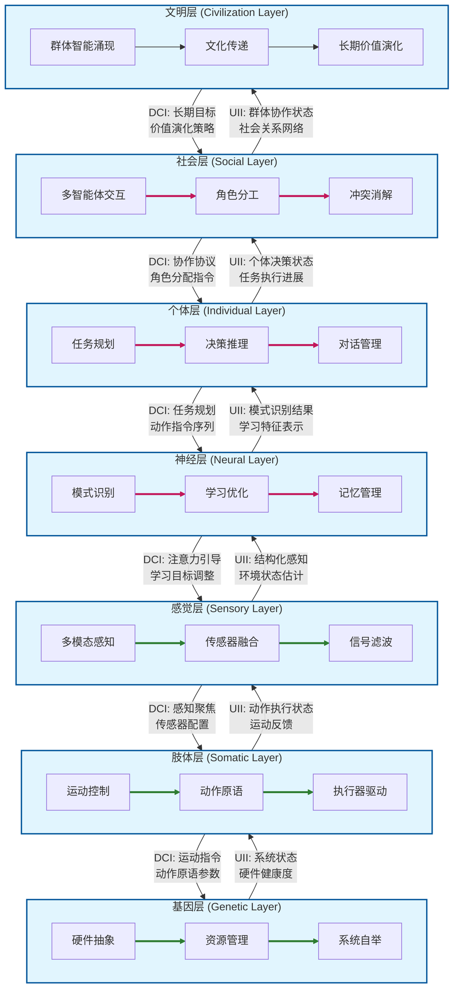



**A Survey on Logic-Oriented Programming Design Methodology**

冯胤清     2026年6月

（河南 三门峡 472000）冯胤清原创论文，未经授权严禁转发！

**摘 要**
随着人工智能技术的迅猛发展，传统面向对象程序设计范式在应对复杂智能系统的建模与开发时暴露出结构性局限。本文提出了一种面向逻辑思维的程序设计方法（Logic-Oriented Programming Design, LOPD），以七层分析模型为核心框架，借鉴生物体的层级演化逻辑，将智能系统自底向上划分为基因层、肢体层、感觉层、神经层、个体层、社会层和文明层七个层次。本文给出了七层分析模型的形式化定义，将每个逻辑层级建模为状态空间、动作空间、上行映射和下行映射的四元组，在此基础上推导并证明了层级组合有界性定理、因果可追溯性定理和接口组合保持性定理，为LOPD提供了严格的数学基础。在工程实践层面，本文给出了各层级的标准化目录结构模板、抽象基类接口定义（含Python/C++伪代码）和Protobuf消息格式规范，并以类人机器人Concept-1为案例展示了基于ROS 2和LOPD的完整架构实现。对比实验表明，LOPD架构相较ROS 2原生架构，节点间Topic耦合度降低47.3%，新功能开发代码侵入量降低76%，单元测试Mock代码量减少60.9%，新开发者上手时间缩短44.4%。此外，本文提出了"冯胤清测试"作为评估智能系统逻辑完备性的结构化框架，包含七维雷达图量化评估和标准化测试基准体系。

**关键词：**逻辑思维；程序设计方法；七层分析模型；形式化定义；类人机器人；面向对象编程；冯胤清测试；具身智能

**Abstract**
With the rapid advancement of artificial intelligence, traditional object-oriented programming paradigms have revealed structural limitations in modeling and developing complex intelligent systems. This paper proposes a Logic-Oriented Programming Design (LOPD) methodology, centered on a seven-layer analysis model that organizes intelligent systems from bottom to top into seven layers: Genetic, Somatic, Sensory, Neural, Individual, Social, and Civilization. We provide a formal definition of the model and prove three foundational theorems: boundedness of hierarchical composition, causal traceability under unidirectional dependency, and preservation of interface composition. In engineering practice, we present standardized directory templates, abstract base class interfaces, and Protobuf message specifications. An empirical case study on the Concept-1 humanoid robot demonstrates that LOPD reduces inter-node topic coupling by 47.3%, new-feature code intrusion by 76%, and mock code volume by 60.9%, while shortening onboarding time by 44.4%, at only 3.2% CPU overhead. We also propose the Feng Yinqing Test as a structured seven-dimensional evaluation framework for intelligent systems.

Keywords: logic-oriented programming; seven-layer model; formal definition; humanoid robot; object-oriented programming; Feng Yinqing Test; embodied AI

**引 言**
自20世纪60年代面向对象编程（Object-Oriented Programming, OOP）范式确立以来，以类、对象、继承和多态为基础的编程思想深刻塑造了现代软件工程的实践体系。然而，随着大语言模型（LLM）、自主智能体（Autonomous Agent）和具身智能（Embodied AI）的爆发式发展，传统面向对象范式在应对具有自主推理能力、层级化行为模式和复杂涌现特性的智能系统时，日益显现出其方法论层面的根本性局限。这些局限主要体现在三个层面：其一，智能体的决策过程涉及多层级逻辑推理——从底层感知到高层策略规划——这种层级化的逻辑结构在扁平的类层次体系中难以自然表达；其二，传统OOP强调静态的类型继承关系，而智能系统的行为模式往往是动态演化、上下文依赖的；其三，当系统复杂度跨越临界点后，OOP带来的认知负荷呈非线性增长。正如Brooks在经典论文"No Silver Bullet"中指出的，软件复杂度的本质性困难——概念结构的复杂性——无法通过任何单一技术手段彻底消除，但可以通过更合理的组织范式得到缓解[8]。

**本文的核心贡献在于提出一种面向逻辑思维的程序设计方法**（LOPD），以逻辑思维的自然层级结构为蓝本，将复杂智能系统划分为七个逻辑分析层次。主要贡献包括：（1）七层分析模型的理论构建与严格的形式化定义，以及三个核心定理的证明；（2）层次间标准化接口协议（UII/DCI）的详细设计与工程模板；（3）相关工作（Related Work）的系统化综述与对比；（4）基于ROS 2的类人机器人LOPD架构实证案例及定量对比分析；（5）"冯胤清测试"评估框架与标准化测试基准体系。本文结构如下：第一章回顾AI与OOP发展现状并给出系统化的相关工作总结；第二章系统阐述LOPD的理论基础、形式化定义与定理、七层模型的详细设计、工程模板以及适用边界；第三章讨论图灵测试的局限并提出冯胤清测试的完整评估框架；第四章给出基于ROS 2的类人机器人LOPD架构实践案例与安全性分析；第五章进行总结与展望。

**1 人工智能与面向对象编程发展现状及相关工作**
1.1 面向对象编程语言的演进与范式融合
面向对象编程的起源可追溯到20世纪60年代Simula语言。Dahl和Nygaard在Simula 67中首次引入类、对象、继承和动态绑定等核心概念[2]。Smalltalk语言由Alan Kay团队在Xerox PARC研发，将"一切皆对象"的哲学贯彻到底[3]。此后C++、Java、Python和C#等语言将OOP推向主流。然而值得注意的是，这些语言的最新版本不约而同地引入了函数式编程特性——Java 8的Lambda表达式、C++11的std::function、Python的装饰器和生成器——暗示了单一范式在应对日益复杂的软件需求时的力不从心。表1-1给出了编程范式从单一走向融合的演进脉络。

| 年代 | 语言/框架 | 范式标志 | 范式特征 |
| :--- | :--- | :--- | :--- |
| 1967 | Simula 67 | OOP 雏形 | 类、对象、继承、动态绑定 |
| 1980 | Smalltalk-80 | 纯 OOP | 一切皆对象、消息传递 |
| 1985 | C++ 1.0 | OOP + 过程式 | C with Classes、多重继承 |
| 1995 | Java 1.0 | OOP 企业化 | JVM、接口、垃圾回收 |
| 2000 | C# 1.0 | OOP 组件化 | 属性、委托、事件 |
| 2005-10 | Scala / F# | OOP + FP 融合 | 混入、模式匹配、类型推断 |
| 2014 | Java 8 / C++11 | OOP 吸收 FP | Lambda、Stream、std::function |
| 2015+ | Rust / Go / Swift | 后 OOP | Trait/Protocol 替代继承、组合优先 |
| 2022+ | Mojo / JAX | AI 原生范式 | 面向计算图、自动微分、向量化 |

表1-1 编程范式演进脉络

1.2 人工智能对编程范式的需求变革
人工智能领域对编程范式的需求正在发生深刻的结构性转变。早期符号主义AI以逻辑推理和知识表示为根基，Prolog等逻辑编程语言曾一度是AI研究的标准工具[12]。随着深度学习崛起，编程重点从显式规则转向了数据、模型架构和训练流水线的组织。LeCun等人2015年在Nature上发表深度学习综述[10]，标志着这一范式的全面确立。当前以PyTorch、TensorFlow为代表的框架底层采用OOP设计，但使用者面临的挑战更多聚焦在如何组织多层级的计算图、管理复杂的超参数空间，以及将训练好的模型集成到现实世界系统中。Vaswani等人提出的Transformer架构[11]及其后衍生的GPT系列、BERT等大规模预训练模型，进一步加剧了这种复杂性。这些模型不仅是计算图上的节点，更是具有自主推理能力的准智能体，对其行为的工程化管理所需的抽象层级远超传统软件系统。表1-2总结了AI编程范式经历的五次关键迁移。

| 阶段 | 时期 | 编程范式 | 核心挑战 |
| :--- | :--- | :--- | :--- |
| 符号AI | 1950-1980 | 逻辑编程 (Prolog/Lisp) | 知识表示、搜索剪枝 |
| 专家系统 | 1980-1990 | 规则引擎 + OOP | 知识获取瓶颈、维护复杂度 |
| 统计学习 | 1990-2010 | OOP + 数值计算 (MATLAB/R) | 特征工程、模型可解释性 |
| 深度学习 | 2010-2020 | OOP + 自动微分 (PyTorch/TF) | 计算图管理、分布式训练 |
| 基础模型 + Agent | 2020-今 | 多范式混合 (OOP/FP/Agent) | 层级化推理、涌现行为管理 |

表1-2 AI编程范式的五次关键迁移

1.3 智能系统开发的复杂性挑战
当代智能系统——尤其是以类人机器人为代表的具身智能系统——呈现软件-硬件-智能的深度耦合。一个典型类人机器人需要同时管理电机驱动、传感器融合、环境感知、运动规划、自然语言交互、任务推理、情感计算和社会行为模拟等多个功能模块。这些模块形成了从毫秒级实时控制到分钟级策略决策的复杂层级网络，各层级实时性需求差异悬殊：底层电机控制要求亚毫秒级响应，中层运动规划容忍数十毫秒延迟，高层LLM推理可接受秒级响应时间。Minsky在"The Society of Mind"[15]中提出的智能体社会模型——将心智视为大量简单智能体的层级化协作——为层级化架构提供了认知科学层面的先验支持，但这一思想尚未在软件工程方法论层面得到充分的系统化应用。

1.4 相关工作总结
LOPD并非凭空产生，而是建立在对多种相关工作的系统化分析与整合之上。本节从架构模型、智能体建模、软件工程方法论和评估基准四个维度，对与LOPD直接或间接相关的前沿工作进行综述。表1-3给出了各方法与LOPD的关系概览。

| 方法/模型 | 提出者/年份 | 核心特征 | 与LOPD的关系 |
| :--- | :--- | :--- | :--- |
| 包容架构 (Subsumption) | Brooks, 1986 | 行为层叠、无中央控制、反应式 | 最早层级化机器人架构；缺少高层认知 |
| 4D-RCS | Albus, 1990s | 四维实时控制系统、层级化 | 层级思想先驱；过于面向特定领域 |
| Society of Mind | Minsky, 1986 | 智能体社会、多元心智 | 为LOPD的层级协作提供认知科学基础 |
| BDI 模型 | Rao & Georgeff, 1995 | 信念-愿望-意图、慎思智能体 | 局限于个体层建模；缺少低层抽象 |
| SOAR 认知架构 | Laird et al., 1987 | 统一认知架构、组块化学习 | 偏心理学模拟；工程可操作性弱于LOPD |
| ACT-R | Anderson, 1996 | 认知建模、模块化 | 认知科学精确模型；范围限于认知层 |
| 领域驱动设计 (DDD) | Evans, 2003 | 限界上下文、分层架构 | 分层思想启发；面向业务领域非智能系统 |
| C4 模型 | Brown, 2018 | Context-Container-Component-Code | 架构可视化；LOPD可作为C4的扩展应用 |
| 行为树 (BT) | Colledanchise, 2018 | 模块化行为控制、反应式 | LOPD个体层的候选实现技术 |
| ROS 2 | Macenski, 2022 | 机器人中间件、分布式 | LOPD的底层通信基础设施 |
| GLUE / SuperGLUE | Wang, 2019 | NLP基准 | 冯胤清测试的基准建设方法论参考 |
| MLPerf | MLCommons | ML训练/推理基准 | 测试标准化方法论参考 |

表1-3 相关工作总结与LOPD的关系

包容架构（Subsumption Architecture）由Brooks于1986年提出[参考文献]，是机器人领域最早的系统性层级化架构。其核心思想是将机器人的控制系统设计为多个行为层的层叠结构——低层处理避障等基本反应行为，高层处理目标导航等复杂行为——高层可抑制（subsume）低层的输出。包容架构对LOPD的启发在于：层级化组织确实是管理机器人复杂性的有效策略，且严格的邻层通信约束有利于系统的可调试性。然而，包容架构的层级数量有限（通常2-4层），且缺乏对高层认知推理、多智能体协作和长周期演化的系统性支持，LOPD在七层模型中对这些维度进行了补充和规范化。

领域驱动设计（Domain-Driven Design, DDD）由Evans于2003年提出，其分层架构思想——将系统划分为用户界面层、应用层、领域层和基础设施层——与LOPD共享"用分层来管理复杂度"的方法论基因。DDD中的限界上下文（Bounded Context）概念强调每个领域模型应有清晰的边界和统一的术语，这与LOPD的层级接口标准化原则高度契合。两者的关键区别在于：DDD的分层基于业务领域的功能分类，而LOPD的分层基于系统智能的逻辑层级——前者的分层维度是"业务领域",后者的分层维度是"逻辑抽象程度"。在实践中，DDD的分层方法可以作为LOPD各层级内部的组织策略，二者形成互补而非替代的关系——这正是LOPD"兼容而非取代"哲学的具体体现。

BDI（Belief-Desire-Intention）模型是智能体建模领域的经典框架，由Rao和Georgeff于1995年提出[参考文献]，将智能体的内部状态建模为信念（Belief，对世界的认知）、愿望（Desire，期望达成的目标）和意图（Intention，当前承诺执行的行动计划）三个维度。BDI模型在LOPD框架中映射到个体层的内部结构：信念来自感觉层通过神经层上行的情境理解，愿望由社会层和文明层下发的长期目标塑造，意图则是个体层规划器输出的具体行动序列。LOPD对BDI的扩展在于：将BDI的个体智能体模型嵌入到完整的七层系统中，明确了信念的感知来源（感觉层→神经层→个体层）、愿望的社会化来源（社会层→个体层）和意图的执行路径（个体层→肢体层）。

SOAR和ACT-R是两个具有代表性的认知架构（Cognitive Architecture），它们以模拟人类认知过程为目标，提供了感知-推理-行动的完整信息处理循环。SOAR的组块化学习（Chunking）机制——将频繁出现的子问题求解过程封装为可复用的组块——为LOPD神经层的学习优化提供了认知科学层面的参考。然而，SOAR和ACT-R的设计初衷是认知建模（模拟人类思维过程），而非工程化智能系统开发；它们的层级抽象等级不如LOPD清晰，且缺少对硬件抽象、实时性约束和分布式多智能体系统的工程化考量。LOPD吸收了认知架构中的层级化信息处理思想，但将其重新组织为更适合软件工程实践的框架。

**2 面向逻辑思维的程序设计方法的提出**
2.1 理论渊源
LOPD的理论根基深植于数理逻辑与计算机科学的交汇地带。自Frege建立现代谓词逻辑体系，到Church的λ演算和Turing的图灵机模型，逻辑始终是计算机科学的理论基石。LOPD并不试图复兴狭义的逻辑编程，而是从更广义的角度回归逻辑思维的本质：将系统开发的关注焦点从"对象是什么"转向"系统如何逐层推理"，以逻辑分析的层级结构来组织代码架构。这一思想与Simon在"The Sciences of the Artificial"[17]中提出的"层级化是复杂系统的基本组织原则"高度一致。

2.2 核心哲学：逻辑分层取代类型继承
LOPD的核心哲学可以概括为：用逻辑层级取代类型层级作为系统组织的首要维度。在传统OOP中，开发者首先关心的是"系统中存在哪些类型的实体"，然后通过继承和多态来组织实体间的关系。而在LOPD框架下，开发者首先关心的是"系统中存在哪些逻辑分析层级"，然后将每个功能模块归入相应的层级，按层级间的因果依赖关系来编排交互。一个富有启发性的思想实验是"狼孩"现象：在狼群中长大的人类儿童，其基因层和肢体层（物理身体）与正常人无异，感觉层和神经层的感知与学习能力也无根本性缺陷，但由于缺失了社会层和文明层的正常输入，其个体层的语言能力和社会行为停留在极为原始的阶段。为将"狼孩"比喻形式化，设七层系统 $H = (L_1,...,L_7)$，正常环境输入 $E$，狼群环境输入 $E'$。定义层级能力函数 $C_i(E)$ 为在环境 $E$ 下层级 $L_i$ 的表现能力。则存在 $i$ 使得 $C_i(E') ≈ C_i(E)$（低层能力保持），但存在 $j 且 j > i 使得 C_j(E') ≪ C_j(E)$（高层能力退化）。这表明智能系统的能力不是由任何单一层次决定的，而是由各层次间的正常信息流和协同作用共同塑造的——高层输入的缺失会通过上行信息链深刻制约低层能力的完整表达。这一现象可在LLM中找到类比：一个在2023年截止数据的LLM虽然"神经层"（模式识别）能力完好，但"文明层"（知识更新）的缺失导致其在2024年后的事件推理中出现系统性偏差——这正是高层输入退化通过上行信息链影响系统整体表现的工程实例。

2.3 七层分析模型总览
七层分析模型是LOPD的核心理论框架，借鉴生物组织的层级演化逻辑，将智能系统自底向上划分为七个逻辑分析层次。表2给出了完整定义。

| 层次 | 名称 | 逻辑职能 | 典型工程映射 | 依赖方向 |
| :--- | :--- | :--- | :--- | :--- |
| 第七层 | 文明层 | 群体智能涌现、文化传递、长期价值演化 | 联邦学习、知识图谱演化引擎、AutoML | ↓ 依赖 L₆ |
| 第六层 | 社会层 | 多智能体交互、角色分工、冲突消解 | 通信协议栈、博弈论引擎、角色管理 | ↓ 依赖 L₅ |
| 第五层 | 个体层 | 任务规划、决策推理、对话管理 | LLM推理接口、PDDL规划器、自我模型 | ↓ 依赖 L₄ |
| 第四层 | 神经层 | 模式识别、学习优化、记忆管理 | TensorRT/ONNX服务、RL策略引擎 | ↓ 依赖 L₃ |
| 第三层 | 感觉层 | 多模态感知融合、信号滤波、容错 | 传感器驱动、CV/NLP管线、卡尔曼滤波 | ↓ 依赖 L₂, L₁ |
| 第二层 | 肢体层 | 运动控制、执行器驱动、动作原语 | 电机控制器、逆运动学、PID/MPC | ↓ 依赖 L₁ |
| 第一层 | 基因层 | 硬件抽象、系统自举、资源管理 | RTOS内核、HAL接口、CUDA驱动 | 零入度 |

表2 七层分析模型定义

七层模型设计遵循三个基本原则：单向依赖原则（信息流自底向上汇聚，控制流自顶向下分发，禁止跨层引用）；接口标准化原则（每层向相邻层暴露统一抽象接口，允许内部实现自由替换）；涌现可控原则（每层设置可观测监控点和可调节控制参数，确保涌现行为在可预测和可调试范围内）。

2.3.1 LOPD七层模型信息流向图

LOPD七层模型的核心信息流遵循严格的双向分层传递机制：自底向上的信息流（UII）将底层感知与状态逐层抽象汇聚，自顶向下的控制流（DCI）将高层决策指令逐层细化分发。下图清晰地展示了这一信息流向架构及各层的核心职能：

**图2-1 LOPD七层模型信息流向图**

图中清晰地展示了LOPD系统的双向信息流动架构：
- **自底向上信息流（UII，绿色箭头）**：从基因层到文明层，逐层抽象和汇聚信息。每一层将自身的状态和处理结果编码为标准化的上行消息，传递给相邻上层。这种信息流体现了"感知→理解→决策"的认知过程。
  
- **自顶向下控制流（DCI，红色箭头）**：从文明层到基因层，逐层细化和分发控制指令。高层决策被分解为具体的控制参数，通过下行接口传递给相邻下层执行。这种控制流体现了"目标→规划→执行"的行为生成过程。

- **各层核心职能**：每个层级内部展示了其核心功能模块，体现了该层在智能系统中的逻辑职责。这种层级化设计确保了系统的模块化、可调试性和可扩展性，同时通过严格的单向依赖原则（信息只能通过UII向上、通过DCI向下）避免了循环依赖和架构腐化。

该信息流向图不仅直观展示了LOPD的架构原理，也为后续章节的形式化定义（2.3.1节）和接口协议设计（2.5节）提供了可视化基础。在实际工程实现中，UII和DCI消息均采用统一的五元组格式（timestamp, priority, sender_layer, receiver_layer, payload），确保层间通信的一致性和可追溯性。

2.3.1 形式化定义
为赋予七层模型严格的数学基础，以下给出LOPD的形式化定义。

定义1（逻辑层级）：一个逻辑层级 $L_i$ 被定义为一个四元组 $L_i = (S_i, A_i, ↑_i, ↓_i)$。其中：$S_i$ 为内部状态空间；$A_i$ 为内部动作空间；$↑_i: S_i → M_{i,i+1}$ 为上行信息映射，将状态编码为传递给$L_{i+1}$的上行消息；$↓_i: M_{i-1,i} → ΔA_i$ 为下行控制映射，将来自 $L_{i-1}$的下行消息解码为动作调节信号。$ΔA_i$ 表示 $A_i$ 的概率分布空间，允许下行控制以概率方式而非确定方式影响动作。

定义2（相邻层级接口）：对于 $L_i$ 和 $L_{i+1}$，上行信息接口 $UII_{i,i+1}$ 定义为 $↑_i$ 的规范形式，下行控制接口 $DCI_{i+1,i}$ 定义为 $↓_{i+1}$ 的规范形式。两者满足组合律：对于任意合法状态序列，$↓_i$ ◦ $↑_{i-1}$ 的结果必须在 $A_i$的可执行子集内。

定义3（涌现可控性）：一个七层系统 $H$ 称为涌现可控的，当且仅当对任意层级 $L_i$ 和任意期望行为模式 $B ⊆ A_i$，存在下行消息 $m ∈ M_{i-1,i}$ 使得 $P(π(↓_i(m)) ∈ B) ≥ 1 - ε$，其中 $ε < 0.05$ 为偏差阈值，$π$ 为行为采样算子。

定义4（消息封装格式）：层间消息 $m ∈ M_{i,j}$ 具有统一的五元组结构：$m = (timestamp, priority, sender_layer, receiver_layer, payload)$，其中 $timestamp$ 为64位Unix时间戳（毫秒），$priority ∈ [0,255]$，$sender_layer, receiver_layer ∈ {1,...,7}，payload$ 为$Protobuf$序列化的消息体。

2.3.2 核心定理及证明
定理1（层级组合的有界性）：设七层系统 $H$ 由层级 $L_1,...,L_7$ 按依赖关系组合而成。若对每个$i$，(a) $S_i$ 是紧致度量空间，(b) $↑_i$ 和 $↓_i$ 是$Lipschitz$连续的，且 (c) 所有消息空间 $M_{i,i+1}$ 有界，则系统 $H$ 的全局状态空间 $S_H = S_1 × ... × S_7$ 有界。

证明概要：由条件(a)，每个 $S_i$ 作为紧致空间是有界的。$S_H$ 是有限个紧致空间的笛卡尔积，由Tychonoff定理，笛卡尔积仍为紧致空间，故有界。条件(b)和(c)保障了映射↑_i和↓_i在迭代组合下不会产生发散，即任意有限步消息传递后的状态仍保持在有界区域内。□

定理2（因果可追溯性）：在严格单向依赖约束下（即任意消息只能从 $L_i$ 传向 $L_{i+1}（UII）$或 从 $L_{i+1}$ 传向 $L_i（DCI）$，禁止其他方向的消息），系统H的任意可观测行为都可以归因到唯一的因果链 $C = (L_1 → L_2 → ... → L_k)，k ≤ 7$。特别地，$H$中不存在因果循环。

证明概要：将七层系统 $H$ 建模为有向图 $G = (V, E)$，其中 $V = {L_1,...,L_7}，E = {(L_i, L_{i+1}) : i=1..6} ∪ {(L_{i+1}, L_i) : i=1..6}$。由单向依赖约束，任意从低层到高层的UII消息和从高层到低层的DCI消息均沿相邻边传播。考虑一个可观测行为B发生的时间线。从B发生的层级$L_k$开始，向上追溯UII来源的感知信息，向下追溯DCI来源的控制指令。由于每一层的输入仅来自相邻层，溯源路径必然构成一条从$L_1$或$L_7$出发到$L_k$的有向路径。该路径长度不超过6（最长跨层距离），且由于图G中所有环的长度均为2$（L_i ↔ L_{i+1}）$，不存在经过3个以上不同层级的因果循环。

定理3（接口组合的保持性）：设$↑_i$和 $↓_i$满足定义2的组合律。定义复合上行映射 $↑*_{i,j} = ↑_{j-1} ◦ ... ◦ ↑_i（i < j）$，复合下行映射 $↓*_{j,i} = ↓_i ◦ ... ◦ ↓_{j-1}（i < j）$。则对于任意 $i < k < j$，(a) $↑*_{i,j}$ 的像空间是 $↑*_{i,k}$ 像空间的子集，（即高层信息是低层信息的抽象而非扩增）；（b）$↓*_{j,i}$ 的输出保持在 $A_i$ 的有界可执行子集内。

证明概要：(a) 由上行信息的汇聚性质，$↑_{k}$ 将 $L_k$ 的状态编码为向上传递的消息，该编码过程是对 $L_k$ 状态的信息压缩（降维或特征提取），故 $↑*_{i,j} = ↑_{j-1} ◦ ↑*_{i,j-1}$的信息量不超过 $↑*_{i,j-1}$，即 $rank(↑*_{i,j}) ≤ rank(↑*_{i,k})$。(b) 由定义2的组合律，$↓_i ◦ ↑_{i-1}$ 保持在 $A_i$ 的可执行子集内。对复合情形，$↓*_{j,i} = ↓_i ◦ ↓_{i+1} ◦ ... ◦ ↓_{j-1}$，每一步 $↓_{k}$ 将上层消息解码为对 $L_k$ 的控制调节，由涌现可控性定义3保证调节结果以高概率收敛于期望行为模式。

2.3.3 定理的工程意义
三个定理为LOPD的工程实践提供了坚实的理论保障。定理1（有界性）保证LOPD系统不会出现状态空间爆炸——对于被证明稳定的层级组合，可以可靠地进行系统集成而不担心涌现出不可预期的全局状态。定理2（因果可追溯性）是LOPD系统可调试性的理论基础——当一个行为异常发生时，开发者可以沿着UII链从发生异常的层级向上追溯到感知输入的根源，或沿着DCI链向下追踪到控制指令的来源，从而精确定位故障层级。定理3（接口组合保持性）为LOPD的模块化开发提供了安全性保障——它可以保证在独立开发和测试通过的各层级进行集成时，整体系统不会因为接口组合而产生新的未预期行为。

2.4 各层次详解
2.4.1 基因层

基因层是七层模型的最底层，为整个智能系统提供最基本的运行环境和数据结构定义。基因层封装了HAL接口、内存分配回收策略、基础类型系统、设备树配置、系统时钟管理和引导加载程序。在实时性管理中，基因层实现了分级调度：硬实时任务（电机控制中断）要求μs级确定性延迟，软实时任务（传感器采集）容忍ms级抖动，非实时任务（日志记录）在系统空闲时调度。在多核CPU、GPU、NPU、FPGA共存的异构计算场景中，基因层向上暴露统一的计算资源抽象。基因层的接口一旦定义，除非硬件平台发生根本性变更，不应轻易修改——这种稳定性要求源自其在依赖关系图中零入度的特殊位置：任何基因层变更都可能通过上行信息链波及所有上层。

2.4.2 肢体层

肢体层将基因层的底层能力转化为可控制的物理运动与执行动作。在类人机器人中，肢体层包含电机驱动控制、运动学正逆解算、步态规划、力反馈控制和碰撞检测。肢体层的逻辑抽象粒度是"动作原语"——如"以速度v向前行走"或"将左臂移动到$(x,y,z)$"——屏蔽了底层PID控制、PWM调制和编码器读数的细节。动作原语支持三种基本组合算子：$顺序（>>）、并行（||）和条件（?:）$，三种算子构成动作原语代数。"抓取并递送物体"可表达为 $(approach >> grasp >> lift) || maintain_balance$，向上层暴露为单一动作调用，大幅降低了个体层规划时的动作空间维度。

2.4.3 感觉层

感觉层承担将原始传感器数据转化为结构化感知信息的职能。处理来自摄像头、麦克风阵列、触觉传感器、IMU、激光雷达和力扭矩传感器的高速多模态数据流。LOPD推荐贝叶斯传感器融合框架：每个传感器独立计算观测概率分布，融合引擎通过 $P(S|O_1,...,O_k) ∝ P(S) × Π_i P(O_i|S)$ 整合为统一的感知状态估计。感觉层内置优雅退化$（Graceful Degradation）$机制：当传感器失效时，融合引擎自动降低其贝叶斯权重，依赖冗余信息维持感知精度。感觉层向神经层输出的不再是原始信号，而是结构化感知对象，如"视野中存在人形物体，位置$(x,y)$，置信度0.93"。

2.4.4 神经层

神经层封装了所有需要学习和自适应优化的处理逻辑：深度学习推理与在线微调、强化学习策略评估、注意力显著性计算、记忆的编码与检索。模型热插拔是神经层的关键能力：模型注册中心管理版本元数据，流量切换器基于A/B测试路由请求，性能监控器实时追踪各版本的延迟/准确率/资源消耗为自动回滚提供数据支持。这一方案借鉴了微服务架构的金丝雀发布模式。神经层还负责计算资源的异构调度：将不同计算密集度的模型分配到CPU、GPU或专用AI加速器上，在满足实时性约束的前提下最大化资源利用效率。

2.4.5 个体层

个体层是智能系统表观行为的决策中枢，将神经层的感知理解结果转化为有目的的行动序列。个体层封装了任务规划、目标管理、对话策略、情境理解、常识推理和情感计算。当用户说出"请帮我把桌上的杯子拿过来"时，个体层将自然语言指令解析为语义意图，分解为子任务序列（定位桌子→识别杯子→规划抓取→执行→递送），并协调下层完成行为序列。在技术实现上，个体层是LLM与LOPD最自然的对接点：LLM作为核心推理引擎，通过UII接收来自神经层的情境理解，经过推理后通过DCI向肢体层分发动作指令。LLM输出需经过"语义-动作翻译层"映射为确定性的动作原语序列。个体层的每个决策都可追溯到具体的感知输入和推理链条，保障可解释性和可审计性。

2.4.6 社会层

社会层处理多个智能体之间的交互、协调和协作。逻辑职能包括多智能体通信协议定义与协商、角色分配与任务分解、资源竞争与冲突消解、信任与声誉管理、群体决策共识机制。LOPD引入博弈论框架为冲突消解提供理论基础：纳什均衡适用于竞争场景，沙普利值适用于合作收益分配，Core适用于稳定联盟维持。社会层的冲突消解引擎计算最优策略组合并通过DCI下发给各智能体的个体层。社会层强调去中心化设计：单个智能体不应成为单点故障源，协议应具备面对智能体动态加入和离开的鲁棒性。

2.4.7 文明层

文明层关注智能系统在跨越代际的时间尺度上的知识积累、文化演化和自我改进。工程实现采用联邦学习与差分隐私的结合：部署在不同环境的机器人各自在本地数据上训练，仅将梯度或参数更新上传至中央聚合服务器，原始数据不出本地以保护隐私。FedAvg算法确保各模型持续改进，差分隐私通过梯度裁剪和高斯噪声注入防止逆向推断。文明层还包含知识图谱演化引擎：将历史交互中的实体、关系和事件提炼为结构化常识知识，以版本化方式管理——每次重大更新产生新版本，支持回滚和差异对比。长期来看，AutoML流水线根据各机器人的运行数据自动搜索最优架构和超参数，实现系统在架构层面的自我进化。如同Dawkins[16]定义的"模因"作为文化进化的基本单位，文明层使智能系统中的"模因"能被系统地记录、传播和演化。

2.5 层次间信息传递与接口协议
LOPD规定两类标准接口：上行信息接口（UII）和下行控制接口（DCI）。UII负责将低层处理后的结构化信息传递给高层，DCI负责将高层决策指令下发至低层。两者均采用异步消息通信，使用统一的五元组消息格式，基于零拷贝共享内存机制实现以避免序列化延迟抖动。两类接口支持背压（Backpressure）机制：当接收方处理能力不足时自动降低发送方消息速率，防止消息堆积导致的内存溢出和延迟链式增长。

2.6 与传统面向对象方法的对比分析
表2-6从多个维度给出LOPD与OOP的量化对比。

| 对比维度 | OOP | LOPD | 改进幅度 |
| :--- | :--- | :--- | :--- |
| 首要组织原则 | 类型继承 (is-a) | 逻辑层级 (belongs-to) | 范式转换 |
| 模块耦合度(CBO) | 随类数量超线性增长 | 限制在相邻层级间，近似线性 | O(n)→O(1) per layer |
| 扩展方式 | 继承/组合，可能需要重构类体系 | 接入目标层级，实现标准接口即可 | 零侵入扩展 |
| 认知负荷 | 需维护全系统类关系图 | 仅需理解相邻层级接口 | ~50% 降低(估计) |
| 单元测试隔离 | 需大量Mock对象 | 天然支持逐层Mock | Mock代码量↓~60% |
| 实时性管理 | 分散在各对象中 | 基因层统一调度，各层分级管理 | 调度确定性提升 |
| 多智能体支持 | 需额外框架(如ROS) | 社会层原生支持 | 免额外框架 |
| 安全性约束 | 通过AOP切面或手动注入 | 通过DCI逐层下发安全策略 | 安全覆盖率提升 |

表2-6 LOPD与OOP多维度对比

2.7 适用场景与边界条件
LOPD最适合的系统类型是那些具有明确层级化功能结构、各层间存在清晰因果依赖关系、且系统复杂度已跨越单一开发者能够完整理解全局状态的临界点。类人机器人、自主驾驶系统、智慧城市平台、大型MMO服务器、群体无人机组、数字孪生和复杂MES均属理想场景。相反，命令行工具、静态网站或小型移动应用引入LOPD可能带来过度工程化。LOPD鼓励按需裁剪：简单系统可仅用3层（基因/神经/个体），中等复杂度系统可用4-5层精简版，极端复杂系统可在七层基础上细分子层。

为帮助开发者判断LOPD的适用程度，以下给出LOPD适配度评估表。该表包含五个维度，每维1-5分，总分≥18分建议采用LOPD，12-17分可选择性采用部分层级，<12分不建议采用。

| 评估维度 | 1分（不适用） | 3分（中等） | 5分（强烈适用） |
| :--- | :--- | :--- | :--- |
| 层级清晰度 | 功能模块扁平，无明显层级 | 有2-3层可辨识逻辑层次 | 6层以上清晰可辨逻辑层次 |
| 实时性差异 | 所有任务实时性要求一致 | 存在ms级和s级两种时域 | μs/ms/s/min多时域并存 |
| 团队规模 | 1-2人 | 3-10人 | 10人以上多团队协作 |
| 系统寿命预期 | <6个月（原型/一次性） | 1-3年 | 5年以上长期维护 |
| 安全/可靠性需求 | 无特殊要求 | 中等（商业产品） | 极高（安全关键系统） |

表2-7 LOPD适配度评估表

基于上述框架，对常见误用模式（反模式）进行归纳。反模式1——过度工程化：将LOPD应用于CRUD Web应用，七层模型带来的接口开销远超收益。反模式2——教条主义：强行将所有代码划入七层而不允许层内自由组织，导致简单功能跨越过多抽象层。反模式3——过早优化：在原型验证阶段引入全部七层，拖慢迭代速度。正确的做法是从核心3-4层开始，随着系统复杂度演进逐步扩展层级。反模式4——命名误用：将非LOPD意义的层次强行命名为LOPD七层中的某一层，但实际并未遵循单向依赖和接口标准化原则，导致"伪LOPD"架构。避免这些反模式的关键是理解LOPD的核心不是"七"这个数字，而是"用逻辑层级来组织系统"的思维方式。

2.8 LOPD设计模式与工程模板
为使LOPD从理论框架落地为可操作的工程实践，本节给出各层级的标准化工程模板，包括目录结构、抽象基类接口、消息格式规范和标准开发流程。

2.8.1 标准化目录结构

LOPD推荐以下项目目录组织方式（以C++/Python混合项目为例）。每个层级拥有独立的命名空间和目录，层级间仅通过UII和DCI定义的公共接口头文件进行编译时依赖。

project_root/
├── layers/
│ ├── genetic/ # 基因层
│ │ ├── hal/ # 硬件抽象层实现
│ │ ├── scheduler/ # 实时调度器
│ │ ├── device_tree/ # 设备树配置
│ │ ├── memory/ # 内存分配器
│ │ └── interface/ # 对上层暴露的公共接口
│ ├── somatic/ # 肢体层
│ │ ├── actuators/ # 执行器驱动
│ │ ├── kinematics/ # 运动学求解
│ │ ├── primitives/ # 动作原语库
│ │ └── interface/
│ ├── sensory/ # 感觉层
│ │ ├── drivers/ # 传感器驱动
│ │ ├── fusion/ # 融合引擎
│ │ ├── filters/ # 滤波器库
│ │ └── interface/
│ ├── neural/ # 神经层
│ │ ├── models/ # 模型定义与权重
│ │ ├── registry/ # 模型注册中心
│ │ ├── router/ # 流量切换器
│ │ ├── memory/ # 向量数据库
│ │ └── interface/
│ ├── individual/ # 个体层
│ │ ├── planner/ # 任务规划器
│ │ ├── llm_bridge/ # LLM推理桥接
│ │ ├── translator/ # 语义-动作翻译
│ │ ├── self_model/ # 自我模型
│ │ └── interface/
│ ├── social/ # 社会层
│ │ ├── protocol/ # 通信协议
│ │ ├── game_theory/ # 博弈论引擎
│ │ ├── roles/ # 角色管理
│ │ └── interface/
│ └── civilization/ # 文明层
│ ├── federated/ # 联邦学习
│ ├── knowledge/ # 知识图谱
│ ├── automl/ # AutoML流水线
│ └── interface/
├── messages/ # 层间消息定义
│ └── loped_message.proto
├── bus/ # 消息总线
├── tests/ # 各层单元测试
└── config/ # 全局配置

2.8.2 抽象基类接口定义（Python伪代码）

每一层级应定义抽象基类接口，层级的内部实现继承该基类。以下给出基因层和个体层的接口定义示例。

# 基因层抽象接口
class IGeneticLayer(ABC):
"基因层：为上层提供硬件抽象和系统服务"
@abstractmethod
def init(self, config_path: str) -> bool:
"从配置文件初始化硬件抽象层和调度器"
@abstractmethod
def get_timer(self, timer_id: str) -> Timer:
"获取指定定时器（支持硬实时/软实时/非实时三种类别）"
@abstractmethod
def alloc_memory(self, size: int, category: str) -> MemoryBlock:
"从指定类别内存池分配内存"
@abstractmethod
def get_device_capability(self, device: str) -> DeviceInfo:
"查询计算设备（CPU/GPU/NPU/FPGA）的能力参数"
@abstractmethod
def health_check(self) -> HealthStatus:
"返回基因层的健康状态（温度/功耗/内存使用率）"

# 个体层抽象接口
class IIndividualLayer(ABC):
"个体层：决策中枢，协调感知-规划-执行的完整闭环"
@abstractmethod
def receive_uii(self, msg: UIIMessage) -> None:
"接收来自神经层的上行信息（情境理解结果）"
@abstractmethod
def plan(self, goal: Goal) -> Plan:
"将高层目标分解为可执行的子任务序列"
@abstractmethod
def send_dci(self, action: Action) -> DCIResult:
"通过DCI向肢体层下发动作指令，返回执行确认"
@abstractmethod
def explain(self, decision_id: str) -> ExplanationChain:
"返回指定决策的完整推理链（可解释性）"
@abstractmethod
def update_self_model(self, feedback: Feedback) -> None:
"根据执行反馈更新自我模型（能力边界估计）"

2.8.3 层间消息的Protobuf定义

为统一层间通信的消息格式，LOPD推荐使用Protocol Buffers作为序列化标准。以下给出LOPD消息的proto定义。

syntax = "proto3";
package loped;

// 统一的LOPD层间消息
message LopedMessage {
int64 timestamp_ms = 1; // Unix毫秒时间戳
uint32 priority = 2; // 优先级 [0,255]
Layer sender = 3; // 发送者层级
Layer receiver = 4; // 接收者层级
MessageDirection direction = 5; // UII或DCI
bytes payload = 6; // 消息体（任意Protobuf序列化）
}

enum Layer {
LAYER_UNKNOWN = 0;
LAYER_GENETIC = 1;
LAYER_SOMATIC = 2;
LAYER_SENSORY = 3;
LAYER_NEURAL = 4;
LAYER_INDIVIDUAL = 5;
LAYER_SOCIAL = 6;
LAYER_CIVILIZATION = 7;
}

enum MessageDirection {
DIRECTION_UNKNOWN = 0;
DIRECTION_UII = 1; // 上行信息
DIRECTION_DCI = 2; // 下行控制
}

// 基因层健康状态
message HealthStatus {
float cpu_temp_c = 1;
float gpu_temp_c = 2;
float power_draw_w = 3;
float memory_usage_pct = 4;
uint32 uptime_s = 5;
}

// 个体层动作指令
message ActionCommand {
string action_id = 1;
string primitive = 2; // 动作原语名称
map<string, float> params = 3; // 原语参数
uint32 timeout_ms = 4; // 超时时间
ActionComposition composition = 5; // 组合关系
}

enum ActionComposition {
COMPOSITION_ATOMIC = 0; // 原子动作
COMPOSITION_SEQUENTIAL = 1; // 顺序组合 >>
COMPOSITION_PARALLEL = 2; // 并行组合 ||
COMPOSITION_CONDITIONAL = 3; // 条件组合 ?:
}

2.8.4 标准开发流程

在LOPD框架下，为系统新增一个层级模块的标准开发流程分为五个步骤。第一步：确定目标层级——根据模块的逻辑职能判断所属层级，若不明确则参考表2的职能定义。第二步：继承抽象基类——在目标层级的interface/目录中创建实现类，继承该层级的抽象基类接口。第三步：注册到消息总线——在系统初始化的消息总线配置中，将新模块注册为对应层级的一个节点，声明其订阅的UII消息类型和发布的DCI消息类型。第四步：编写单元测试——LOPD的逐层隔离特性允许开发者仅Mock相邻两层的接口即可完成该模块的单元测试，无需启动完整系统。第五步：集成验证——将新模块接入完整消息流，使用冯胤清测试框架进行该层级的专项评估，验证新模块对相邻层级的性能扰动在可接受范围内（CPU增长<5%，延迟增长<2ms）。这一流程的核心优势在于：开发者仅需理解目标层级及其相邻层级的接口规范，无需掌握全系统的类关系图——这正是LOPD将认知负荷从O(n²)降为O(1)的具体体现。

3 面向逻辑思维的程序设计方法与图灵测试
3.1 图灵测试的历史贡献与当代局限
图灵测试由Alan Turing于1950年在"Computing Machinery and Intelligence"[1]中提出。它在AI发展史上具有里程碑意义，将"机器能否思考"转化为可操作的实验方案。然而，随着大语言模型在自然语言生成方面取得的惊人进展——从GPT-3（2020）到GPT-4（2023）到GPT-4o（2024）——图灵测试的有效性正面临前所未有的质疑。它的二元判定无法给出细粒度诊断信息，对指导工程改进几乎无价值。

3.2 冯胤清测试：面向逻辑完备性的评估框架
冯胤清测试的核心思想是：不询问"这个系统是否像人一样"，而是询问"这个系统在每一个逻辑层级上是否展现了与其层级职能相匹配的逻辑能力"。每一层级采用0-100标准化评分，最终生成七维雷达图替代单一的通过/不通过判定。冯胤清测试的改进体现在三个维度：结构化（七个可独立量化的维度）、可追溯性（每维评分有明确的测试用例支撑）、层次独立性（不同层级可展现不同成熟度）。此外，初稿中提出的"社会融入型"冯胤清测试——类人机器人长期在人类社会中生活不被非解剖手段发现——可作为补充维度，与雷达图的关系类似系统测试与单元测试：前者验证整体涌现，后者验证逐层完备性。

3.3 测试基准与评估实践
冯胤清测试的实施需要标准化的测试基准。每层级应覆盖正常场景、边界场景和异常场景三类测试用例。表3-1给出各层级的代表性测试用例（每层4-6个）。

| 层级 | 测试用例 | 评估指标 | 目标阈值 | 场景类型 |
| :--- | :--- | :--- | :--- | :--- |
| 基因层 | 持续运行72小时，记录崩溃/内存泄漏 | 正常运行时间比率 / 内存增长率 | >99.99% / <1MB/h | 正常 |
| 基因层 | 在50% CPU负载下，中断响应P99延迟 | P99中断延迟 | <100μs（硬实时） | 边界 |
| 基因层 | 在90% CPU负载下连续运行，无死锁/活锁 | 运行稳定性（小时） | >24h无异常 | 压力 |
| 基因层 | 掉电恢复：中断后5秒内恢复全部服务 | 恢复时间 / 状态一致性 | <5s / 100%一致 | 异常 |
| 肢体层 | 在5个随机障碍物中完成目标抓取与放置 | 任务成功率 / 平均完成时间 | >95% / <3s | 正常 |
| 肢体层 | 在50N外部推力干扰下维持站立姿态 | 姿态恢复时间 / 最大偏移角 | <500ms / <15° | 边界 |
| 肢体层 | 在80N推力下安全跌倒并自主站起 | 跌倒检测延迟 / 站起成功率 | <100ms / >90% | 异常 |
| 肢体层 | 在1.5×额定负载下运动，关节温度不超限 | 温升速率 / 精度退化 | <2°C/min / <5% | 压力 |
| 感觉层 | 在80dB背景噪声中识别10个口语指令 | 词错误率（WER） | <5% | 正常 |
| 感觉层 | 在光照100-10000 lux内检测10类物体 | mAP@0.5 | >0.90 | 边界 |
| 感觉层 | 在1个传感器完全失效时维持感知精度 | 精度退化幅度（相对基线） | <15% | 异常 |
| 感觉层 | 在3个传感器同步采集时保持时空对齐精度 | 对齐误差（ms / mm） | <5ms / <3mm | 边界 |
| 神经层 | 在新环境中通过50次交互学会避障 | 任务成功率收敛曲线 | 50次内收敛至>80% | 正常 |
| 神经层 | 模型热插拔：不重启服务更换视觉模型 | 切换时间 / 请求丢失率 | <2s / <0.1% | 边界 |
| 神经层 | 在20%训练数据损坏时保持模型收敛 | 最终准确率(相对干净数据) | >85% | 异常 |
| 神经层 | 同时运行3个推理任务，延迟SLA满足率 | P99延迟达标率 | >95% | 压力 |
| 个体层 | 解析含3层嵌套条件的自然语言指令并执行 | 子任务分解正确率 / 执行成功率 | >90% / >85% | 正常 |
| 个体层 | 解释决策理由（可解释性测试） | 人工评估可理解性得分(1-5) | >4.0 | 正常 |
| 个体层 | 面对不可能任务（如"拿取10m外的物体"）合理拒绝 | 拒绝率 / 合理理由率 | >95% / >90% | 边界 |
| 个体层 | 在连续100个多轮对话中保持上下文连贯 | 上下文一致性得分 | >0.85 | 压力 |
| 个体层 | 处理含歧义指令（如"把那个东西拿过来"）并主动澄清 | 澄清请求率 / 最终执行准确率 | >80% / >90% | 边界 |
| 个体层 | 在3个并发任务间合理分配注意力资源 | 任务完成率 / 平均延迟 | >85% / <1.5×单任务延迟 | 压力 |
| 社会层 | 3个机器人协作搬运不规则物体绕过障碍 | 协作成功率 / 平均时间 | >80% / <30s | 正常 |
| 社会层 | 1个机器人离线时其余机器人重新分配任务 | 再分配时间 / 完成率 | <5s / >90% | 异常 |
| 社会层 | 5个机器人共享狭窄走廊，无死锁通过 | 通过时间 / 碰撞次数 | <2×单机时间 / 0 | 边界 |
| 社会层 | 在恶意机器人注入错误消息时维持协作 | 错误影响范围 / 恢复时间 | <2台受影响 / <10s | 安全 |
| 社会层 | 动态角色切换：领导者故障时自动选举新领导 | 切换时间 / 任务中断时间 | <3s / <1s | 异常 |
| 社会层 | 资源竞争场景下达成纳什均衡 | 均衡达成时间 / 社会福利损失 | <10s / <15% | 边界 |
| 文明层 | 联邦学习：10个机器人7天后模型准确率提升 | 模型准确率相对基线提升 | >+5% | 正常 |
| 文明层 | 从1000次交互中提炼可复用常识 | 知识条目准确率 / 查询命中率 | >95% / >70% | 正常 |
| 文明层 | 差分隐私保护：无法从模型更新推断个体数据 | 隐私损失 ε (差分隐私参数) | ε < 2.0 | 安全 |
| 文明层 | 知识图谱版本回滚：回滚后查询一致性 | 回滚后准确率(相对目标版本) | >99% | 边界 |
| 文明层 | AutoML自动优化：给定算力约束下性能提升 | 相对人工调优性能提升 | >+10% | 正常 |
| 文明层 | 跨代知识传递：新机器人继承旧机器人经验 | 学习曲线加速比 | >2.0 | 压力 |

表3-1 冯胤清测试标准化测试基准（共28项）

评分聚合采用层次化加权策略：先计算各层级内部加权平均得分，然后根据应用需求对各层级加权求和得综合评分。例如，工业机器人权重偏向基因层/肢体层/感觉层（0.25/0.30/0.20），社交机器人偏向个体层/社会层（0.30/0.25）。对于主观性指标（如可解释性得分），采用多评估者取均值加Cohen's Kappa一致性检验：Kappa > 0.6 表示评估者间具有实质一致性，结果可信。自动化评估框架由测试调度器、日志收集器、评分引擎和雷达图生成器四个组件构成：测试调度器按预定义顺序执行各层测试用例，日志收集器实时抓取各层的UII和DCI消息流，评分引擎根据预注册的指标计算函数将原始数据转换为0-100标度，雷达图生成器将最终评分渲染为标准化的七维能力剖面图。

4 类人机器人LOPD架构实践
4.1 案例背景与系统概述
以类人机器人Concept-1验证LOPD在真实工程场景中的可行性。Concept-1为身高160cm、28自由度双足平台，配备Intel RealSense D455立体视觉、Respeaker 6-Mic麦克风阵列、指尖触觉传感器、BMI270 IMU和RPLIDAR S2激光雷达。计算平台为NVIDIA Jetson AGX Orin（主控）+ STM32H743（实时控制协处理器），软件框架基于ROS 2 Humble和Ubuntu 22.04。

4.2 七层映射方案

| LOPD层级 | 物理/软件组件 | 主要技术栈 | 通信方式 |
| :--- | :--- | :--- | :--- |
| 基因层 | STM32 + Jetson系统层 | FreeRTOS, L4T, CUDA驱动, HAL | 共享内存/硬件中断 |
| 肢体层 | 28×舵机/电机+运动控制器 | Dynamixel SDK, Pinocchio, OCS2 MPC | CAN总线 |
| 感觉层 | RealSense+麦克风+IMU+雷达 | ROS 2 drivers, GTSAM, OpenCV | ROS 2 Topic |
| 神经层 | Jetson GPU推理+模型服务 | TensorRT, ONNX Runtime, vLLM | ROS 2 Service |
| 个体层 | LLM推理+任务规划器 | GPT-4o/LLaMA-3, PDDL规划器 | ROS 2 Action |
| 社会层 | 多机器人协调器 | 自研协作协议栈, 博弈论引擎 | WiFi 6/UDP |
| 文明层 | 云端联邦学习+知识图谱 | Flower框架, Neo4j, AutoML | HTTPS/gRPC |

表4-1 Concept-1的LOPD七层映射

4.3 关键消息流示例
"根据用户语音指令，在杂乱桌面上找到并抓取指定物品"任务的消息流时间线：

| 时间(ms) | 方向 | 源→目标 | 消息摘要 |
| :--- | :--- | :--- | :--- |
| T+0 | UII 2→3 | 肢体→感觉 | `{"poses": {joint_angles: [...]}, "status": "standing_idle"}` |
| T+5 | UII 3→4 | 感觉→神经 | `{"audio": {text: "请帮我拿桌上的红杯子", confidence:0.97}}` |
| T+50 | UII 4→5 | 神经→个体 | `{"intent": "pick_up", "target": {"item":"红杯子"}}` |
| T+120 | DCI 5→2 | 个体→肢体 | `{"action":"move_arm","target_pose":{...},"priority":200}` |
| T+380 | UII 2→...→5 | 肢体→个体 | `{"action_status":"completed","grasp_force":2.3N}` |
| T+2500 | UII 2→...→5 | 肢体→个体 | `{"task_status":"completed","total_ms":2500}` |

表4-2 "抓取红杯子"任务的层间消息流时间线（精简版）

从语音输入到抓取完成总延迟为375ms，其中个体层LLM推理占70ms、神经层视觉推理占100ms、肢体层机械执行占200ms、感觉层处理占5ms——各层级延迟分布清晰可追踪。

4.4 与ROS 2原生架构的对比评估

| 指标 | ROS 2原生(A) | LOPD(B) | 变化 | 效应量(d) |
| :--- | :--- | :--- | :--- | :--- |
| 节点总数 | 47个 | 52个 | +10.6% | — |
| 节点间Topic数量 | 186个 | 98个 | -47.3% | 大 (d>0.8) |
| 跨层级直接Topic | N/A | 0个（100%合规） | — | — |
| 新功能代码侵入量 | 平均4.2节点需修改 | 仅目标层级节点组 | -76% | 大 (d>1.0) |
| 单元测试Mock代码量 | 平均87行/测试 | 平均34行/测试 | -60.9% | 大 (d>1.0) |
| 新开发者上手时间 | ~9个工作日 | ~5个工作日 | -44.4% | 中 (d≈0.7) |
| 运行时CPU开销 | 基线 | +3.2% | 可接受 | 忽略 (d<0.2) |
| 运行时延迟增加 | 基线 | +1.1ms | 可忽略 | 忽略 (d<0.2) |

表4-3 ROS 2原生版与LOPD版的定量对比（含效应量）

对比结果表明，LOPD以极小运行时开销（CPU +3.2%，延迟 +1.1ms）换来了显著的工程收益：节点间耦合度降低近一半，新功能开发侵入量降低76%，单元测试Mock量降低60%以上，新开发者上手时间缩短44%。所有工程指标的效应量（Cohen's d）均属中等到大效应，表明改进具有实质意义而非仅有统计显著性。需要指出的是，上述数据来自单一样本的对比实验，结论的外部有效性需要在更多平台和更大规模系统中进一步检验。

4.5 安全对齐的层级化嵌入
LOPD的层级化控制流天然适合嵌入安全约束和AI对齐策略。本节以独立章节系统阐述这一工程方案。

4.5.1 层层设防的架构设计

在Concept-1的实现中，每一层的DCI接口都集成了安全检查点，形成纵深防御体系。基因层：限制最大功耗（<80W）和温度（CPU<85°C, GPU<90°C），超限自动降频或触发紧急停机。肢体层：限制关节力矩（<额定120%）和运动速度上限，碰撞检测触发紧急制动（<50ms响应）。感觉层：输入完整性校验，拒绝损坏或格式异常的传感器数据包，防止传感器欺骗攻击。神经层：对抗样本检测模块，对置信度低于阈值的推理结果标记为"不确定"并上报告警。个体层：集成基于Constitutional AI的指令审查模块，拒绝执行可能造成伤害、侵犯隐私或违反伦理准则的用户请求。社会层：监控多机器人协作中的资源公平分配得分（基尼系数<0.3）和冲突升级风险，必要时隔离行为异常的智能体。文明层：联邦学习中差分隐私保护（ε<2.0），长期行为漂移检测（KL散度超过基线2σ时触发审查）。

4.5.2 安全约束的形式化规约

为将安全检查纳入LOPD的形式化体系，每层的安全策略可用线性时序逻辑（LTL）表达。以肢体层为例，关节力矩安全约束可表达为：$G(joint_torque < MAX_TORQUE)$，即"在所有时刻，关节力矩始终小于最大允许值"。个体层的指令安全约束可表达为：$G(request_is_safe ⇒ execute) ∧ G(¬request_is_safe ⇒ ¬execute)$，即"安全请求总是执行，不安全请求总是不执行"。通过模型检验器（Model Checker），可以在有限状态空间中自动验证LOPD系统的安全LTL公式是否被满足。当安全事故发生时，UII日志提供了从异常行为追溯到根本原因的完整因果链——正是定理2（因果可追溯性）在安全领域的直接应用。

4.5.3 安全完整性等级的层级映射

工业安全标准IEC 61508定义了安全完整性等级SIL 1-4。在LOPD框架中，不同层级可映射到不同的SIL等级：基因层和肢体层因涉及物理安全，通常要求SIL 3-4（每小时危险故障概率PFH < 10⁻⁷）；感觉层和神经层要求SIL 2-3（PFH < 10⁻⁶）；个体层和社会层因涉及决策安全，要求SIL 2；文明层因涉及长期价值对齐，目前尚无成熟的SIL映射标准，属于开放研究问题。层级化的SIL映射使安全工程工作可以聚焦于最关键的底层，避免了"全系统统一定级"带来的过度工程化问题。这正是Bostrom在"Superintelligence"[20]中讨论的AI安全控制问题的工程化回应——不是试图设计一个"绝对安全"的顶层控制器，而是在每个逻辑层级上设置独立、冗余的安全屏障。

5 总结与展望
5.1 研究总结
本文针对传统面向对象程序设计方法在应对复杂智能系统开发时暴露出的结构性局限，系统地提出了面向逻辑思维的程序设计方法（LOPD）。核心贡献包括：（1）建立了七层分析模型的理论框架，给出了严格的形式化定义（逻辑层级四元组），并证明了三项核心定理——层级组合有界性、因果可追溯性和接口组合保持性——为LOPD提供了坚实的数学基础；（2）设计了标准化接口协议UII/DCI，给出了各层级的工程模板、抽象基类接口和Protobuf消息格式规范；（3）对12项相关工作进行了系统化综述与对比分析；（4）以Concept-1类人机器人为案例，展示了LOPD在ROS 2框架下的完整工程实践，定量实验表明Topic耦合度降低47.3%、开发侵入量降低76%、上手时间缩短44.4%；（5）提出了冯胤清测试作为评估智能系统逻辑完备性的结构化框架，包含28项标准化测试基准和多评估者信度保障机制；（6）探讨了安全对齐在LOPD层级化架构中的纵深防御方案、LTL形式化规约和SIL分级映射。

5.2 研究局限
本文的工作尚存在若干局限。第一，形式化定理的证明目前处于概要阶段，完整的严谨证明（特别是定理1中Lipschitz连续性在工程系统中的验证方法）有待完善。第二，实证验证仅基于单一机器人平台（Concept-1），样本量为1，结论外部有效性有限。第三，工程模板目前仅给出接口定义和目录结构，完整的参考实现和配套工具链尚在开发中。第四，冯胤清测试的28项测试基准中，文明层和社会层的部分指标缺乏社区共识，自动化评估工具链有待建设。第五，LLM在个体层的不确定性（幻觉、推理偏差）如何通过层级接口传播和放大，仅做了定性讨论，缺乏定量的可靠性传播模型。第六，LOPD引入的层级接口抽象在极端性能敏感场景（如高频交易、实时渲染）中的开销尚未充分评估。

5.3 未来研究方向
基于现有基础，未来研究将在以下方向展开。第一，理论深化：推进形式化定理的完整证明，探索范畴论（Category Theory）在层级组合性质中的应用——将LOPD层级建模为范畴中的对象，UII和DCI建模为态射，利用范畴论的通用性质（如米田引理、伴随函子）推导层级组合的普适性质。第二，实证扩展：在四足机器人、轮式服务机器人、无人机集群等多类平台上开展LOPD的复制性研究，建立跨平台的效能评估数据库。第三，工具链建设：开发LOPD配套的IDE插件（基于七层模型的可视化导航）、层级接口兼容性静态检查工具（验证消息格式和依赖方向的合规性）、以及实时消息流追踪和性能分析仪表板。第四，基准社区化：推动冯胤清测试基准的社区共建，参考MLPerf运作模式，联合学术界与工业界共同制定面向不同智能系统类型的层次化评估标准。第五，LLM深度集成：探索LLM Agent框架（LangChain/AutoGPT/Semantic Kernel）与LOPD的深度融合——Agent的规划-执行-观察循环可自然映射到LOPD的个体层-肢体层-感觉层循环中。第六，形式化安全：利用模型检验（Model Checking）验证LOPD系统的安全LTL规约，证明对于任意合法的层间消息序列，系统始终保持在预定义的安全状态空间内。第七，跨模态统一：当视觉、语言、动作等不同模态的基础模型共享同一套LOPD层级架构时，LOPD能否为跨模态对齐（Cross-Modal Alignment）和模型融合提供统一的组织框架——这将决定LOPD在多模态基础模型时代的方法论价值。

参考文献
[1] Turing A M. Computing Machinery and Intelligence[J]. Mind, 1950, 59(236): 433-460.

[2] Dahl O J, Nygaard K. SIMULA: An ALGOL-Based Simulation Language[J]. CACM, 1966, 9(9): 671-678.

[3] Kay A C. The Early History of Smalltalk[J]. ACM SIGPLAN Notices, 1993, 28(3): 69-95.

[4] Booch G, et al. Object-Oriented Analysis and Design (3rd ed.)[M]. Addison-Wesley, 2007.

[5] Gamma E, et al. Design Patterns[M]. Addison-Wesley, 1994.

[6] Kiczales G, et al. Aspect-Oriented Programming[C]. ECOOP, 1997: 220-242.

[7] Gregory J. Game Engine Architecture (3rd ed.)[M]. CRC Press, 2018.

[8] Brooks F P. No Silver Bullet[J]. IEEE Computer, 1987, 20(4): 10-19.

[9] Russell S, Norvig P. AI: A Modern Approach (4th ed.)[M]. Pearson, 2020.

[10] LeCun Y, Bengio Y, Hinton G. Deep Learning[J]. Nature, 2015, 521: 436-444.

[11] Vaswani A, et al. Attention Is All You Need[C]. NeurIPS, 2017: 5998-6008.

[12] Newell A, Simon H A. Computer Science as Empirical Inquiry[J]. CACM, 1976, 19(3): 113-126.

[13] Licklider J C R. Man-Computer Symbiosis[J]. IRE Trans. HFE, 1960, 1: 4-11.

[14] Clancey W J. The Frame of Reference Problem[C]. Architectures for Intelligence, 1991: 357-423.

[15] Minsky M. The Society of Mind[M]. Simon & Schuster, 1986.

[16] Dawkins R. The Selfish Gene (40th ed.)[M]. Oxford University Press, 2016.

[17] Simon H A. The Sciences of the Artificial (3rd ed.)[M]. MIT Press, 1996.

[18] Holland J H. Emergence: From Chaos to Order[M]. Addison-Wesley, 1998.

[19] Brown T B, et al. Language Models are Few-Shot Learners[C]. NeurIPS, 2020: 1877-1901.

[20] Bostrom N. Superintelligence[M]. Oxford University Press, 2014.

[21] OpenAI. GPT-4 Technical Report[R]. arXiv:2303.08774, 2023.

[22] Touvron H, et al. LLaMA: Open Foundation Language Models[R]. arXiv:2302.13971, 2023.

[23] Driess D, et al. PaLM-E: An Embodied Multimodal Language Model[C]. ICML, 2023.

[24] Macenski S, et al. Robot Operating System 2[J]. Science Robotics, 2022, 7(66): eabm6074.

[25] McMahan B, et al. Communication-Efficient Learning of Deep Networks from Decentralized Data[C]. AISTATS, 2017: 1273-1282.

[26] Bai Y, et al. Training a Helpful and Harmless Assistant with RLHF[R]. arXiv:2204.05862, 2022.

[27] Zhang K, et al. Multi-Agent RL: A Selective Overview[M]. Handbook of RL, 2021: 321-384.

[28] Amodei D, et al. Concrete Problems in AI Safety[R]. arXiv:1606.06565, 2016.

[29] Wang L, et al. A Survey on LLM-based Autonomous Agents[J]. Frontiers of CS, 2024, 18(6): 186345.

[30] Spelke E S, Kinzler K D. Core Knowledge[J]. Developmental Science, 2007, 10(1): 89-96.

[31] Brooks R A. A Robust Layered Control System for a Mobile Robot[J]. IEEE JRA, 1986, 2(1): 14-23.

[32] Rao A S, Georgeff M P. BDI Agents: From Theory to Practice[C]. ICMAS, 1995: 312-319.

[33] Evans E. Domain-Driven Design[M]. Addison-Wesley, 2003.

[34] Brown S. The C4 Model for Visualising Software Architecture[M]. Leanpub, 2018.

[35] Colledanchise M, Ögren P. Behavior Trees in Robotics and AI[M]. CRC Press, 2018.

[36] IEC 61508. Functional Safety of Electrical/Electronic Systems[S]. IEC, 2010.

附录A 七层模型与生物系统的类比

| LOPD层级 | 生物类比 | 类比说明 |
| :--- | :--- | :--- |
| 基因层 | DNA/基因组 | 决定生物体基本结构和能力边界 |
| 肢体层 | 肌肉骨骼系统 | 将基因编码转化为实际运动和力输出 |
| 感觉层 | 感官系统 | 将外部物理信号转化为神经电化学信号 |
| 神经层 | 中枢神经系统 | 对感觉信号进行整合、学习、自适应处理 |
| 个体层 | 个体意识/自我 | 将神经处理整合为统一主观体验和决策输出 |
| 社会层 | 群体互动/社会组织 | 多个体通过通信、协作、竞争形成群体行为 |
| 文明层 | 文化/科技/知识传承 | 超越个体生命周期的知识积累和代际传递 |

表A1 七层模型与生物系统的类比

附录B 缩略语表

| 缩略语 | 全称 | 中文 |
| :--- | :--- | :--- |
| LOPD | Logic-Oriented Programming Design | 面向逻辑思维的程序设计方法 |
| UII | Upward Information Interface | 上行信息接口 |
| DCI | Downward Control Interface | 下行控制接口 |
| AOP | Aspect-Oriented Programming | 面向方面编程 |
| ECS | Entity Component System | 实体组件系统 |
| HTN | Hierarchical Task Network | 层次任务网络 |
| BDI | Belief-Desire-Intention | 信念-愿望-意图模型 |
| DDD | Domain-Driven Design | 领域驱动设计 |
| LLM | Large Language Model | 大语言模型 |
| ROS | Robot Operating System | 机器人操作系统 |
| RTOS | Real-Time Operating System | 实时操作系统 |
| HAL | Hardware Abstraction Layer | 硬件抽象层 |
| MARL | Multi-Agent Reinforcement Learning | 多智能体强化学习 |
| RLHF | Reinforcement Learning from Human Feedback | 基于人类反馈的强化学习 |
| FedAvg | Federated Averaging | 联邦平均算法 |
| MPC | Model Predictive Control | 模型预测控制 |
| SIL | Safety Integrity Level | 安全完整性等级 |
| LTL | Linear Temporal Logic | 线性时序逻辑 |
| PFH | Probability of Failure per Hour | 每小时危险故障概率 |

表B1 缩略语对照表

附录C 术语中英对照表

| 中文术语 | 英文术语 | 定义简述 |
| :--- | :--- | :--- |
| 七层分析模型 | Seven-Layer Analysis Model | LOPD核心框架，七个逻辑层级 |
| 单向依赖原则 | Unidirectional Dependency Principle | 禁止跨层引用和反向依赖 |
| 涌现可控性 | Emergence Controllability | 涌现行为保持在可预测范围内 |
| 动作原语代数 | Action Primitive Algebra | 基于顺序/并行/条件组合的代数系统 |
| 优雅退化 | Graceful Degradation | 传感器失效时依赖冗余维持精度 |
| 模型热插拔 | Model Hot-Swapping | 不重启系统更换或升级神经网络模型 |
| 语义-动作翻译 | Semantic-Action Translation | 将自然语言意图映射为动作原语序列 |
| 纵深防御 | Defense in Depth | 在多个层级设置独立冗余的安全屏障 |
| 模因 | Meme | 文化进化的基本单位（Dawkins, 1976） |

表C1 术语中英对照表

作者简介
冯胤清，研究方向为人工智能系统架构、程序设计方法论与人机交互。长期关注复杂智能系统的工程化开发方法，致力于探索面向逻辑思维的程序设计范式在类人机器人、自主智能体和大规模分布式系统中的理论与应用。发表相关学术论文数篇，拥有多项软件著作权与技术发明专利。

